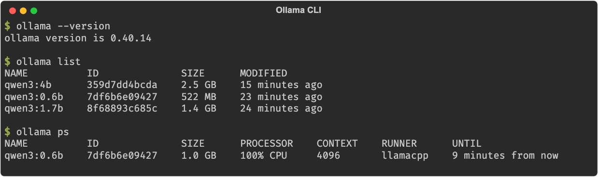
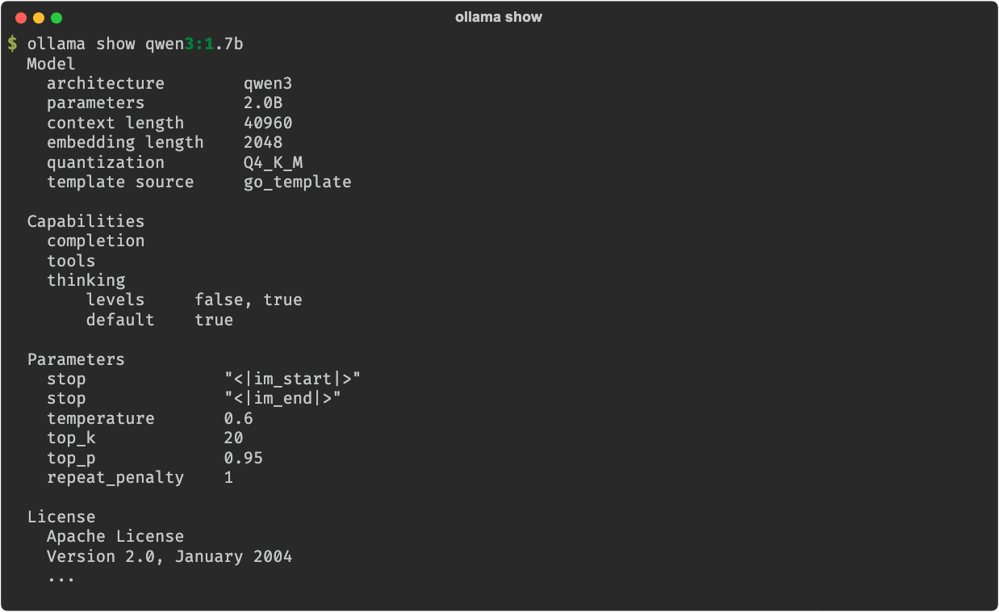
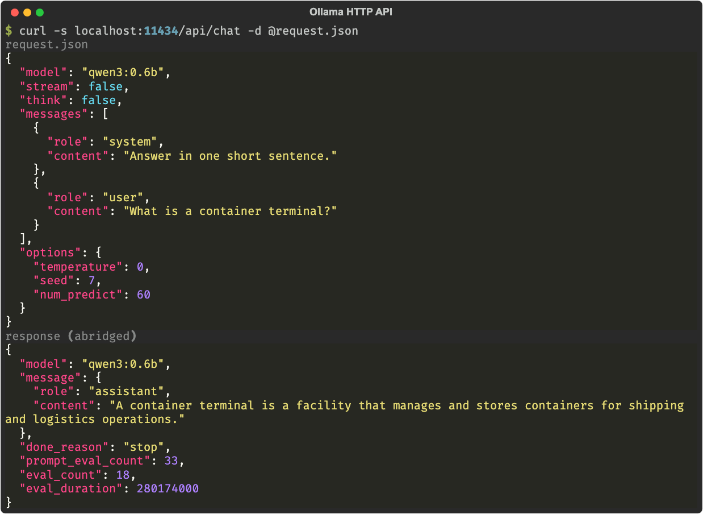

# Prompt Engineering Lab

**The Lantern Files, Case File 01: The Pier 9 Ledger.**
Learn prompt engineering by working a real case on a local language model.

> On the night of 14 March, Tomas Reyes, finance chief of Halcyon Maritime Logistics, was found
> dead at the foot of stairwell C on Pier 9. The coroner called it a fall. Two weeks later an
> anonymous envelope reached the Economic Offences Wing: one page of Halcyon's ledger, one vendor
> circled, and three words in the dead man's handwriting. *Not a vendor.*
>
> You are the analyst. You have the evidence, an offline workstation called LANTERN, and nineteen
> chapters to find out what happened.

Every chapter teaches one prompt engineering concept. Every example runs on that chapter's
evidence. By chapter 19 you will have used every technique in this lab to answer the case's first
question, and found the thread that leads into Case File 02.

## What you will learn

| Ch | Concept | In the story |
|---|---|---|
| [01](lessons/01-prompt-engineering/README.md) | What prompt engineering is; the parts of a prompt | A vague question and a precise one about the night supervisor's statement |
| [02](lessons/02-system-prompt/README.md) | System prompts | LANTERN's standing orders: cite the evidence or say "not in evidence" |
| [03](lessons/03-context-window/README.md) | The context window | The victim's 40 pages of notes do not fit, and the middle holds the key line |
| [04](lessons/04-what-goes-in-context/README.md) | What goes in the context, and how | Building a proper briefing: rules, case summary, documents, history |
| [05](lessons/05-temperature-and-top-k/README.md) | Temperature, top-k, top-p | Reading a partial number plate versus brainstorming leads |
| [06](lessons/06-temperature-zero-and-nondeterminism/README.md) | Temperature 0, and why LLMs are nondeterministic | Defence counsel says your machine gives different answers on different days |
| [07](lessons/07-zero-one-few-shot/README.md) | Zero-shot, one-shot, few-shot | Sorting 48 messages from the victim's phone |
| [08](lessons/08-structured-output/README.md) | Structured output | Turning invoices into rows for the link chart |
| [09](lessons/09-chain-of-thought/README.md) | Chain of thought, and whether it still matters | Breaking an alibi, minute by minute |
| [10](lessons/10-thinking-mode/README.md) | Thinking mode, and whether it still matters | Who could open a locked door at 23:36? |
| [11](lessons/11-personas/README.md) | Personas | Rehearsing the interview against defence counsel |
| [12](lessons/12-choosing-a-model/README.md) | How to choose a model | Three models, one workstation, which can the case trust? |
| [13](lessons/13-future-proofing/README.md) | Future-proofing prompts | Headquarters is replacing LANTERN's models next quarter |
| [14](lessons/14-tool-calling/README.md) | Tool calling, by hand and native | LANTERN stops recalling the ledger and starts looking it up |
| [15](lessons/15-prompt-injection/README.md) | Prompt injection and its defences | A vendor email in the evidence carries instructions for LANTERN |
| [16](lessons/16-prompt-caching-and-cost/README.md) | Prompt caching, tokens and cost per call | Headquarters asks what a year of intercepts would cost |
| [17](lessons/17-reliable-calls-at-scale/README.md) | Timeouts, retries, logging and tracing at scale | Thousands of messages, a flaky server, and a log that must stand up in court |
| [18](lessons/18-evals-with-promptfoo/README.md) | Evals with promptfoo | Proving the pipeline before anything goes to court |
| [19](lessons/19-reading-eval-results/README.md) | Reading eval results | One test fails on every model, the same way |

The lab ends with a **[capstone](capstone/README.md)**: from a blank folder you build the whole
pipeline the chapters taught (versioned prompts, schema output, a validation retry, an eval suite
and a CI gate), graded offline by tests and live against recorded thresholds.

Each chapter's README has the same shape: **the scene**, **the concept**, **how it works** (with
diagrams), **the nuances** (every subtle point, drawn where a picture helps), **run it**, **what you
should see** (a real screenshot of the run), **on a hosted model** (the same chapter on a hosted
model, beside the local numbers), **try this**, **master it** (the practice below), and **what the
evidence now shows**.

## Practice: build it, check it, break it

Reading and running is not enough. Every chapter has a `practice/` folder:

| command | what it does |
|---|---|
| `make lesson N=08` | the lesson; in a terminal it stops to ask for your predictions first |
| `make exercise N=08` | grades your `practice/exercise.py` offline, against a scripted model |
| `make hint N=08`, `make solution N=08` | hints in order; the reference once you have tried |
| `make lesson N=08 ARGS=--mine` | the live lesson on your own code, where the exercise is a whole component |
| `make quiz N=08` | the chapter check, with the reason after each answer |
| `make challenge N=08` | break-it challenges, checked against your latest run's recorded numbers |
| `make progress` | every chapter |
| `make notebook N=08` | the chapter as a Jupyter notebook (`uv sync --extra notebooks`) |

How the practice is written is in [docs/practice-guide.md](docs/practice-guide.md).

## Quick start

You need [Docker](https://docs.docker.com/get-docker/) (or a native
[Ollama](https://ollama.com/download)), [uv](https://docs.astral.sh/uv/), and, for chapters 18 and
19, [Node.js](https://nodejs.org/) 20 or later. About 5 GB of disk and 8 GB of RAM.

```bash
git clone https://github.com/AkellaRaviTeja/prompt-engineering-lab.git && cd prompt-engineering-lab && make setup
```

`make setup` installs the Python dependencies, starts Ollama in Docker, pulls the three models and
runs a health check. Then open the case:

```bash
make lesson N=01
```

Work through the chapters in order. The story only makes sense that way, and so do the concepts.

### Other ways to run Ollama

| Setup | Command | When |
|---|---|---|
| Docker, CPU | `make up` | Default. Works everywhere Docker does. |
| Docker, NVIDIA GPU | `make up-gpu` | Needs the [NVIDIA Container Toolkit](https://docs.nvidia.com/datacenter/cloud-native/container-toolkit/). Much faster. |
| Native Ollama | install from [ollama.com](https://ollama.com/download), then `ollama serve` | Uses your GPU (NVIDIA, AMD or Apple silicon) without Docker. `make setup` and `make up` see it already answering and skip Docker, and `make models` pulls through it. |

Check everything at any time with `make doctor`.

## The tools

**Ollama** serves the models locally. LANTERN talks to it over its HTTP API.



`ollama show` tells you a model's context length, capabilities and default sampling settings. Note
that Qwen3 ships with thinking on, temperature 0.6 and top-k 20. This lab overrides all three in
`config.yaml`, and chapters 05 and 10 show what each one does.



Every lesson's `chat()` call is one request to `/api/chat`. This is the whole interface:



**promptfoo** runs the evals in chapters 18 and 19, in the terminal and in a web viewer. The
screenshots are in those chapters.

**The sampling explorer** (`docs/explorer/index.html`) is an interactive page for temperature,
top-k and top-p on a real next-token distribution. Open it in a browser; chapter 05 explains it.

## Configuration

Everything lives in [`config.yaml`](config.yaml):

| Key | Default | What it does |
|---|---|---|
| `tier` | `local` | `local` (Ollama) or `hosted` (`TIER=hosted`) |
| `hosted.provider` | `anthropic` | `anthropic`, `openai` or `gemini` on the hosted tier |
| `hosted.anthropic.models` | `claude-haiku-5-5`, `claude-sonnet-5-5` | The hosted models behind the same aliases |
| `prices` | checked 21 November 2026 | USD per million tokens, with cache read and write prices |
| `reliability` | 300 s, 3 retries | Timeout per attempt, retries with backoff and jitter (chapter 17) |
| `models.default` | `qwen3:1.7b` | The model every lesson uses unless it says otherwise |
| `models.small` / `models.large` | `qwen3:0.6b` / `qwen3:4b` | Used to compare sizes (chapter 12) |
| `generation.temperature` | `0.2` | Randomness of sampling (chapter 05) |
| `generation.top_k`, `top_p` | `40`, `0.9` | Which tokens are allowed to be sampled (chapter 05) |
| `generation.seed` | `7` | Makes local runs repeatable (chapter 06) |
| `generation.num_ctx` | `8192` | Context window Ollama allocates, in tokens (chapter 03) |
| `generation.think` | `false` | Qwen3 thinking mode (chapter 10) |

Environment variables override the file: `LANTERN_MODEL=qwen3:4b make lesson N=09`.

### Two tiers: local and hosted

The story's rule is that evidence never leaves the building, so every chapter runs fully offline
on Ollama, and that is the default. Every case document in this lab is synthetic, though, which
the series allows on hosted models, and a team at work will use one. So every chapter that calls a
model also runs on a hosted model:

```bash
uv sync --extra cloud            # the provider SDKs
cp .env.example .env             # then add ANTHROPIC_API_KEY
make lesson N=08 TIER=hosted     # the same chapter on claude-haiku-5-5
```

The hosted path uses each provider's **native** features, never a prompt imitating them: schema
enforced structured output, native tool calling, prompt caching and the provider's reasoning
setting. A setting the provider does not take (Claude has no seed and no log-probabilities, and
its current models reject sampling settings) is not sent and is reported, once per run and on
every reply. Every call records input, output and cached tokens and its cost.

Without a key you can still finish the lab: `make lesson N=08 TIER=hosted RECORD=1` saves a hosted
run to `recordings/hosted/`, `REPLAY=1` replays it with no key, and `make challenge N=08
TIER=hosted` checks the recorded numbers. Each chapter's README has a section **On a hosted
model**. As of this edit no hosted run has been recorded: every hosted number there reads "not
run" until one is.

## How the repository is laid out

```text
case/                 the evidence: statements, notes, ledger, invoices, logs
lessons/NN-name/      one chapter: README.md, run.py, practice/ and lesson.ipynb
capstone/             the final project: brief, offline tests, live check, solution
src/lantern/          the small client every lesson uses: chat(), the hosted tier, retries,
                      the call log, tracing, predictions and practice
evals/                promptfoo configuration, prompts, tests and the calibrated judge (18, 19)
recordings/hosted/    recorded hosted runs, replayed without a key
docs/diagrams/        D2 sources and rendered SVG diagrams
docs/charts/          charts built from real model runs
docs/screenshots/     real screenshots of every lesson and tool
docs/explorer/        interactive sampling explorer
scripts/              health check, gates, chart and screenshot builders
```

`src/lantern/llm.py` is under 300 lines and worth reading. There is no framework between you and
the model. Every call has a timeout and retries with backoff and jitter, records its full latency
(model load and prompt processing included), and is logged to `.progress/calls.jsonl` with its
prompt version, model, tokens and cost, and traced to `.progress/traces.jsonl` as an OpenTelemetry
span with GenAI attributes.

## Make targets

```text
make setup        install, start Ollama, pull models, check
make lesson N=05  run one chapter (TIER=hosted for the hosted model)
make exercise N=05, make quiz N=05, make challenge N=05, make progress
make capstone     grade your capstone offline (capstone-live: against the thresholds)
make lessons      run every chapter in order
make doctor       check Ollama, models and config
make eval         run the promptfoo evals
make eval-view    open the promptfoo viewer at http://localhost:15500
make shots-promptfoo  screenshot the viewer (with eval-view running)
make shots        re-run every chapter and refresh the screenshots
make charts       rebuild the charts from live runs
make diagrams     render the D2 diagrams
make check        lint, unit tests, prose and structure gates (no model needed)
make release-check  every gate, notebooks current, practice and capstone complete
make judge-calibrate  check the eval's judge against labelled answers (live)
make hosted-check one chapter end to end on the hosted model (needs a key)
make smoke        live tests against Ollama
```

## A note on small models

The models here are small enough to run on a laptop CPU, and they make mistakes: they invent
quotes, misread times and sometimes ignore a rule. The lessons do not hide this. Every screenshot
is a real run, and every README says what the model got wrong. Learning to spot those mistakes is
half of prompt engineering. Your results will differ in detail from the screenshots, which is
itself the subject of chapter 06.

## Troubleshooting

| Symptom | Fix |
|---|---|
| `Cannot reach Ollama` | `make up`, or `ollama serve` for a native install. Then `make doctor`. |
| `Model ... is not pulled` | `make models` |
| A run is killed or the machine swaps | The container keeps one model in memory at a time. Close other heavy apps, or set `LANTERN_MODEL=qwen3:0.6b`. |
| Very slow replies | You are on CPU. Use `make up-gpu` or a native Ollama install with a GPU. |
| `make eval` cannot find `npx` | Install Node.js 20 or later. |

## The series

The Lantern Files is a set of standalone repositories that share one investigation. Each one teaches
a GenAI topic and moves the case forward. This is Case File 01.

## Licence

MIT. All people, companies and places in the case are fictional.
