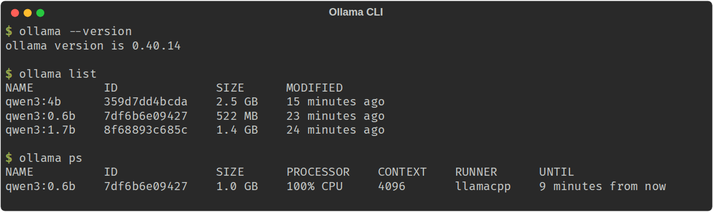
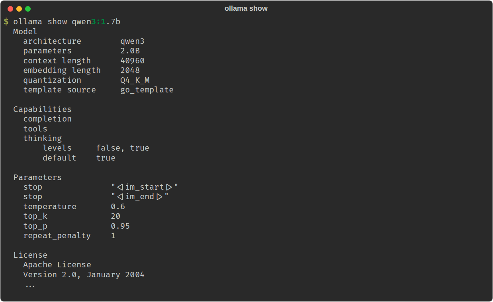
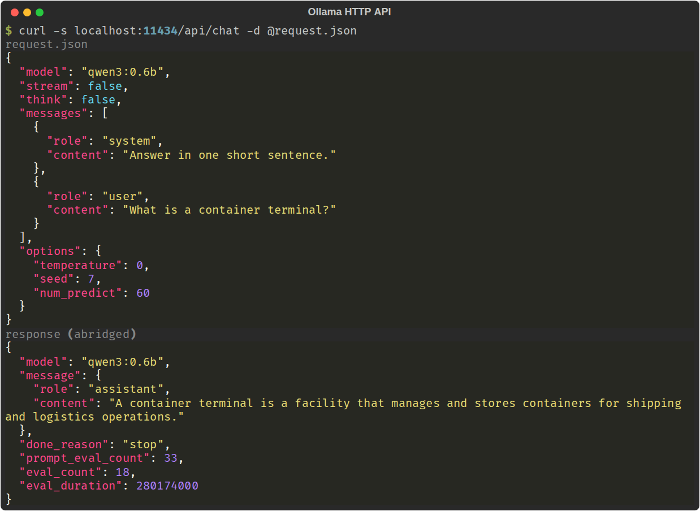

# Prompt Engineering Lab

**The Lantern Files, Case File 01: The Pier 9 Ledger.**
Learn prompt engineering by working a real case on a local language model.

> On the night of 14 March, Tomas Reyes, finance chief of Halcyon Maritime Logistics, was found
> dead at the foot of stairwell C on Pier 9. The coroner called it a fall. Two weeks later an
> anonymous envelope reached the Economic Offences Wing: one page of Halcyon's ledger, one vendor
> circled, and three words in the dead man's handwriting. *Not a vendor.*
>
> You are the analyst. You have the evidence, an offline workstation called LANTERN, and fifteen
> chapters to find out what happened.

Every chapter teaches one prompt engineering concept. Every example runs on that chapter's
evidence. By chapter 15 you will have used every technique in this lab to answer the case's first
question, and found the thread that leads into Case File 02.

## What you will learn

| Ch | Concept | In the story |
|---|---|---|
| [01](lessons/01-prompt-engineering/README.md) | What prompt engineering is; the parts of a prompt | A vague question and a precise one about the night supervisor's statement |
| [02](lessons/02-system-prompt/README.md) | System prompts | LANTERN's standing orders: cite the evidence or say "not in evidence" |
| [03](lessons/03-context-window/README.md) | The context window | The victim's 40 pages of notes do not fit, and the middle holds the key line |
| [04](lessons/04-what-goes-in-context/README.md) | What goes in the context, and how | Building a proper briefing: rules, case summary, documents, history |
| [05](lessons/05-temperature-and-top-k/README.md) | Temperature, top-k, top-p | Reading a partial number plate versus brainstorming leads |
| [06](lessons/06-temperature-zero-and-nondeterminism/README.md) | Temperature 0, and why LLMs are nondeterministic | Defence counsel says your machine gives different answers on different days |
| [07](lessons/07-zero-one-few-shot/README.md) | Zero-shot, one-shot, few-shot | Sorting 48 messages from the victim's phone |
| [08](lessons/08-structured-output/README.md) | Structured output | Turning invoices into rows for the link chart |
| [09](lessons/09-chain-of-thought/README.md) | Chain of thought, and whether it still matters | Breaking an alibi, minute by minute |
| [10](lessons/10-thinking-mode/README.md) | Thinking mode, and whether it still matters | Who could open a locked door at 23:36? |
| [11](lessons/11-personas/README.md) | Personas | Rehearsing the interview against defence counsel |
| [12](lessons/12-choosing-a-model/README.md) | How to choose a model | Three models, one workstation, which can the case trust? |
| [13](lessons/13-future-proofing/README.md) | Future-proofing prompts | Headquarters is replacing LANTERN's models next quarter |
| [14](lessons/14-evals-with-promptfoo/README.md) | Evals with promptfoo | Proving the pipeline before anything goes to court |
| [15](lessons/15-reading-eval-results/README.md) | Reading eval results | One test fails on every model, the same way |

Each chapter's README has the same shape: **the scene**, **the concept**, **how it works** (with
diagrams), **the nuances** (every subtle point, drawn where a picture helps), **run it**, **what you
should see** (a real screenshot of the run), **try this** (exercises), and **what the evidence now
shows**.

## Quick start

You need [Docker](https://docs.docker.com/get-docker/) (or a native
[Ollama](https://ollama.com/download)), [uv](https://docs.astral.sh/uv/), and, for chapters 14 and
15, [Node.js](https://nodejs.org/) 20 or later. About 5 GB of disk and 8 GB of RAM.

```bash
git clone https://github.com/AkellaRaviTeja/prompt-engineering-lab.git && cd prompt-engineering-lab && make setup
```

`make setup` installs the Python dependencies, starts Ollama in Docker, pulls the three models and
runs a health check. Then open the case:

```bash
make lesson N=01
```

Work through the chapters in order. The story only makes sense that way, and so do the concepts.

### Other ways to run Ollama

| Setup | Command | When |
|---|---|---|
| Docker, CPU | `make up` | Default. Works everywhere Docker does. |
| Docker, NVIDIA GPU | `make up-gpu` | Needs the [NVIDIA Container Toolkit](https://docs.nvidia.com/datacenter/cloud-native/container-toolkit/). Much faster. |
| Native Ollama | install from [ollama.com](https://ollama.com/download), then `ollama serve` | Uses your GPU (NVIDIA, AMD or Apple silicon) without Docker. `make setup` and `make up` see it already answering and skip Docker, and `make models` pulls through it. |

Check everything at any time with `make doctor`.

## The tools

**Ollama** serves the models locally. LANTERN talks to it over its HTTP API.



`ollama show` tells you a model's context length, capabilities and default sampling settings. Note
that Qwen3 ships with thinking on, temperature 0.6 and top-k 20. This lab overrides all three in
`config.yaml`, and chapters 05 and 10 show what each one does.



Every lesson's `chat()` call is one request to `/api/chat`. This is the whole interface:



**promptfoo** runs the evals in chapters 14 and 15, in the terminal and in a web viewer. The
screenshots are in those chapters.

**The sampling explorer** (`docs/explorer/index.html`) is an interactive page for temperature,
top-k and top-p on a real next-token distribution. Open it in a browser; chapter 05 explains it.

## Configuration

Everything lives in [`config.yaml`](config.yaml):

| Key | Default | What it does |
|---|---|---|
| `provider` | `ollama` | `ollama`, `anthropic`, `openai` or `gemini` |
| `models.default` | `qwen3:1.7b` | The model every lesson uses unless it says otherwise |
| `models.small` / `models.large` | `qwen3:0.6b` / `qwen3:4b` | Used to compare sizes (chapter 12) |
| `generation.temperature` | `0.2` | Randomness of sampling (chapter 05) |
| `generation.top_k`, `top_p` | `40`, `0.9` | Which tokens are allowed to be sampled (chapter 05) |
| `generation.seed` | `7` | Makes local runs repeatable (chapter 06) |
| `generation.num_ctx` | `8192` | Context window Ollama allocates, in tokens (chapter 03) |
| `generation.think` | `false` | Qwen3 thinking mode (chapter 10) |

Environment variables override the file: `LANTERN_MODEL=qwen3:4b make lesson N=09`.

**Cloud models are optional.** The story's rule is that evidence never leaves the building, so the
lab runs fully offline. To compare against a frontier model, run `uv sync --extra cloud`, copy
`.env.example` to `.env`, add a key, and set `LANTERN_PROVIDER=anthropic` (or `openai`, `gemini`).

## How the repository is laid out

```text
case/                 the evidence: statements, notes, ledger, invoices, logs
lessons/NN-name/      one chapter: README.md (the lesson) and run.py (the example)
src/lantern/          the small client every lesson uses: chat(), config, terminal output
evals/                promptfoo configuration, prompts and tests (chapters 14, 15)
docs/diagrams/        D2 sources and rendered SVG diagrams
docs/charts/          charts built from real model runs
docs/screenshots/     real screenshots of every lesson and tool
docs/explorer/        interactive sampling explorer
scripts/              health check, gates, chart and screenshot builders
```

`src/lantern/llm.py` is under 200 lines and worth reading. There is no framework between you and
the model.

## Make targets

```text
make setup        install, start Ollama, pull models, check
make lesson N=05  run one chapter
make lessons      run every chapter in order
make doctor       check Ollama, models and config
make eval         run the promptfoo evals
make eval-view    open the promptfoo viewer at http://localhost:15500
make shots-promptfoo  screenshot the viewer (with eval-view running)
make shots        re-run every chapter and refresh the screenshots
make charts       rebuild the charts from live runs
make diagrams     render the D2 diagrams
make check        lint, unit tests, prose and structure gates (no model needed)
make smoke        live tests against Ollama
```

## A note on small models

The models here are small enough to run on a laptop CPU, and they make mistakes: they invent
quotes, misread times and sometimes ignore a rule. The lessons do not hide this. Every screenshot
is a real run, and every README says what the model got wrong. Learning to spot those mistakes is
half of prompt engineering. Your results will differ in detail from the screenshots, which is
itself the subject of chapter 06.

## Troubleshooting

| Symptom | Fix |
|---|---|
| `Cannot reach Ollama` | `make up`, or `ollama serve` for a native install. Then `make doctor`. |
| `Model ... is not pulled` | `make models` |
| A run is killed or the machine swaps | The container keeps one model in memory at a time. Close other heavy apps, or set `LANTERN_MODEL=qwen3:0.6b`. |
| Very slow replies | You are on CPU. Use `make up-gpu` or a native Ollama install with a GPU. |
| `make eval` cannot find `npx` | Install Node.js 20 or later. |

## The series

The Lantern Files is a set of standalone repositories that share one investigation. Each one teaches
a GenAI topic and moves the case forward. This is Case File 01.

## Licence

MIT. All people, companies and places in the case are fictional.
