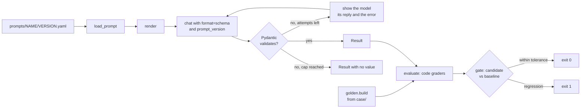

# Capstone: The handover

**What you build:** LANTERN's invoice and message pipeline as a team would ship it, from a blank
folder. Versioned prompts stored as files, schema-constrained output, validation with a retry
that shows the model its error, an eval suite over a golden set built from the case files, and a
CI gate that stops a prompt change that makes things worse.

## The scene

The hearing is set for Monday. Varma stops at your desk on Thursday evening with her coat
already on.

"Everything LANTERN told us about the invoices and the messages came out of scripts you ran by
hand," she says. "Hale will ask which prompt produced which answer, and whether anyone could
change it without our knowing. From tomorrow the Wing's own engineers keep this running, and I
want it handed over before we go into court."

She puts a sheet on the desk. Four lines: every prompt stored with a version; every answer
checked before anyone sees it; every change tested against the cases we already know; nothing
changes in production unless the test passes.

"No borrowed parts," she says. "If it breaks at two in the morning, the person on call has to
be able to read all of it."

## What you build

Everything goes in [`work/`](work/), which starts empty. From `lantern` you may import only the
model client: `from lantern import chat` (and `Reply` if you want the type). A test reads your
source with `ast` and fails on any other `lantern` import, and on any import of the solution.

Your files can import each other by plain name (`from prompts import load_prompt`): the tests
and the live check put `work/` first on the path.

### The files and their contract

**`work/prompts/<name>/<version>.yaml`**: one file per prompt version. Keys: `name` and
`version` (they must match the path), `description`, `system` (may be empty), `user` (the
template, with `{{placeholders}}`), `schema` (the JSON schema the reply must match) and
`settings` (passed to `chat`, for example `temperature: 0`). Ship at least:

| Prompt | Versions | Placeholders | Schema |
|---|---|---|---|
| `extract-invoice` | `v1` | `{{invoice}}` | `invoice_id`, `vendor`, `date`, `total` |
| `classify-message` | `v1`, `v2` | `{{sender}}`, `{{text}}` | `label`, an enum of `threat`, `logistics`, `personal` |

**`work/prompts.py`**

- `load_prompt(name, version, root=None) -> Prompt`. `root` defaults to the `prompts/` folder
  beside the module. An unknown name or version raises `LookupError` whose message lists the
  versions that exist. A file whose `name` or `version` disagrees with its path raises
  `ValueError`.
- `versions(name, root=None) -> list[str]`: oldest first, so `v10` comes after `v2`.
- `Prompt` has `name`, `version`, `system`, `user`, `schema`, `settings`, an `id` property
  (`"extract-invoice@v1"`), and `render(**fields)`, which returns the messages: a system message
  if there is system text, then the user message, every `{{placeholder}}` filled. A placeholder
  with no value raises `KeyError`.

**`work/pipeline.py`**

- `Invoice`, a Pydantic model: `invoice_id` (matches `^[A-Z]{2,4}-\d{4}$`), `vendor` (not
  empty), `date` (a date), `total` (a number above zero). These rules go beyond the schema: the
  schema shapes the reply, the model checks it.
- `MessageLabel`, a Pydantic model: `label`, one of `threat`, `logistics`, `personal`.
- `run(prompt, fields, model, *, chat=None, max_attempts=3) -> Result`. Renders the prompt and
  calls `chat(messages, format=prompt.schema, prompt_version=prompt.id, **prompt.settings)`.
  `chat` defaults to `lantern.chat`; the tests pass a scripted one. The reply text is validated
  with `model.model_validate_json`. On a validation error the next call sends the same messages
  plus the model's reply (as `assistant`) and a `user` message holding the validation error
  text, until `max_attempts` calls have been made. A failed call (the model times out) is
  raised, never turned into an empty result.
- `Result` has `value` (the validated object, or `None`), `ok`, `attempts` (calls made),
  `errors` (one string per failed attempt) and `prompt_version`.
- `run_task(task, version, fields, *, chat=None, max_attempts=3)`,
  `extract_invoice(text, *, chat=None, version="v1")` and
  `classify_message({"sender", "text"}, *, chat=None, version="v1")` run the shipped prompts.

**`work/golden.py`**

- `build(task, case_dir=None) -> list[dict]`, sorted by `id`. `case_dir` defaults to the
  repository's `case/`. An unknown task raises `LookupError`. Each case is
  `{"id", "input", "expected"}`, built by code, never by a model:
  - `extract-invoice`: one case per `case/invoices/*.txt`. `input` is `{"invoice": text}`.
    `expected` holds `invoice_id`, `date` (YYYY-MM-DD) and `total` as printed on the invoice, and
    `vendor` as the ledger writes it (`Northwind Freight Ltd`). Add `ledger_total`, the ledger's
    amount for that reference. It is never the expected total: chapter 19 showed why.
  - `classify-message`: one case per line of `case/messages.jsonl`. `input` is
    `{"sender", "text"}`, `expected` is `{"label"}`.

**`work/evaluate.py`**

- `grade(task, expected, got) -> dict[str, bool]`: one entry per expected field. `got` is the
  validated reply as a dict, or `None` (every field fails). Vendors compare without regard to
  case, punctuation or spacing; totals must match to the cent; everything else exactly.
- `evaluate(task, version, cases, *, chat=None) -> dict`, plain JSON: `task`, `version`, `n`,
  `passed` (cases with every field right), `score` (`passed / n`), `invalid` (cases with no
  valid reply), `calls`, `fields` (accuracy per field) and `cases` (one row per case with `id`
  and `passed`).
- `save(report, path)` and `load(path)` write and read a report as JSON.

**`work/gate.py`**

- `compare(baseline, candidate, tolerance) -> (ok, lines)`. Fails when the score drops by more
  than `tolerance`, when the share of invalid replies rises by more than `tolerance`, or when a
  field's accuracy drops by more than `tolerance`. Never passes reports it cannot compare: no
  cases, different tasks, different case ids. `lines` says what was checked.
- `main(argv=None, chat=None) -> int`, a command line:
  `python gate.py TASK --baseline V --candidate V [--tolerance T] [--limit N] [--out DIR]
  [--baseline-report FILE] [--candidate-report FILE]`. Without report files it runs the eval for
  both versions on the golden set. Exit 0 on a pass, 1 on a regression, 2 when it cannot
  compare.

**CI.** [`ci/prompt-gate.yml`](ci/prompt-gate.yml) is an example GitHub Actions workflow: the
offline tests on every push, and the gate on a real model when a prompt file changes. It lives
here, not in `.github/`, so it never runs on this repository. Copy it into yours.

## How it is graded

| Command | What it checks |
|---|---|
| `make capstone` | The offline tests in [`tests/`](tests/) against your `work/`, with a scripted model (`lantern.testing.Scripted`). No Ollama, a few seconds. |
| `make capstone-live` | Your pipeline on the real model over the whole golden set, checked against [`thresholds.yaml`](thresholds.yaml). |
| `make capstone-solution` | The same tests against the reference in [`solution/`](solution/). |
| `make capstone-live ARGS=--solution` | The reference, live. |

The offline tests cover: loading a prompt by version and refusing an unknown one, rendering,
the schema and settings sent to the model, the validation retry with the error fed back, the
attempt cap, the prompt version on every call, a failed call raised, the invoice rules beyond
the schema, the golden sets, the graders, the eval report, the gate passing an equal candidate
and failing a regression (from saved reports and from a run), and the import rule. With an empty
`work/`, every test fails.

The live check runs each task at the version listed in `thresholds.yaml`, saves the report
under `.progress/capstone/`, and fails when the score is below the recorded minimum or there are
more invalid replies than the recorded maximum.

The reference solution, live, on 23 November 2026 (local tier, `qwen3:1.7b`, Ollama, Apple M1 Pro
16 GB):

| task | version | score | invalid | calls | thresholds recorded |
|---|---|---|---|---|---|
| extract-invoice | v1 | 0.875 (7 of 8; HCS-0554's vendor wrong) | 0 | 8 | score at least 0.75, invalid at most 1 |
| classify-message | v2 | 0.792 (38 of 48) | 0 | 48 | score at least 0.70, invalid at most 2 |

The thresholds sit a little below what the solution measured, so ordinary run-to-run variation
does not fail a correct pipeline and a real regression does. Hosted thresholds are not run: this
lab has no hosted key.

## Where to start

Read [`work/README.md`](work/README.md), then build in the order of the contract above:
prompts, pipeline, golden set, eval, gate. Run `make capstone` after each file. The chapters you
will lean on: 07 (the message labels), 08 (schema output and the retry), 13 (versioned prompts),
17 (the call log), 18 and 19 (evals, and why the ledger is not the answer key).

The reference is in [`solution/`](solution/). Read it after you have tried.
