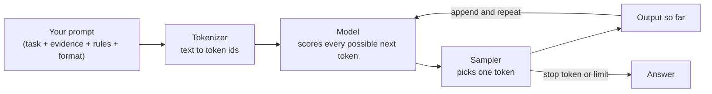
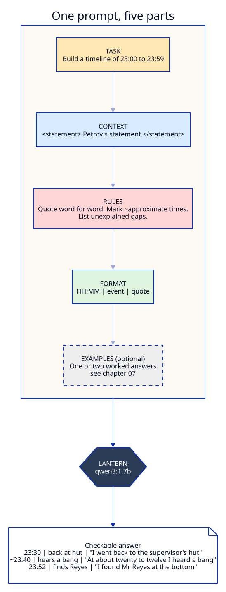
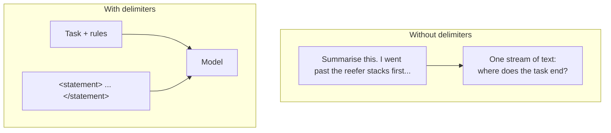
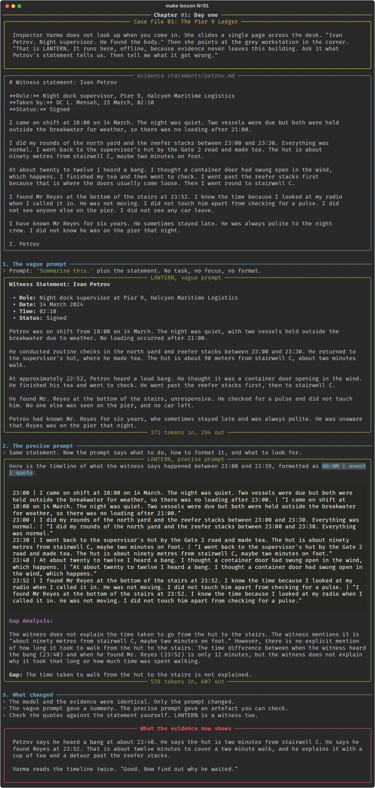

# Chapter 01: Day one

**Concept:** what prompt engineering is, and why the same model gives a useless answer or a useful
one depending only on what you send it.

## The scene

Inspector Varma does not look up when you come in. She slides a single page across the desk.
"Ivan Petrov. Night supervisor. He found the body." She points at the grey workstation in the
corner. "That is LANTERN. It runs here, offline, because evidence never leaves this building. Ask
it what Petrov's statement tells us. Then tell me what it got wrong."

You have one witness statement ([`case/statements/petrov.md`](../../case/statements/petrov.md)),
one local model, and no idea yet what a good question looks like.

## The concept

A language model does one thing: given some text, it predicts the next token (a word or a piece of
a word), appends it, and repeats. It has no goal of its own. Whatever you send is the only thing
it knows about what you want.

**Prompt engineering** is designing that input so the most likely continuation is the answer you
need. It is not magic phrasing. It is the same discipline as writing a good brief for a new
colleague: say what the task is, give the material, set the rules, and say what the result should
look like.



Everything in this lab is a way of controlling one of those boxes: what goes into the prompt
(chapters 01 to 04, 07, 08, 11), how the sampler picks (05, 06), how much the model reasons before
answering (09, 10), which model sits in the middle (12), and how you prove the whole thing works
(13 to 15).

## How it works

A useful prompt has up to five parts. You will not always need all five, but you should know which
ones you left out.



| Part | Question it answers | Petrov example |
|---|---|---|
| Task | What should the model do? | Build a timeline of 23:00 to 23:59. |
| Context | What material should it use? | The statement, inside `<statement>` tags. |
| Rules | What must it do or never do? | Quote word for word. Mark approximate times with `~`. |
| Format | What shape should the answer take? | `HH:MM \| event \| quote`, one per line. |
| Examples | What does a good answer look like? | (Not used here. Chapter 07 is about examples.) |

The vague prompt in this chapter has only the context. The precise prompt has the first four.

## The nuances

**1. "Summarise" is a task with no target.** A summary is whatever the model thinks matters, and a
small model thinks the first and last paragraphs matter. A timeline with quotes is a task with a
checkable output. Prefer tasks whose answers you can verify.

**2. Delimiters stop evidence from being read as instructions.** Wrapping the statement in
`<statement>` tags tells the model where your instructions end and the material begins. Without
them, a document that says "ignore the above" is just more instructions. This matters more when the
material comes from a suspect.



**3. Ask for quotes, then check them.** A model that must quote is easier to audit than a model that
paraphrases. Small models still invent quotes, timings and distances. In the run below, the 1.7B
model may produce walking times that are not in the statement. That is the point of Varma's
instruction: *tell me what it got wrong.* LANTERN is a witness too.

**4. Small models need more structure, not less.** A frontier model may infer that you want a
timeline from "what does this tell us?". A 1.7B model on a laptop will not. Everything you make
explicit is something the model does not have to guess.

**5. The prompt is code.** It has inputs, rules and an output contract. Later chapters version it
(13), test it (14) and read its failures (15).

## Run it

```bash
make lesson N=01
```

The script sends the same statement twice: once with "Summarise this." and once with the precise
prompt at temperature 0. Both replies show the token counts underneath.

## What you should see



- The vague reply is a fluent paragraph that misses the timing problem entirely. In our run it
  even invented a time ("approximately 22:52") that appears nowhere in the statement.
- The precise reply is a list of timestamped events with quotes, and a gap analysis that finds
  the 12 minutes between the bang (23:40) and the body (23:52). It is longer and slower, and you
  can check every line of it against the statement.
- The rule "twenty to twelve means 23:40" matters. Without it, both the 1.7B and the 4B model
  turned the phrase into 22:52, 23:30 or 11:20. A model cannot know the shift pattern unless you
  tell it.
- Look closely at the precise reply. In our run the event text says "no loading after 23:00"
  while the quote beside it correctly says 21:00. The model paraphrased and changed a fact in the
  same line. That is your first lesson in not trusting LANTERN, and the reason the rule asks for
  quotes.

## Try this

1. Remove the `<statement>` tags and rerun. Does the format still hold?
2. Change the rule "copied word for word" to "summarised". How many details survive?
3. Add one line to the task: "Calculate how long the witness took to reach stairwell C after the
   bang." Does the model find the gap on its own now?
4. Run with the bigger model: `LANTERN_MODEL=qwen3:4b make lesson N=01`. Compare.

## What the evidence now shows

Petrov says he heard a bang at about 23:40. He says the hut is two minutes from stairwell C. He
says he found Reyes at 23:52. That is about twelve minutes to cover a two minute walk, and he
explains it with a cup of tea and a detour past the reefer stacks.

Varma reads the timeline twice. "Good. Now find out why he waited."

**Next:** [Chapter 02: Standing orders](../02-system-prompt/README.md)
