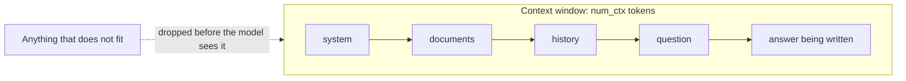
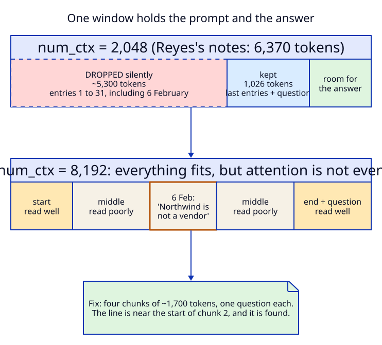
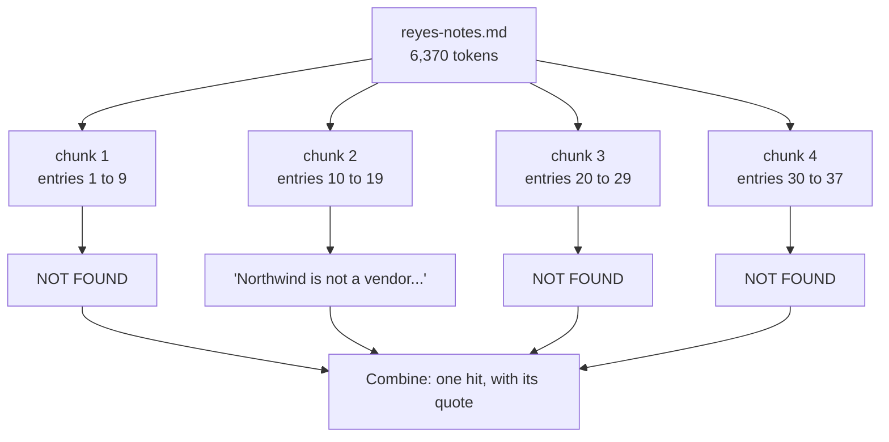
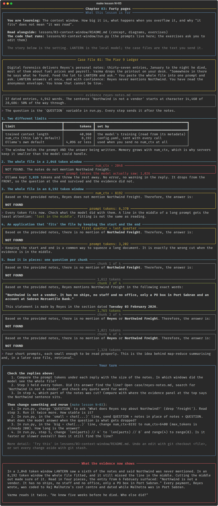

# Chapter 03: Forty pages

**Concept:** the context window. How big it is, what happens when you overflow it, and why
"it fits" does not mean "it was read".

## The scene

Digital forensics delivers Reyes's personal notes: thirty-seven entries, January to the night he
died, most of them about fuel prices and payroll. Varma drops the printout on your desk.
"Somewhere in there he says what he found. Feed the lot to LANTERN and ask." You paste the whole
file into one prompt and ask. LANTERN answers at once, and with confidence: Reyes never mentions
Northwind. You have read the anonymous envelope. You know that cannot be true.

## The concept

A model reads tokens, not pages, and it can only attend to a fixed number of them at once. That
number is the **context window**. Everything the model knows about your request (system prompt,
documents, conversation history, the question) and everything it writes in reply must fit inside
it together.



There are two limits, and they are easy to confuse:

| Limit | Value for qwen3:1.7b | Who sets it |
|---|---|---|
| Trained context length | 40,960 tokens | The model's training. The most it can handle at all. |
| `num_ctx` | 8,192 in this lab | The server, per request. The window actually allocated. |

Servers allocate less than the maximum because memory for the window (the KV cache) grows with
`num_ctx` for every request. If you send no `num_ctx`, Ollama uses its own default, which is
smaller still.

## How it works

Reyes's notes are 4,942 words: 6,370 tokens with the question. The line that matters, "Northwind
is not a vendor", sits 50% of the way through, in the entry for 6 February.



The script runs four experiments on the same file and the same question:

| Experiment | Tokens the model saw | What happened |
|---|---|---|
| `num_ctx = 2048` | 1,026 | Ollama silently kept only the end. The 6 February entry was gone. |
| `num_ctx = 8192` | 6,370 | Everything fitted. The model still answered NOT FOUND. |
| First quarter + last quarter, `num_ctx = 8192` | 3,202 | The application cut the middle out. NOT FOUND, correctly, for what it was given. |
| Four chunks, one question each | ~1,300 to 1,800 each | Chunk 2 returned the exact quote. |



## The nuances

**1. Overflow is silent.** With `num_ctx = 2048`, Ollama did not raise an error. It kept 1,026
tokens, threw away about 5,300, and the model answered with total confidence. The only trace is
`prompt_eval_count` in the response (`Reply.prompt_tokens` in this lab). Always compare it with
what you sent.

**2. Ollama drops from the front.** It keeps the most recent tokens, because in a chat the latest
turns usually matter most. For a document followed by a question, that means the question survives
and the start of the document does not. A model that can still see the question will happily
answer it from whatever is left.

**3. The window includes the answer.** `num_ctx` covers input and output together. A prompt of
8,000 tokens in an 8,192 window leaves 192 tokens to answer in. Budget for the reply (this lab
reserves `max_tokens: 800`), and remember that thinking tokens (chapter 10) come out of the same
budget.

**4. Fitting is not reading.** At 8,192 tokens the whole file fitted and the model still missed
the line. Models attend most reliably to the start and the end of a long context and least to the
middle. This is known as "lost in the middle". Small models suffer from it badly; large models
less, but not zero. The exact behaviour varies with wording: in an earlier run with a slightly
different question, the same model did find the line in the full file. That variability is the
problem.

**5. Truncating in your own code needs a strategy.** Keeping the first and last parts of a
document is a common shortcut. It is exactly wrong when the evidence is in the middle, and you
will not know where the evidence is in advance.

**6. Chunking trades one hard question for several easy ones.** Each chunk is short enough to be
read properly, and the answers are combined afterwards (this is map-reduce). The price: more calls,
and a fact that spans two chunks can be missed. Retrieval, which picks only the relevant chunks,
is the next step and gets its own case file.

**7. More window costs more.** Prompt processing time grows with the number of tokens. On this
laptop's CPU the full 6,370 token prompt took close to a minute; each chunk took a few seconds.
Hosted APIs charge per input token, so a bigger window is also a bigger bill.

**8. Tokens are not words.** 4,942 words became about 6,300 tokens here (roughly 1.3 tokens per
word for this English text). Numbers, code and other languages tokenise differently. Measure; do
not estimate.

## Run it

```bash
make lesson N=03
```

Expect two to three minutes on a CPU: the full file is processed twice.

## What you should see



- The table of limits: 40,960 trained, 8,192 configured.
- `num_ctx = 2048`: "NOT FOUND", with **1,026** prompt tokens. The model never saw the entry.
- `num_ctx = 8192`: "NOT FOUND" again, with **6,370** prompt tokens. This time it did see it.
- Head and tail: "NOT FOUND", 3,202 tokens. The middle was removed on purpose.
- Four chunks: three NOT FOUND, and chunk 2 quoting Reyes word for word. In our run it then
  said the entry was dated Tuesday 03 February. The notes date it Friday 06 February. The quote
  was right and the date beside it was not, so check both.

## Try this

1. Change the question to "What does Reyes say about Northwind?" (drop "Freight", add nothing
   else) and rerun step 3. Does the full file now work? Run it twice more. How stable is it?
2. Move the question to the start of the prompt, before the notes, in the 2,048 window. What does
   the model answer now that the question is the part that gets dropped?
3. Set `num_ctx` to 6,400 (just above the prompt) with `max_tokens` at 200. How long is the answer?
4. Split into 8 chunks instead of 4. Is it faster or slower overall? Does it still find the line?

## What the evidence now shows

In a 2,048 token window LANTERN saw a sixth of the notes and said Northwind was never mentioned. In
an 8,192 token window the whole file fitted, and it still missed the line in the middle. Cutting
the middle out made sure of it. Read in four pieces, the entry from 6 February surfaced:
"Northwind is not a vendor. It has no ships, no staff and no office, only a PO box in Port
Sabran." Every payment, Reyes wrote, was coded to Raj Malhotra's cost centre and dated while
Malhotra was in Port Sabran.

Varma reads it twice. "He knew five weeks before he died. Who else did?"

**Next:** [Chapter 04: The briefing](../04-what-goes-in-context/README.md)
