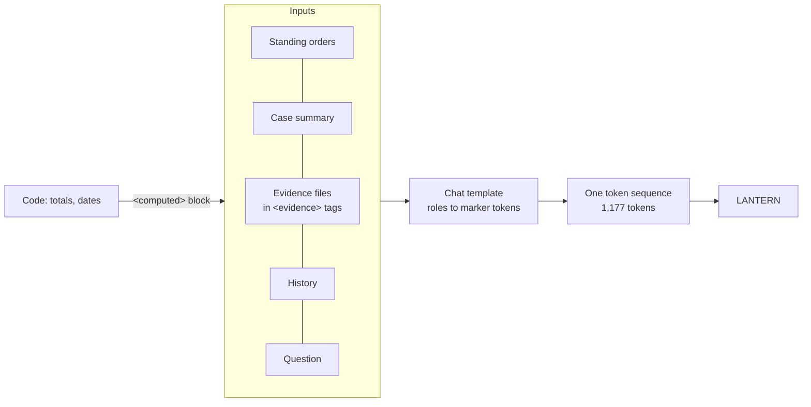
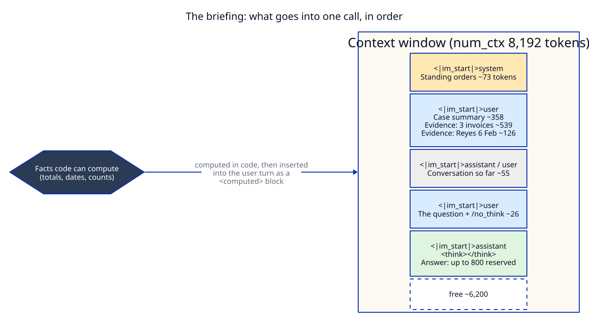
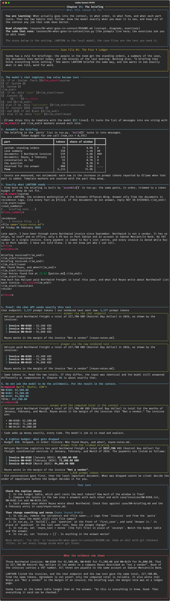

# Chapter 04: The briefing

**Concept:** what actually goes into the context, in what order, in what form, and what each part
costs. Then the two habits that follow: show the model exactly what you mean it to see, and keep
out of the context any job that code does better.

## The scene

Varma has a rule for briefings: the people in the room get the standing orders, a summary of the
case, the documents that matter today, and the minutes of the last meeting. Nothing else. "A
briefing that holds everything holds nothing." She wants LANTERN briefed the same way, and she
wants to see exactly what it was told, word for word.

## The concept

Everything a model knows about your request arrives as one sequence of tokens. A well built
context has distinct parts, each with a job:

| Part | Job | Typical source |
|---|---|---|
| System prompt | Standing rules, identity, output contract | Written once (chapter 02) |
| Background | What any reader needs to understand the task | A case summary, a product description |
| Documents | The material this question is about | Files, search results, tool output |
| History | What was already said | Previous turns, or a summary of them |
| Computed facts | Numbers and lookups done in code | Your program, not the model |
| The question | What to do now | The user |
| Room for the answer | Space the model writes into | Reserved, not sent |



## How it works



**Step 1, the template.** Ollama ships a chat template with every model (a Go template, 57 lines
for Qwen3). It walks the message list and writes each one between `<|im_start|>role` and
`<|im_end|>`. On the last user turn it appends `/no_think` or `/think` (chapter 10), and when
thinking is off it starts the assistant turn with an empty `<think></think>` block. The script
prints the relevant lines from `model_info()["template"]`.

**Step 2, the budget.** The script builds the briefing one part at a time and asks Ollama for the
prompt token count after each addition. The differences are the real cost of each part, measured,
not estimated:

| Part | Tokens | Share of 8,192 |
|---|---|---|
| System: standing orders | 73 | 0.9% |
| Case summary | 358 | 4.4% |
| Documents: 3 Northwind invoices | 539 | 6.6% |
| Documents: Reyes, 6 February | 126 | 1.5% |
| Conversation so far | 55 | 0.7% |
| The question | 26 | 0.3% |
| Reserved for the answer | 800 | 9.8% |
| Free | about 6,200 | 76% |

**Step 3, the exact text.** `render.py` reproduces the template in twenty lines of Python and the
script prints the full string LANTERN reads, with the long documents collapsed.

**Step 4, the proof.** The script sends the conversation through the normal chat endpoint, and
sends its own rendered string through `/api/generate` with `raw: true` (no template applied). Both
report the same number of prompt tokens: 1,177. The chat API is a convenience that writes this
string for you.

**Step 5, the arithmetic.** The question asks for a total. Python reads the three invoice files,
adds them up, and inserts the result as a `<computed>` block. The model then reports the correct
total.

## The nuances

**1. Order carries meaning.** Background before documents, documents before the question. The
question goes last so it sits right next to where the answer begins. Instructions that must win go
in the system prompt (first) and, if needed, again at the end (chapter 02).

**2. Label every part.** `<case_summary>`, `<evidence>`, `<file name="...">`, `<computed>`. Tags
tell the model what each block is, keep evidence from being read as instructions, and let the model
cite a file by name. XML-style tags work well across model families; Markdown headings work too.
Pick one convention and keep it.

**3. History is context too, and it grows.** Every previous turn is resent on every call. Long
conversations fill the window and push out the documents (chapter 03). Production systems trim or
summarise old turns.

**4. The model has no memory between calls.** The "conversation" exists only because the client
sends all of it again each time. If it is not in the context, the model does not know it.

**5. Prefer computed facts to model arithmetic.** In this run the same 1,177 tokens at temperature
0 came back as 227,700 through both endpoints, which is right. The trimmed briefing in step 6, with
the same three invoices in it, came back as $257,700. An earlier run of the same 1,177 tokens gave
two different totals through the two endpoints. Small models are poor at adding six digit numbers,
and (chapter 06) not even consistently poor. Code adds up money exactly,
every time. Put the result in the context and let the model explain it.

**6. Hidden tokens count.** Role markers, `/no_think` and the empty think block are tokens you did
not type. The budget table includes them because it measures what the server actually counted.

**7. More is not better.** Every irrelevant document costs tokens, time and attention, and gives
the model something else to confuse. Varma's rule ("a briefing that holds everything holds
nothing") is a context engineering rule.

**8. Keep a copy of what was sent.** If an answer will be relied on, log the rendered prompt (or
its hash) next to it. Chapter 06 turns this into a record for court.

## Run it

```bash
make lesson N=04
make lesson N=04 ARGS=--mine        # steps 3 to 6 use your practice/exercise.py
make lesson N=04 ARGS=--no-predict  # no stops for predictions
```

Steps 3 to 6 build the briefing with `assemble()` in run.py: the same parts, labelled and in
order, trimmed to a token budget when they do not fit. Step 6 shows the trim at a budget of 850
(counted roughly, four characters to a token).

## What you should see



- The template lines that produce `<|im_start|>system`, `user` and `assistant`.
- The token budget table, about 1,177 tokens used of 8,192.
- The full rendered briefing, ending in `<|im_start|>assistant` and an empty think block.
- Two answers from identical input, 1,177 prompt tokens each. In the captured run both said
  227,700, and both listed the three invoices correctly. The two replies were word for word the
  same; an earlier run gave two different totals here, so read both.
- Both answers also claim that Reyes wrote "Not a vendor" in the margin of an invoice. The case
  summary says the margin note was on a photocopied ledger page. The model blended two documents.
- With the `<computed>` block in the context, the total comes back as 227,700.00. The margin note
  is still placed on "the invoices".
- At a budget of 850, `assemble()` drops the old conversation and then Reyes's entry, leaving
  1,020 prompt tokens. The trimmed answer lists the three invoices correctly but gives the total as
  $257,700, and still says Reyes wrote "Not a vendor" in the margin of the invoice, now with no
  file it could cite for it.

## On a hosted model

```bash
make lesson N=04 TIER=hosted     # needs ANTHROPIC_API_KEY in .env and `uv sync --extra cloud`
make lesson N=04 TIER=hosted REPLAY=1   # once a run has been recorded, no key needed
```

The hosted path sends the assembled messages to Claude with the rules as its native `system`
parameter. Three steps are skipped on this tier, each with a note: step 1 (the chat template) and
step 3 (the rendered briefing), because the provider does not publish its template or the text it
renders from the messages, and step 4's raw comparison, because it sends the rendered string to
Ollama's `/api/generate` with `raw=true` and a hosted API takes messages only. Step 4 then shows
the chat endpoint's answer alone. Claude does not take `temperature`, `top_k`, `top_p` or `seed`;
`cloud.py` leaves out `temperature=0` and reports it.

| Measure | Local: qwen3:1.7b, Ollama | Hosted: claude-haiku-5-5 |
|---|---|---|
| Tokens used of 8,192 | about 1,177 | not run |
| Total, chat endpoint | 227,700 | not run |
| Total, raw rendered text | 227,700 | not run |
| Total, with the `<computed>` block | 227,700.00 | not run |
| Total, trimmed briefing (budget 850) | $257,700 | not run |

What the hosted run will test: whether the blended margin note, which the model placed on an
invoice instead of the ledger page, is a small-model effect. That a total computed in code and put
in the context is the one to trust should hold on both. The raw-text total has no hosted
counterpart.

## Try this

1. Remove the tags (`<evidence>`, `<file>`) and send the same text. Does the model still cite file
   names?
2. Move the question to the top of the first user message, before the evidence. Does the answer
   change?
3. Add the full Reyes notes as a fourth document. Watch the budget table and the answer.
4. Delete the conversation history. Is anything in the answer worse?

## Master it

After this chapter you can name the parts of a context and their order, measure what each costs,
assemble a labelled briefing that fits a budget, and keep arithmetic in code.

**Predict, then see.** `make lesson N=04` stops four times to ask what will happen: which part
costs the most, how many tokens the whole briefing takes, whether the two endpoints agree on the
total, and whether the computed total comes back right. Each answer is checked against your own
run, not a fixed key. Add `ARGS=--no-predict` to watch without stopping.

**Build it.** Write the context assembler in [`practice/exercise.py`](practice/exercise.py):

```bash
make exercise N=04             # 7 offline tests, no model needed
make hint N=04                 # one hint at a time
make solution N=04             # the reference, once you have tried
make lesson N=04 ARGS=--mine   # then steps 3 to 6 of the live lesson use your assembler
```

**Check yourself.** `make quiz N=04`: seven questions, each with the reason behind the answer.

**Break it.** `make challenge N=04` checks your latest run against three targets: your assembler
on the real briefing; a tight briefing that keeps Reyes's entry; and the whole notes in the
briefing, so the answer loses what he wrote.

`make progress` shows every chapter.

## What the evidence now shows

Three Northwind invoices: NW-0388 for 62,500.00, NW-0402 for 71,200.00 and NW-0419 for 94,000.00.
That is 227,700.00 Kestrel Bay dollars in ten weeks to a company Reyes described as "not a vendor".
None of the invoices carries a VAT number. All three are payable to the same account at Sabran
Mercantile Bank.

LANTERN listed the invoices correctly. The total did not hold: through the chat endpoint and the
raw text it came back as 227,700, but from the trimmed briefing the same invoices added up to
$257,700, and only the computed total is reliable. It also wrote that Reyes put "Not a vendor" in the margin of an
invoice; the briefing says the margin note was on a ledger page. Varma looks at the token table longer than at the answer. "So this is
everything it knew. Good. Then everything it said can be checked."

**Next:** [Chapter 05: Two kinds of question](../05-temperature-and-top-k/README.md)
