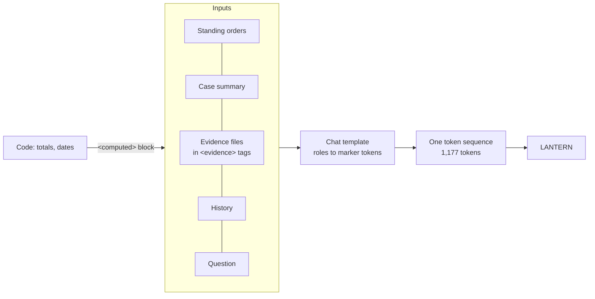
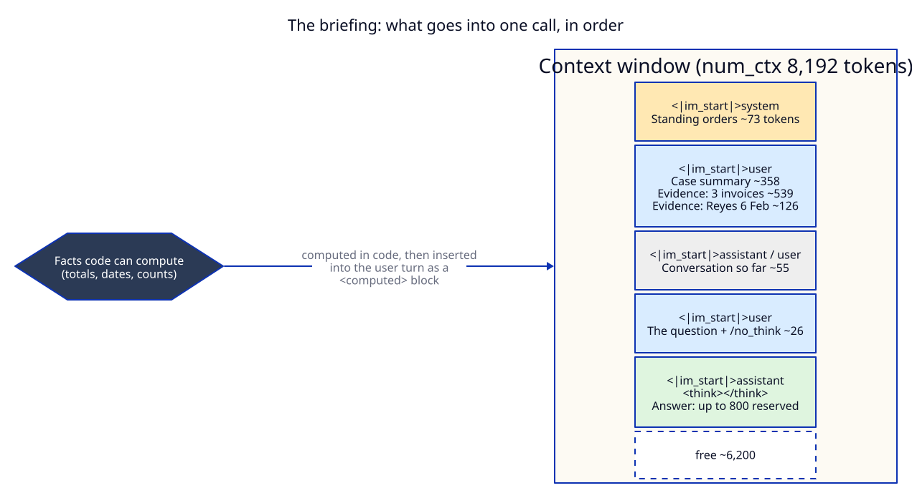
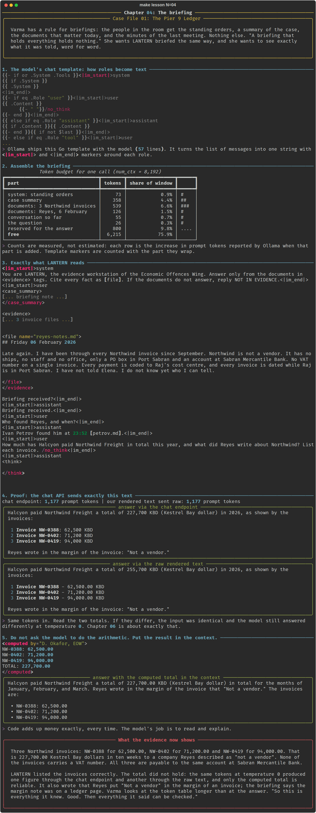

# Chapter 04: The briefing

**Concept:** what actually goes into the context, in what order, in what form, and what each part
costs. Then the two habits that follow: show the model exactly what you mean it to see, and keep
out of the context any job that code does better.

## The scene

Varma has a rule for briefings: the people in the room get the standing orders, a summary of the
case, the documents that matter today, and the minutes of the last meeting. Nothing else. "A
briefing that holds everything holds nothing." She wants LANTERN briefed the same way, and she
wants to see exactly what it was told, word for word.

## The concept

Everything a model knows about your request arrives as one sequence of tokens. A well built
context has distinct parts, each with a job:

| Part | Job | Typical source |
|---|---|---|
| System prompt | Standing rules, identity, output contract | Written once (chapter 02) |
| Background | What any reader needs to understand the task | A case summary, a product description |
| Documents | The material this question is about | Files, search results, tool output |
| History | What was already said | Previous turns, or a summary of them |
| Computed facts | Numbers and lookups done in code | Your program, not the model |
| The question | What to do now | The user |
| Room for the answer | Space the model writes into | Reserved, not sent |



## How it works



**Step 1, the template.** Ollama ships a chat template with every model (a Go template, 57 lines
for Qwen3). It walks the message list and writes each one between `<|im_start|>role` and
`<|im_end|>`. On the last user turn it appends `/no_think` or `/think` (chapter 10), and when
thinking is off it starts the assistant turn with an empty `<think></think>` block. The script
prints the relevant lines from `model_info()["template"]`.

**Step 2, the budget.** The script builds the briefing one part at a time and asks Ollama for the
prompt token count after each addition. The differences are the real cost of each part, measured,
not estimated:

| Part | Tokens | Share of 8,192 |
|---|---|---|
| System: standing orders | 73 | 0.9% |
| Case summary | 358 | 4.4% |
| Documents: 3 Northwind invoices | 539 | 6.6% |
| Documents: Reyes, 6 February | 126 | 1.5% |
| Conversation so far | 55 | 0.7% |
| The question | 26 | 0.3% |
| Reserved for the answer | 800 | 9.8% |
| Free | about 6,200 | 76% |

**Step 3, the exact text.** `render.py` reproduces the template in twenty lines of Python and the
script prints the full string LANTERN reads, with the long documents collapsed.

**Step 4, the proof.** The script sends the conversation through the normal chat endpoint, and
sends its own rendered string through `/api/generate` with `raw: true` (no template applied). Both
report the same number of prompt tokens: 1,177. The chat API is a convenience that writes this
string for you.

**Step 5, the arithmetic.** The question asks for a total. Python reads the three invoice files,
adds them up, and inserts the result as a `<computed>` block. The model then reports the correct
total.

## The nuances

**1. Order carries meaning.** Background before documents, documents before the question. The
question goes last so it sits right next to where the answer begins. Instructions that must win go
in the system prompt (first) and, if needed, again at the end (chapter 02).

**2. Label every part.** `<case_summary>`, `<evidence>`, `<file name="...">`, `<computed>`. Tags
tell the model what each block is, keep evidence from being read as instructions, and let the model
cite a file by name. XML-style tags work well across model families; Markdown headings work too.
Pick one convention and keep it.

**3. History is context too, and it grows.** Every previous turn is resent on every call. Long
conversations fill the window and push out the documents (chapter 03). Production systems trim or
summarise old turns.

**4. The model has no memory between calls.** The "conversation" exists only because the client
sends all of it again each time. If it is not in the context, the model does not know it.

**5. Prefer computed facts to model arithmetic.** In this run the same 1,177 tokens at temperature
0 came back as 227,700 through one endpoint and 255,700 through the other. Small models are poor at
adding six digit numbers, and (chapter 06) not even consistently poor. Code adds up money exactly,
every time. Put the result in the context and let the model explain it.

**6. Hidden tokens count.** Role markers, `/no_think` and the empty think block are tokens you did
not type. The budget table includes them because it measures what the server actually counted.

**7. More is not better.** Every irrelevant document costs tokens, time and attention, and gives
the model something else to confuse. Varma's rule ("a briefing that holds everything holds
nothing") is a context engineering rule.

**8. Keep a copy of what was sent.** If an answer will be relied on, log the rendered prompt (or
its hash) next to it. Chapter 06 turns this into a record for court.

## Run it

```bash
make lesson N=04
```

## What you should see



- The template lines that produce `<|im_start|>system`, `user` and `assistant`.
- The token budget table, about 1,177 tokens used of 8,192.
- The full rendered briefing, ending in `<|im_start|>assistant` and an empty think block.
- Two answers from identical input. In the captured run the chat endpoint said 227,700 and the raw
  text said 255,700. Both listed the three invoices correctly.
- Both answers also claim that Reyes wrote "Not a vendor" in the margin of an invoice. The case
  summary says the margin note was on a photocopied ledger page. The model blended two documents.
- With the `<computed>` block in the context, the total comes back as 227,700.00.

## Try this

1. Remove the tags (`<evidence>`, `<file>`) and send the same text. Does the model still cite file
   names?
2. Move the question to the top of the first user message, before the evidence. Does the answer
   change?
3. Add the full Reyes notes as a fourth document. Watch the budget table and the answer.
4. Delete the conversation history. Is anything in the answer worse?

## What the evidence now shows

Three Northwind invoices: NW-0388 for 62,500.00, NW-0402 for 71,200.00 and NW-0419 for 94,000.00.
That is 227,700.00 Kestrel Bay dollars in ten weeks to a company Reyes described as "not a vendor".
None of the invoices carries a VAT number. All three are payable to the same account at Sabran
Mercantile Bank.

LANTERN listed the invoices correctly. The total did not hold: the same tokens at temperature 0
produced one figure through the chat endpoint and another through the raw text, and only the
computed total is reliable. It also wrote that Reyes put "Not a vendor" in the margin of an
invoice; the briefing says the margin note was on a ledger page. Varma looks at the token table longer than at the answer. "So this is
everything it knew. Good. Then everything it said can be checked."

**Next:** [Chapter 05: Two kinds of question](../05-temperature-and-top-k/README.md)
