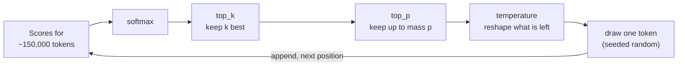
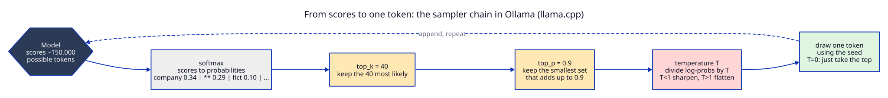
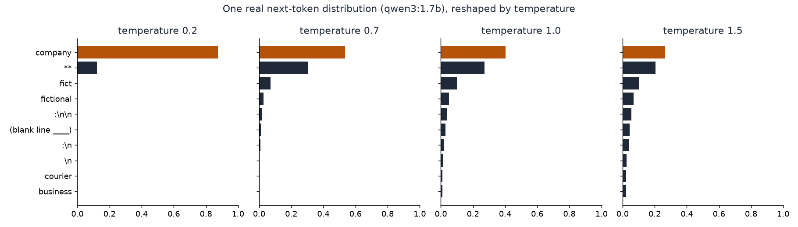
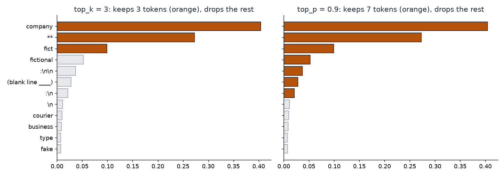
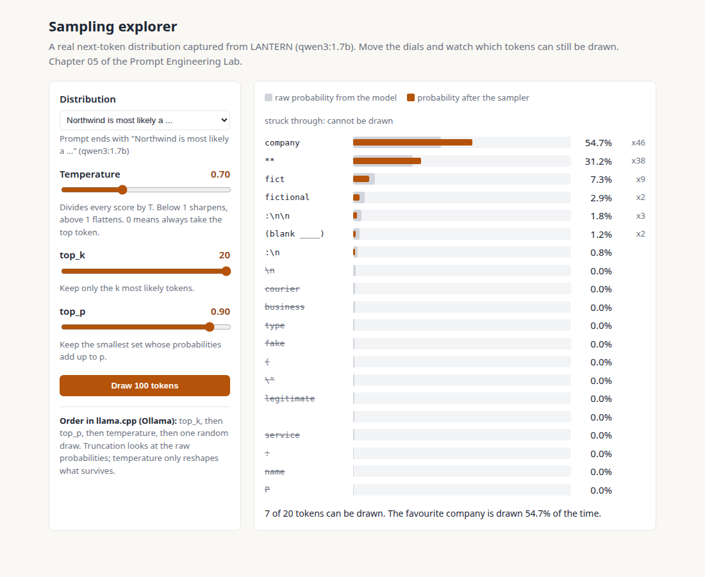
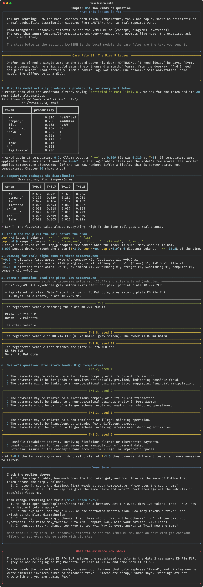

# Chapter 05: Two kinds of question

**Concept:** how the model chooses each token. Temperature, top-k and top-p, shown as arithmetic
on a real probability distribution captured from LANTERN, then as real repeated runs.

## The scene

Okafor has pinned a single word to the board above his desk: NORTHWIND. "I need ideas," he says.
"Every way a company with no ships could earn ninety thousand a month." Varma, from the doorway:
"And I need one plate number, read correctly, from a camera log. Not ideas. One answer." Same
workstation, same model. The difference is a dial.

## The concept

At every step the model produces a score for every token in its vocabulary (about 150,000 for
Qwen3). A softmax turns the scores into probabilities. The model never "decides" anything: a
**sampler** picks one token from that distribution, appends it, and the model scores the next
position.

Three settings control the sampler:

| Setting | What it does | Low value | High value |
|---|---|---|---|
| `temperature` | Divides every log-probability by T, then renormalises | Sharp: the favourite almost always wins | Flat: the tail gets real chances |
| `top_k` | Keeps only the k most likely tokens | Very conservative | Effectively off |
| `top_p` | Keeps the smallest set whose probabilities add up to p | Only the favourites | Effectively off |





## How it works

The script ends the conversation with the assistant already saying "Northwind is most likely a"
(a **prefill**), asks for one token and the 20 most likely alternatives (`logprobs=20`). This is
a real distribution LANTERN produced, captured once by `make charts` and stored in
[`docs/explorer/data.js`](../../docs/explorer/data.js):



Temperature is plain arithmetic. With log-probabilities `lp`, the new probability of each token is
`exp(lp / T)` divided by the sum over all tokens. For the distribution in the chart:

| Token | T = 0.2 | T = 0.7 | T = 1.0 (raw) | T = 1.5 |
|---|---|---|---|---|
| ` company` | 0.876 | 0.536 | 0.404 | 0.267 |
| ` **` (bold markdown) | 0.123 | 0.306 | 0.273 | 0.205 |
| ` fict` (start of "fictitious") | 0.001 | 0.072 | 0.099 | 0.104 |
| ` fictional` | 0.000 | 0.029 | 0.052 | 0.068 |

Your run asks the same question again, so its numbers will be close to these but not equal. The
terminal screenshot below came from a later run, where " **" came first at 0.310 raw and
" company" second at 0.266, against 0.404 for " company" here. The leading pair can swap places;
the shape, a few strong candidates and a long tail, is the same every time. Chapter 06 explains why the raw numbers move at all.

Top-k and top-p cut the list before the draw. On this distribution, `top_k = 3` keeps three
tokens; `top_p = 0.9` keeps seven, because no single token is dominant:



Then the script draws for real: eight runs at each temperature, each with a different seed, and
counts the distinct first words. Finally it asks the two case questions: read a partial plate at
temperature 0, brainstorm Northwind leads at 0.2 and at 1.3.

### The sampling explorer

[`docs/explorer/index.html`](../../docs/explorer/index.html) is an interactive page built from the
same captured distributions. Open it in a browser (no server needed) and move the sliders:

```bash
xdg-open docs/explorer/index.html   # macOS: open docs/explorer/index.html
```



Grey bars are the model's raw probabilities. Orange bars are what the sampler actually draws from.
Struck through tokens cannot be drawn at all. Switch to the plate distribution to see the opposite
case: one token at 100%, where no setting changes anything.

## The nuances

**1. Ollama's logprobs are the raw distribution.** The script asks for the same distribution at
T = 1.0 and T = 0.2. In the captured run the favourite, " **", was 0.310 at T = 1.0; if
temperature were applied to the reported numbers it would jump to 0.667 at T = 0.2. Ollama
reported 0.309. The sampler applies temperature after the model has
reported its scores. (You may still see the raw numbers move a little between calls. That is
server state, not temperature; chapter 06 explains it.)

**2. Temperature matters only where the model is unsure.** The plate question has one correct
answer and the model knows it: the next token is near 100% at every temperature. In the run,
LANTERN read KB 714 FLR at T = 0 and at T = 1.8. Temperature does not make a model creative about
things it is certain of. It makes it random about things it is unsure of.

**3. High temperature unlocks junk.** At T = 1.5 the eight runs produced eight different first
words, among them "UK", "computer" and bold markup glued to "Phishing" and "phishing". Formatting
tokens, stray markup and half-words live in the tail. Turning the temperature up gives them a
chance.

**4. Top-k is fixed; top-p adapts.** `top_k = 3` keeps three tokens whether the model is certain or
confused. `top_p = 0.9` keeps one token when the model is certain and many when it is not. That is
why most providers default to top-p and leave top-k high or off.

**5. Order matters.** In llama.cpp, top-k and top-p cut using the raw probabilities, and
temperature only reshapes what survives. Some other libraries apply temperature first. The same
three numbers can therefore behave differently on different servers.

**6. Temperature 0 is a special case.** T = 0 cannot be divided by. It means greedy decoding: take
the single most likely token every time. No random number is drawn, so the seed has no effect.

**7. Brainstorming wants variety, not nonsense.** At T = 0.2 the two lists of Northwind leads
opened with the same lead word for word and stayed on the same themes. At T = 1.3 they differed,
but most of the extra variety was rephrasing of fraud.
Variety of ideas comes more reliably from asking for many distinct ideas in one prompt, or from
different prompts, than from heat alone.

**8. Defaults differ by provider.** Ollama's default temperature is 0.8; this lab sets 0.2 in
`config.yaml`. Some hosted reasoning models ignore temperature or fix it. Always set it explicitly
for anything you will rely on.

## Run it

```bash
make lesson N=05
make lesson N=05 ARGS=--no-predict   # without stopping for predictions
make lesson N=05 ARGS=--mine   # on your sampler (practice/exercise.py)
```

To rebuild the charts and the explorer data from your own model:

```bash
make charts
```

## What you should see



- The raw distribution table with bars: " **" 0.310, " company" 0.266.
- The temperature table: the favourite rises to 0.667 at T = 0.2 and falls to 0.234 at T = 1.5.
- The kept sets: top_k = 3 keeps three tokens, top_p = 0.9 keeps six. 1,000 seeded draws give 6
  distinct tokens, " **" 36.5% of the time.
- Distinct first words: 4 at T = 0.2, 7 at T = 1.0, 8 at T = 1.5 (exact counts vary run to run).
- The plate: KB 714 FLR, R. Malhotra, at T = 0 and at both T = 1.8 seeds. The T = 0 reply ends on
  a stray fragment, "The other vehicle".
- Four lists of leads. The two at T = 0.2 share their first lead word for word; the two at T = 1.3
  share none.

## On a hosted model

```bash
make lesson N=05 TIER=hosted            # needs ANTHROPIC_API_KEY in .env, uv sync --extra cloud
make lesson N=05 TIER=hosted REPLAY=1   # once a hosted run is recorded (RECORD=1), no key
```

This chapter is about the settings Claude does not take. Current Claude models reject
`temperature`, `top_k` and `top_p`, have no `seed`, and return no log-probabilities, so
`lantern.cloud` does not send them and reports each one once per run (see `src/lantern/cloud.py`).
No native feature replaces them. What the hosted run does:

- Step 1 cannot show Claude's own distribution. It says so and uses the qwen3:1.7b distribution
  captured by `make charts` (`docs/explorer/data.js`) for steps 2 and 3, so the temperature,
  top_k and top_p arithmetic and the 1,000 seeded draws still run.
- Steps 4 to 6 send the same requests without the dial. The three rows of step 4 are then the
  same request eight times each: the distinct count measures the provider's own sampling, not
  temperature.

| Measure | Local: qwen3:1.7b | Hosted: claude-haiku-5-5 |
|---|---|---|
| Raw probability of the favourite | " company" 0.404 captured; " **" 0.310 in this run | not run (no logprobs) |
| Favourite at T = 0.2 | 0.876 captured; 0.667 in this run | not run (no temperature) |
| Tokens kept by top_p = 0.9 | 7 captured; 6 in this run | not run |
| Distinct first words, 8 seeds, T = 0.2 / 1.0 / 1.5 | 4 / 7 / 8 in this run (varies run to run) | not run |
| Plate read as KB 714 FLR at T = 0 / T = 1.8 (of 2) | yes / 2 | not run |

Local numbers: "captured" is the distribution stored by `make charts` in `docs/explorer/data.js`; "this run" is the screenshot's run (qwen3:1.7b, local tier, Apple M1 Pro 16 GB, 23 November 2026).

What the hosted run will test: whether the plate reading holds on a much larger model with no
temperature to set (it should: the answer is in the context), and how many distinct first words
eight identical unseeded requests give. The junk tokens in the tail at T = 1.5 are a property of
a small model at high temperature; the hosted run cannot reproduce that experiment at all.

## Try this

1. In the explorer, set T = 0.05 and then T = 2. Draw 100 tokens each time. How many distinct
   tokens appear?
2. In the explorer, set top_p = 0.5 on the Northwind distribution. How many tokens survive? Now
   switch to the plate distribution.
3. In `run.py`, change the brainstorm prompt to "List ten distinct hypotheses" at T = 0.2. Compare
   the variety with three hypotheses at T = 1.3.
4. Rerun step 4 with `top_k=1` at T = 1.5. Why is every answer now the same?

## Master it

After this chapter you can turn log-probabilities into the distribution a sampler draws from,
say what top_k and top_p each keep, write the sampler chain in llama.cpp's order, and choose a
temperature for a reading and for a brainstorm.

**Predict, then see.** `make lesson N=05` stops four times to ask what will happen: what share
the favourite gets at T = 0.2, how many tokens top_p = 0.9 keeps, how many distinct first words
eight seeds give at T = 1.5, and whether the plate survives T = 1.8. Each answer is checked
against your own run. Add `ARGS=--no-predict` to watch without stopping.

**Build it.** Write the sampler yourself in [`practice/exercise.py`](practice/exercise.py):
temperature, top_k, top_p, the chain, and a seeded draw.

```bash
make exercise N=05             # 8 offline tests, no model needed
make hint N=05                 # one hint at a time
make solution N=05             # the reference, once you have tried
make lesson N=05 ARGS=--mine   # steps 2 and 3, and 1,000 seeded draws, on your sampler
```

**Check yourself.** `make quiz N=05`: seven questions, each with the reason behind the answer.

**Break it.** `make challenge N=05` checks your latest run against three targets: your sampler
matching the lesson's chain on the live distribution; a top_p that keeps only the favourite; and
one first word from all eight seeds at T = 1.5.

`make progress` shows every chapter.

## What the evidence now shows

The camera's partial plate KB 7?4 ?LR matches one registered vehicle in the Gate 2 car park: KB
714 FLR, a grey saloon belonging to Raj Malhotra. It left at 23:47 and came back at 23:59.

Okafor reads the brainstormed leads, crosses out the ones that only rephrase "fraud", and
circles one he wrote himself: invoices timed to someone's travel. "Ideas are cheap," Varma says.
"Readings are not. Know which one you are asking for."

**Next:** [Chapter 06: The letter](../06-temperature-zero-and-nondeterminism/README.md)
