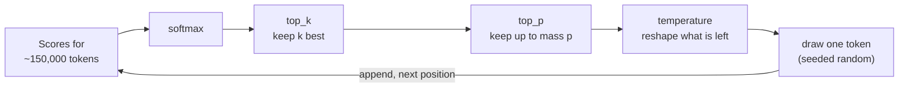
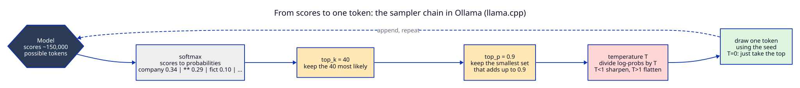
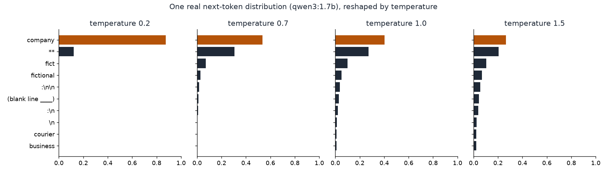
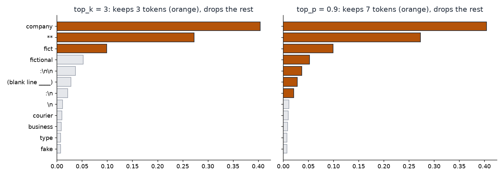
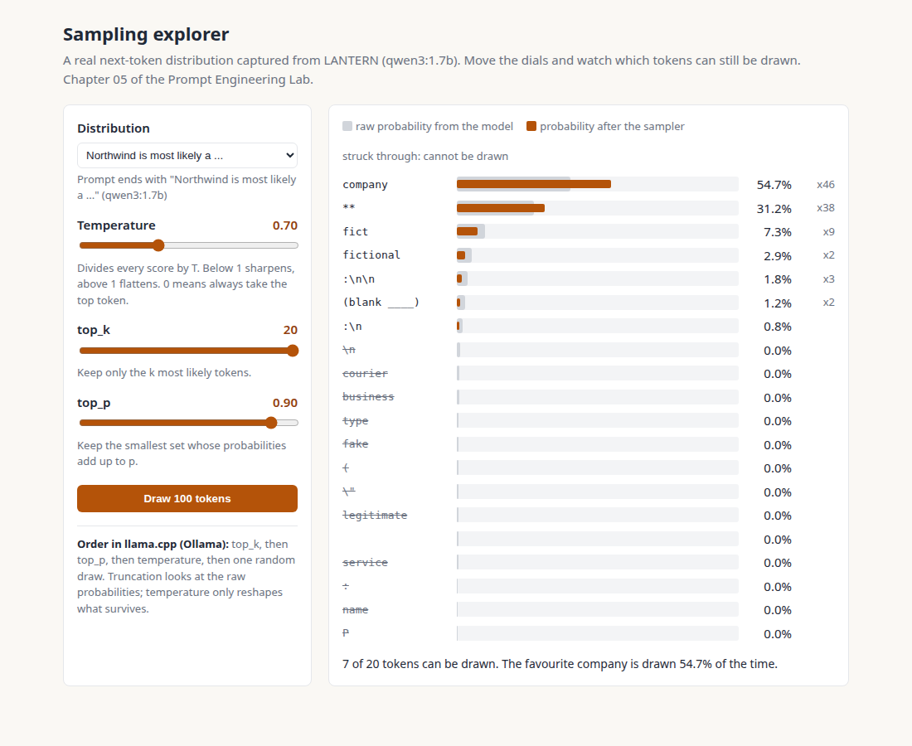
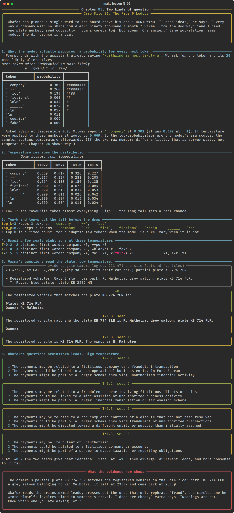

# Chapter 05: Two kinds of question

**Concept:** how the model chooses each token. Temperature, top-k and top-p, shown as arithmetic
on a real probability distribution captured from LANTERN, then as real repeated runs.

## The scene

Okafor has pinned a single word to the board above his desk: NORTHWIND. "I need ideas," he says.
"Every way a company with no ships could earn ninety thousand a month." Varma, from the doorway:
"And I need one plate number, read correctly, from a camera log. Not ideas. One answer." Same
workstation, same model. The difference is a dial.

## The concept

At every step the model produces a score for every token in its vocabulary (about 150,000 for
Qwen3). A softmax turns the scores into probabilities. The model never "decides" anything: a
**sampler** picks one token from that distribution, appends it, and the model scores the next
position.

Three settings control the sampler:

| Setting | What it does | Low value | High value |
|---|---|---|---|
| `temperature` | Divides every log-probability by T, then renormalises | Sharp: the favourite almost always wins | Flat: the tail gets real chances |
| `top_k` | Keeps only the k most likely tokens | Very conservative | Effectively off |
| `top_p` | Keeps the smallest set whose probabilities add up to p | Only the favourites | Effectively off |





## How it works

The script ends the conversation with the assistant already saying "Northwind is most likely a"
(a **prefill**), asks for one token and the 20 most likely alternatives (`logprobs=20`). This is
the real distribution LANTERN produced:



Temperature is plain arithmetic. With log-probabilities `lp`, the new probability of each token is
`exp(lp / T)` divided by the sum over all tokens. In the run captured above:

| Token | T = 0.2 | T = 0.7 | T = 1.0 (raw) | T = 1.5 |
|---|---|---|---|---|
| ` company` | 0.669 | 0.417 | 0.326 | 0.227 |
| ` **` (bold markdown) | 0.317 | 0.337 | 0.281 | 0.205 |
| ` fict` (start of "fictitious") | 0.014 | 0.138 | 0.150 | 0.135 |
| ` fictional` | 0.000 | 0.049 | 0.073 | 0.084 |

Top-k and top-p cut the list before the draw. On this distribution, `top_k = 3` keeps three
tokens; `top_p = 0.9` keeps six or seven, because no single token is dominant:



Then the script draws for real: eight runs at each temperature, each with a different seed, and
counts the distinct first words. Finally it asks the two case questions: read a partial plate at
temperature 0, brainstorm Northwind leads at 0.2 and at 1.3.

### The sampling explorer

[`docs/explorer/index.html`](../../docs/explorer/index.html) is an interactive page built from the
same captured distributions. Open it in a browser (no server needed) and move the sliders:

```bash
xdg-open docs/explorer/index.html   # macOS: open docs/explorer/index.html
```



Grey bars are the model's raw probabilities. Orange bars are what the sampler actually draws from.
Struck through tokens cannot be drawn at all. Switch to the plate distribution to see the opposite
case: one token at 100%, where no setting changes anything.

## The nuances

**1. Ollama's logprobs are the raw distribution.** The script asks for the same distribution at
T = 1.0 and T = 0.2. If temperature were applied to the reported numbers, " company" would jump
from about 0.30 to about 0.67. It does not. The sampler applies temperature after the model has
reported its scores. (You may still see the raw numbers move a little between calls. That is
server state, not temperature; chapter 06 explains it.)

**2. Temperature matters only where the model is unsure.** The plate question has one correct
answer and the model knows it: the next token is near 100% at every temperature. In the run,
LANTERN read KB 714 FLR at T = 0 and at T = 1.8. Temperature does not make a model creative about
things it is certain of. It makes it random about things it is unsure of.

**3. High temperature unlocks junk.** At T = 1.5 the eight runs produced five different first
words, including a closing `</think>` tag and a run of underscores. Formatting tokens, stray markup
and half-words live in the tail. Turning the temperature up gives them a chance.

**4. Top-k is fixed; top-p adapts.** `top_k = 3` keeps three tokens whether the model is certain or
confused. `top_p = 0.9` keeps one token when the model is certain and many when it is not. That is
why most providers default to top-p and leave top-k high or off.

**5. Order matters.** In llama.cpp, top-k and top-p cut using the raw probabilities, and
temperature only reshapes what survives. Some other libraries apply temperature first. The same
three numbers can therefore behave differently on different servers.

**6. Temperature 0 is a special case.** T = 0 cannot be divided by. It means greedy decoding: take
the single most likely token every time. No random number is drawn, so the seed has no effect.

**7. Brainstorming wants variety, not nonsense.** At T = 0.2 the two lists of Northwind leads were
almost the same list. At T = 1.3 they differed, but most of the extra variety was rephrasing.
Variety of ideas comes more reliably from asking for many distinct ideas in one prompt, or from
different prompts, than from heat alone.

**8. Defaults differ by provider.** Ollama's default temperature is 0.8; this lab sets 0.2 in
`config.yaml`. Some hosted reasoning models ignore temperature or fix it. Always set it explicitly
for anything you will rely on.

## Run it

```bash
make lesson N=05
```

To rebuild the charts and the explorer data from your own model:

```bash
make charts
```

## What you should see



- The raw distribution table with bars: " company" about 0.30, " **" about 0.26.
- The temperature table: the favourite rises to about two thirds at T = 0.2 and falls to under a
  quarter at T = 1.5.
- The kept sets for top_k = 3 and top_p = 0.9.
- Distinct first words: 2 at T = 0.2, 3 to 6 at T = 1.0, 4 to 8 at T = 1.5 (exact counts vary run
  to run).
- The plate: KB 714 FLR, R. Malhotra, at T = 0 and at T = 1.8.
- Four lists of leads. The two at T = 0.2 nearly match; the two at T = 1.3 differ.

## Try this

1. In the explorer, set T = 0.05 and then T = 2. Draw 100 tokens each time. How many distinct
   tokens appear?
2. In the explorer, set top_p = 0.5 on the Northwind distribution. How many tokens survive? Now
   switch to the plate distribution.
3. In `run.py`, change the brainstorm prompt to "List ten distinct hypotheses" at T = 0.2. Compare
   the variety with three hypotheses at T = 1.3.
4. Rerun step 4 with `top_k=1` at T = 1.5. Why is every answer now the same?

## What the evidence now shows

The camera's partial plate KB 7?4 ?LR matches one registered vehicle in the Gate 2 car park: KB
714 FLR, a grey saloon belonging to Raj Malhotra. It left at 23:47 and came back at 23:59.

Okafor reads the brainstormed leads, crosses out the ones that only rephrase "fraud", and
circles one he wrote himself: invoices timed to someone's travel. "Ideas are cheap," Varma says.
"Readings are not. Know which one you are asking for."

**Next:** [Chapter 06: The letter](../06-temperature-zero-and-nondeterminism/README.md)
