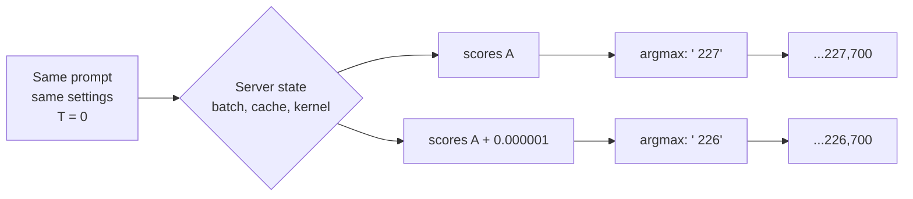
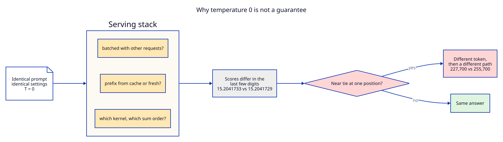
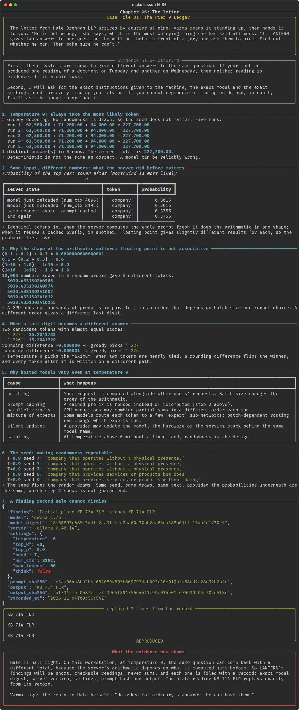

# Chapter 06: The letter

**Concept:** what temperature 0 really guarantees, why language models still give different
answers to identical requests, and how to make a finding reproducible enough to defend.

## The scene

The letter from Hale Brennan LLP arrives by courier at nine. Varma reads it standing up, then hands
it to you. "He is not wrong," she says, which is the most worrying thing she has said all week. "If
LANTERN gives two answers to one question, he will put both in front of a jury and ask them to
pick. Find out whether he can. Then make sure he can't."

The letter is [`case/hale-letter.md`](../../case/hale-letter.md). Its first complaint: "these
systems are known to give different answers to the same question."

## The concept

**Temperature 0 means greedy decoding**: at every step, take the single most likely token. No
random number is drawn. In theory that makes the output a pure function of the input.

In practice the "most likely token" is decided by floating point arithmetic on thousands of
numbers, and that arithmetic depends on more than your prompt: how the server batched your request,
whether part of it came from a cache, which GPU kernel ran. Change any of those and the scores move
in their last few digits. Usually that changes nothing. When two tokens are nearly tied, it changes
the winner, and every token after that is written on a different path.





## How it works

The script runs seven steps:

1. **Five runs at T = 0** of a question about the Northwind total. On one machine, one after
   another, they agree with each other. Whether they agree with the correct total is another
   matter.
2. **The server state experiment.** The same one-token request is sent four times: after a forced
   model reload (by changing `num_ctx`), after a second reload, then twice more with the prompt
   already cached. The reported probability of " company" moves with the server's state, not with
   the request:

   | Server state | P(" company") |
   |---|---|
   | model just reloaded (num_ctx 4096) | 0.3015 |
   | model just reloaded (num_ctx 8192) | 0.3015 |
   | same request again, prompt cached | 0.3755 |
   | and again | 0.3755 |

3. **Floating point is not associative**, in plain Python: `(0.1 + 0.2) + 0.3` and
   `0.1 + (0.2 + 0.3)` are different numbers, `(1e16 + 1.0) - 1e16` is 0.0 while
   `(1e16 - 1e16) + 1.0` is 1.0, and the same 10,000 numbers added left to right in five random
   orders give five different totals. (The script uses plain addition on purpose: Python's own
   `sum()` uses a compensated algorithm that hides the effect. GPU kernels do not.)
4. **A near tie** between two candidate tokens, and the rounding difference that flips greedy
   decoding from one to the other.
5. **The causes in hosted systems**, as a table (see the nuances below).
6. **The seed**: T = 0.9 with seed 7 three times gives the same text; seeds 8 and 9 give different
   text.
7. **A finding record**: the plate reading from chapter 05, stored with the model digest, server
   version, every setting, the prompt hash and the output hash, then replayed three times and
   checked.

## The nuances

**1. Deterministic is not correct.** Five identical answers at T = 0 can be five identical wrong
answers. Reproducibility tells you the system is stable, not that it is right.

**2. Batching.** Hosted APIs process many users' requests together. The batch size changes how the
matrix arithmetic is split up, and therefore the rounding. Your output can depend on who else was
using the service at that moment. This is the main reason hosted models vary at T = 0.

**3. Caching.** Servers reuse the computed state of a prompt prefix they have seen before. Computing
a prefix fresh and computing it from cache take different arithmetic paths. You saw the effect
directly in step 2, and chapter 04 showed the consequence: identical tokens, two different totals.

**4. Floating point order.** `a + b + c` in floating point depends on the order of the additions.
GPUs add in parallel, and some reductions do not fix the order. The difference is in the last bits,
which is enough when two tokens are within a hair of each other.

**5. Mixture of experts.** Some large models route each token to a few "expert" sub-networks. When
routing has per-batch capacity limits, which experts a token reaches can depend on the other
requests in the batch.

**6. Silent updates.** A hosted model name can point at different weights, quantisation, hardware
or serving code over time. Pin dated model versions where the provider offers them, and record what
you used.

**7. The seed fixes the draws, not the probabilities.** With a seed, the sampler draws the same
random numbers each time, so the same distribution gives the same text. If the distribution itself
moves (points 2 to 6), the same random number can land on a different token.

**8. Local is more reproducible, not perfectly.** One model, one machine, one request at a time:
consecutive runs here agreed. The cache experiment shows that even that depends on what the server
did just before. Running other models in between (as the lab's other chapters do) reloads models
and resets caches.

**9. Make it defensible, not magical.** You cannot make a language model perfectly deterministic
everywhere. You can (a) use it for short, checkable readings, (b) keep arithmetic and logic in code,
(c) record the exact model digest, server version, settings and prompt for every finding, (d) replay
the record and confirm the output, and (e) have a person verify it against the source. That is the
standard Hale asked for.

## Run it

```bash
make lesson N=06
```

The model reloads a few times in step 2, so expect a couple of minutes.

## What you should see



- Step 1: five identical answers at T = 0. Check them against the correct total, 227,700.00.
- Step 2: P(" company") of about 0.30 after a reload and about 0.38 from cache, for an identical
  request.
- Step 3: `0.6000000000000001` against `0.6`, 0.0 against 1.0, and five totals of the same
  10,000 numbers that differ from the twelfth significant digit.
- Step 4: a difference of one millionth flipping the greedy choice.
- Step 6: seed 7 three times, identical; seeds 8 and 9 different.
- Step 7: a JSON record with the model digest and hashes, and "REPRODUCED" on the replays.

## Try this

1. In step 2, add a row that calls with `num_ctx=4096` again after the cached calls. Which value do
   you get?
2. Run lesson 05 and then this lesson straight after. Does step 1 still give five identical
   answers?
3. Change step 7's settings to `temperature: 0.8` and replay. Is it still REPRODUCED? Why, given
   the seed?
4. If you have a cloud key, run step 1 against a hosted model (`LANTERN_PROVIDER=anthropic`) ten
   times and count the distinct answers.

## What the evidence now shows

Hale is half right. On this workstation, at temperature 0, the same question can come back with a
different total, because the server's arithmetic depends on what it computed just before. So
LANTERN's findings will be short, checkable readings, never sums, and each one is filed with a
record: exact model digest, server version, settings, prompt hash and output. The plate reading KB
714 FLR replays exactly from its record.

Varma signs the reply to Hale herself. "He asked for ordinary standards. He can have them."

**Next:** [Chapter 07](../07-zero-one-few-shot/README.md)
