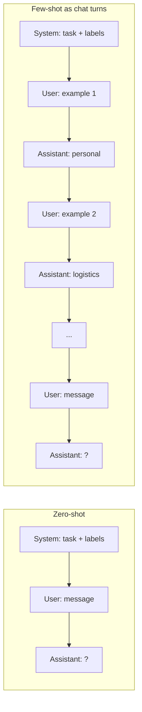
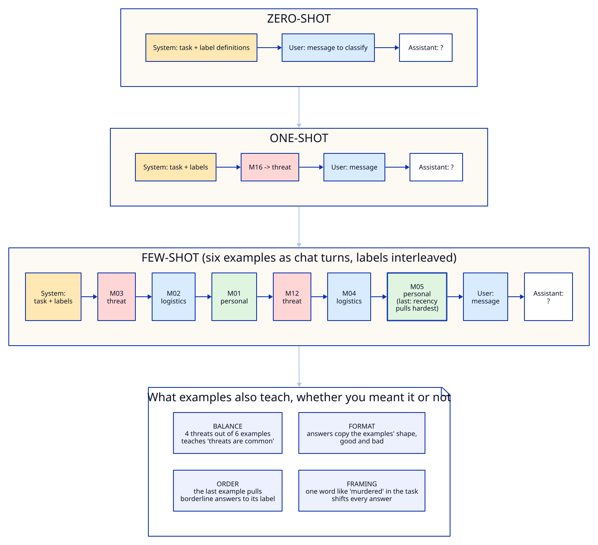
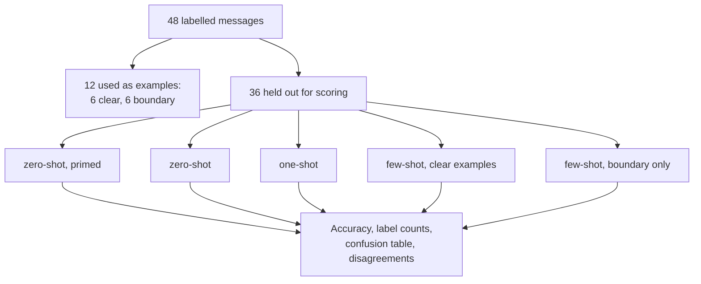
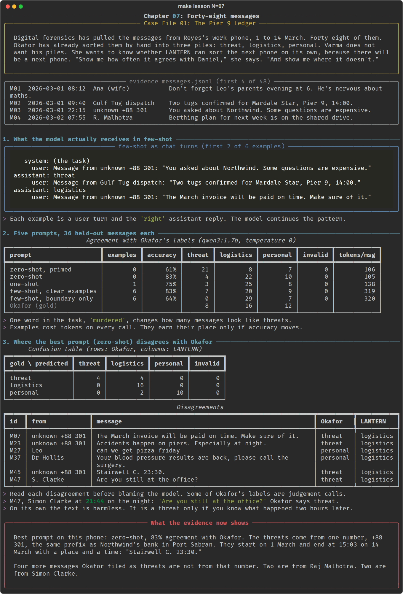

# Chapter 07: Forty-eight messages

**Concept:** zero-shot, one-shot and few-shot prompting. What examples teach a model, what they
teach it by accident, and how to measure whether they helped.

## The scene

Digital forensics has pulled the messages from Reyes's work phone, 1 to 14 March. Forty-eight of
them. Okafor has already sorted them by hand into three piles: threat, logistics, personal. Varma
does not want his piles. She wants to know whether LANTERN can sort the next phone on its own,
because there will be a next phone. "Show me how often it agrees with Daniel," she says. "And show
me where it doesn't."

The messages are in [`case/messages.jsonl`](../../case/messages.jsonl), each with Okafor's label.
Those labels are the **gold standard** you will score against.

## The concept

The number in "N-shot" is the number of worked examples in the prompt.

| Style | What the prompt contains | When it fits |
|---|---|---|
| **Zero-shot** | The task and the label definitions. No examples. | The task is common and the labels are self-explanatory. |
| **One-shot** | The task plus one worked example. | You need to show the output format, or one tricky convention. |
| **Few-shot** | The task plus several examples (typically 2 to 8). | The labels follow house rules the model cannot guess. |

An example is not an instruction. It is evidence of a pattern, and the model continues patterns.
That makes examples powerful and also dangerous: the model learns everything the examples have in
common, including things you did not mean to teach.



## How it works

This lab sends few-shot examples as **earlier turns of the conversation**: each example is a user
message followed by the "correct" assistant reply. Chat models were trained on conversations, so
this is the shape they continue most reliably. Pasting examples as a block of text inside one user
message also works, but small models are more likely to copy the block's layout (answering
`label: threat` or repeating the message) instead of answering.



The script runs five prompts over the same 36 messages. Twelve messages are used as examples
somewhere, so all twelve are held out of scoring in every mode. That keeps the comparison fair: no
prompt is ever graded on a message it was shown the answer to.



## The nuances

**1. Measure, do not assume.** Few-shot is often described as "better". On this phone, with this
model, the clear-example few-shot prompt tied with zero-shot at 83% and cost three times the
tokens per message. The only way to know whether examples help is to score both on held-out data.

**2. The framing is an example too.** The "primed" prompt differs from the plain zero-shot prompt by
one word: "a *murdered* company executive's work phone". That word took the model from 4 threat
labels to 21, and accuracy from 83% to 61%. Everything in the prompt is evidence about what answer
is expected. Keep task descriptions neutral.

**3. Label balance leaks.** If four of your six examples are threats, the model learns that threats
are common. Use roughly the label mix you expect in real data, or an even mix if you do not know.

**4. Order matters, and the last example pulls hardest.** Models weight recent context heavily
(**recency bias**). If all the threat examples come last, borderline messages tilt toward threat.
Interleave labels and end on the least dramatic one.

**5. Examples set the format.** The model copies the shape of the example answers: one word, a
word with a full stop, a sentence. If the examples are sloppy, the output is sloppy. If they answer
in one lowercase word, it will too.

**6. Boundary examples need clear examples around them.** "Boundary only" used six judgement calls
(a colleague's pressure counted as threat, a frightened wife counted as personal, a CEO's probing
question counted as logistics). A large model can learn the rule from those. The 1.7B model learned
"everything is logistics" (0 threats, 29 logistics) and fell to 64%. Teach the clear cases first,
then the edges.

**7. One example can be worse than none.** One-shot with a single threat example (Malhotra's "Can we
talk before you take anything to Elena?") scored 75%, below zero-shot. A single example is a strong
signal about one corner of the space and nothing about the rest.

**8. Gold labels are opinions.** Okafor marked M47, Clarke's "Are you still at the office?", as a
threat. On its own the text is harmless. It is a threat only if you know what happened two hours
later. When the model "gets it wrong", read the message before blaming the model. Some
disagreements are about context the model was never given.

**9. Examples cost tokens on every call.** Six examples took each call from about 105 prompt tokens
to about 320. On a phone with 10,000 messages that is the difference between minutes and hours on a
laptop, and real money on a paid API.

## Run it

```bash
make lesson N=07
```

180 classification calls (5 prompts x 36 messages) at temperature 0. Allow two to six minutes on a
CPU.

## What you should see



On our run (qwen3:1.7b, CPU, temperature 0):

| Prompt | Examples | Accuracy | Threat labels (gold: 8) | Tokens per message |
|---|---|---|---|---|
| zero-shot, primed | 0 | 61% | 21 | 106 |
| zero-shot | 0 | 83% | 4 | 105 |
| one-shot | 1 | 75% | 3 | 138 |
| few-shot, clear examples | 6 | 83% | 7 | 319 |
| few-shot, boundary only | 6 | 64% | 0 | 320 |

The plain zero-shot prompt missed four of the eight threats and filed them as logistics. Three come
from the +88 301 number, including "Accidents happen on piers. Especially at night." and
"Stairwell C. 23:30."; the fourth is Clarke's M47. It also filed Leo's "can we get pizza friday"
and a doctor's message about blood pressure results as logistics. A model that sorts 83% correctly can still miss the
four messages that matter most, which is why the confusion table matters more than the headline
number.

## Try this

1. Swap the order of `EASY` so both threat examples come last. Does the threat count rise?
2. Add `M07` and `M23` to the clear examples (and so to the held-out list). Do the remaining
   +88 301 messages now land as threats?
3. Put the six examples inside the user message as text instead of chat turns. Count the
   `invalid` answers.
4. Run with `LANTERN_MODEL=qwen3:4b make lesson N=07`. Does "boundary only" still collapse?

## What the evidence now shows

The threats come from one number, +88 301, the same prefix as Northwind's bank in Port Sabran. They
start on 1 March and end at 15:03 on 14 March with a place and a time: "Stairwell C. 23:30."

Four more messages Okafor filed as threats are not from that number. Two are from Raj Malhotra. Two
are from Simon Clarke.

**Next:** [Chapter 08: Rows for the link chart](../08-structured-output/README.md)
