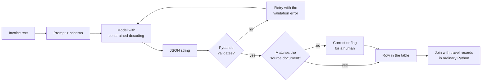
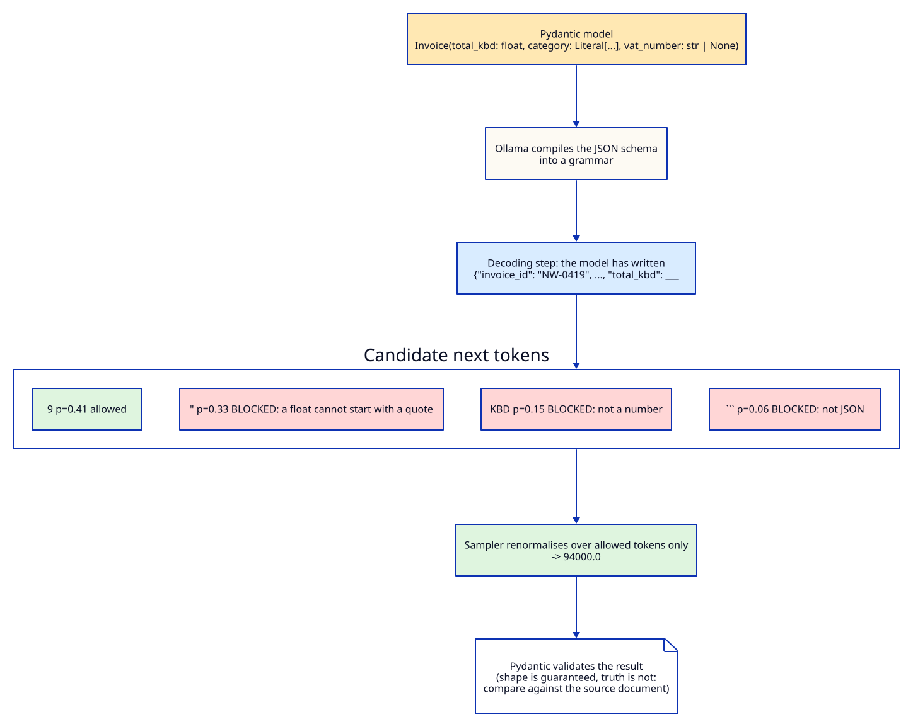
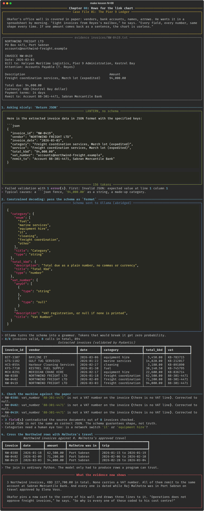

# Chapter 08: Rows for the link chart

**Concept:** structured output. Getting a model to return data a program can use: JSON that
always parses, matches a schema, and is checked against the source.

## The scene

Okafor's office wall is covered in paper: vendors, bank accounts, names, arrows. He wants it in a
spreadsheet by morning. "Eight invoices from Reyes's mailbox," he says. "Every field, every
number, same shape every time. If one amount comes back as a sentence, the chart is useless."

The invoices are plain text files in [`case/invoices/`](../../case/invoices/). Malhotra's approved
travel is in [`case/malhotra-travel.csv`](../../case/malhotra-travel.csv).

## The concept

A model produces text. A program needs data. **Structured output** is everything you do to close
that gap, and there are three levels of it:

| Level | How | Guarantee |
|---|---|---|
| Ask nicely | "Return JSON with keys a, b, c." | None. Usually works, sometimes wraps it in prose or a code fence. |
| JSON mode | `format: "json"` | It will parse. Keys and types can still be anything. |
| Schema-constrained | `format: <JSON schema>` | It parses **and** matches the schema: required keys, types, enums. |

On top of all three you still need **validation** (does it match your model in code?) and
**verification** (is it true, compared with the source?). The schema guarantees shape. Nothing
guarantees truth.



## How it works

**Constrained decoding.** When you pass a JSON schema as `format`, Ollama converts it into a
grammar. At every step, before the sampler picks a token, every token that would break the grammar
gets probability zero. The model cannot write a code fence, cannot put a string where a number
goes, and cannot invent a category outside the enum. It can still choose the wrong *allowed* value.



The schema comes from a Pydantic model, so the same class both instructs the model and validates
the result:

```python
class Invoice(BaseModel):
    invoice_id: str = Field(description="The invoice number exactly as printed, e.g. GTS-1182")
    vendor: str = Field(description="Supplier company name, in normal capitalisation")
    invoice_date: date = Field(description="Invoice date as YYYY-MM-DD")
    category: Literal["fuel", "marine services", "equipment hire", "it", "cleaning",
                      "freight coordination", "other"]
    service: str
    total_kbd: float = Field(description="Total due as a plain number, no commas or currency")
    vat_number: str | None = Field(description="VAT registration, or null if none is printed")
    remit_to: str

r = chat(f"Extract this invoice.\n\n{text}", format=Invoice.model_json_schema(), temperature=0)
invoice = Invoice.model_validate_json(r.text)
```

## The nuances

**1. Asking nicely fails in boring ways.** In our run the unconstrained reply began "Here is the
extracted invoice data in JSON format" and then a ```` ```json ```` fence. It also returned the total as
the string `"94,000.00"`, copied the service line into `category`, and put the vendor's email
address in `vat_number`. `json.loads` fails on the first character.

**2. Constrained is not correct.** With the schema, all eight invoices parsed and validated first
time. They still contained mistakes. The model filled `vat_number` for all three Northwind invoices
with the bank account number `88-301-4471`, although Northwind invoices carry no VAT line. A
nullable field gives the model permission to say null. It does not make it use that permission.
Step 3 of the script catches this by checking the field against the source text.

**3. Field order is generation order.** The model writes fields top to bottom, and each field is
context for the next. Put the fields that anchor the record first (`invoice_id`, `vendor`) and
derived judgements (`category`) after the facts they depend on. If you want reasoning, put a
`reasoning` field *before* the answer field, never after.

**4. Descriptions are prompts.** `Field(description=...)` text goes into the schema the model sees.
"Total due as a plain number, no commas or currency" is an instruction, and it is why `total_kbd`
came back as `94000.0` and not `"KBD 94,000.00"`.

**5. Enums turn free text into categories.** `Literal[...]` becomes a JSON schema `enum`. The model
can only pick from the list. It can still pick badly: Bayline IT's network switch replacement came
back as `equipment hire`, not `it`. Enums remove spelling variants, not judgement errors.

**6. Numbers, dates and nulls need types.** `"94,000.00"` is a string; `94000.0` is a number. Typed
fields (`float`, `date`, `str | None`) make the grammar enforce the type, and Pydantic convert it.
Never parse amounts out of prose with a regular expression if you can make the model emit a number.

**7. Validate, then retry with the error.** `extract()` feeds a failed validation message back to
the model as a new user turn and asks it to fix it. With constrained decoding the retry was never
needed here, but with "ask nicely" or a cloud model without schema support it is the standard
pattern. Cap the retries and send what still fails to a person.

**8. Let the model extract and let code reason.** The model only turns invoices into rows. The join
against Malhotra's travel dates is ordinary Python. It is exact, reproducible and cheap, and Marcus
Hale cannot argue with a date comparison.

## Run it

```bash
make lesson N=08
```

Nine model calls: one unconstrained, eight constrained. About one to two minutes on a CPU.

## What you should see



- The unconstrained reply fails validation on its first character.
- The constrained run: 8 of 8 invoices valid in 8 calls, with no retries.
- The source check flags the three Northwind `vat_number` values and corrects them to null.
- Look at the table yourself: vendor names stay in capitals despite the description asking for
  normal capitalisation, and Bayline IT is filed under `equipment hire`. Neither breaks the
  schema, and neither is quite right.
- The final table puts each Northwind invoice inside one of Malhotra's Port Sabran trips.

## Try this

1. Remove the `description` from `total_kbd` and rerun. What type and format come back?
2. Change `format=schema` to `format="json"` (JSON mode). Which fields drift?
3. Move `category` to be the first field in `Invoice`. Do the categories get worse?
4. Change the `vat_number` description to "Only the value printed after 'VAT registration:'.
   null if that line is absent." Does the source check still find problems?

## What the evidence now shows

Three Northwind invoices, KBD 227,700.00 in total. None carries a VAT number. All of them remit to
the same account at Sabran Mercantile Bank. And every one is dated while Raj Malhotra was in Port
Sabran on travel approved by Elena Voss.

Okafor pins a new card to the centre of his wall and draws three lines to it. "Operations does not
approve freight invoices," he says. "So why is every one of these coded to his cost centre?"

**Next:** [Chapter 09: Sixteen minutes](../09-chain-of-thought/README.md)
