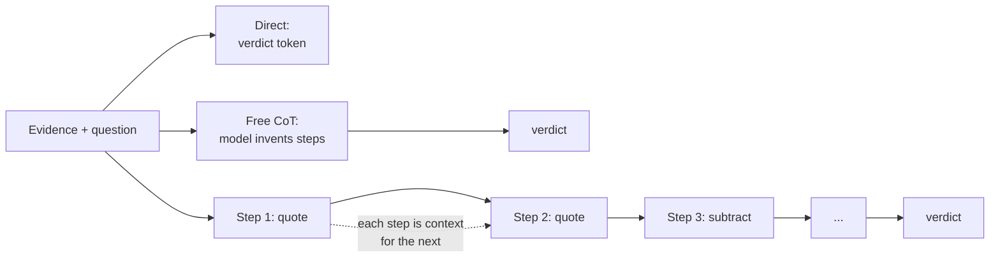
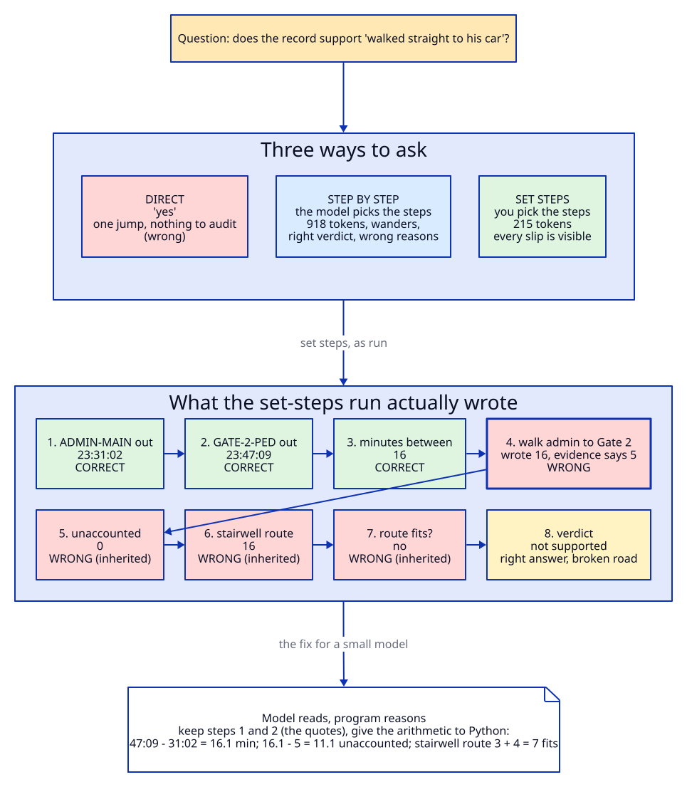
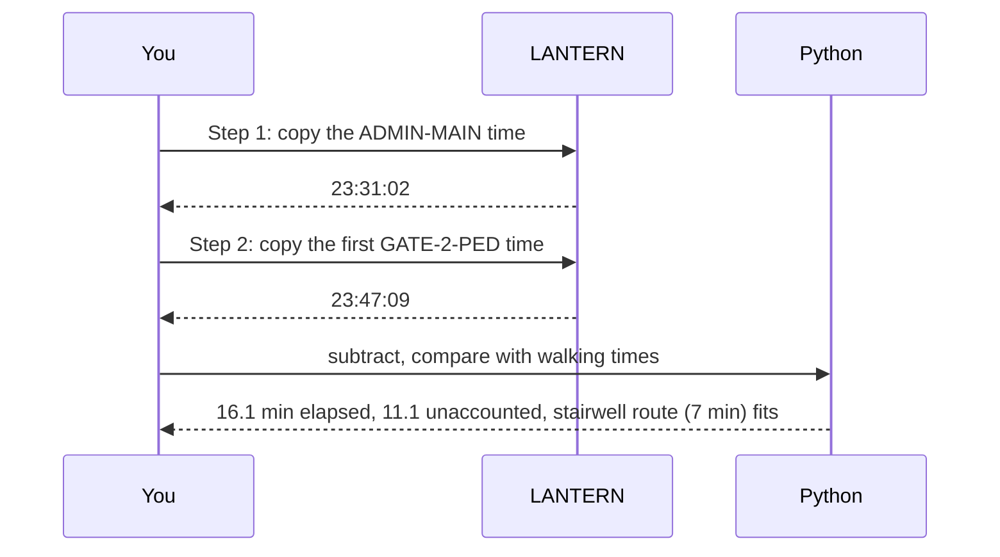
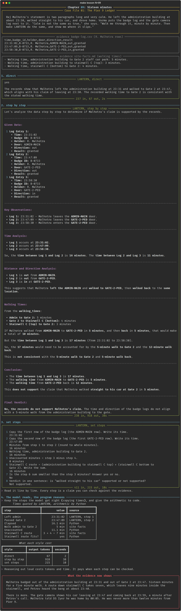

# Chapter 09: Sixteen minutes

**Concept:** chain of thought (CoT). Asking a model to write out intermediate steps before it
answers: why it helps, when it does not, what it costs, and whether it still matters now that
models can "think" on their own.

## The scene

Raj Malhotra's statement is two paragraphs long and very calm. He left the administration building
at about 23:30, walked straight to his car, and drove home. Varma puts the badge log and the gate
camera log next to it. "Calm is not the same as true," she says. "Walk me through it, minute by
minute. Then make LANTERN do the same, and show me where it slips."

The evidence: [`case/statements/malhotra.md`](../../case/statements/malhotra.md),
[`case/badge-log.csv`](../../case/badge-log.csv) and
[`case/site-facts.md`](../../case/site-facts.md).

## The concept

A model produces one token at a time, and every token it has written becomes input for the next.
When you ask for the answer straight away, the model must jump from the evidence to the verdict in
a single token: "yes" or "no". When you ask it to write the steps first, each step becomes part of
the context the final answer is generated from.

That is all chain of thought is: **spending output tokens on intermediate results so the final
answer is conditioned on them.** It comes in three strengths.

| Style | Prompt | Who chooses the steps |
|---|---|---|
| Direct | "Answer yes or no." | Nobody. One jump. |
| Free CoT | "Think step by step." | The model. |
| Set steps | "1. Quote X. 2. Quote Y. 3. Subtract..." | You. |



## How it works



The script asks the same question four ways, with the same evidence (Malhotra's three badge rows
and the walking times):

1. **Direct**: answer yes or no.
2. **Step by step**: the classic "think step by step" suffix.
3. **Set steps**: eight numbered steps you wrote, each small enough to check.
4. **Model reads, program reasons**: keep the two timestamps the model quoted in step 3, and do
   the arithmetic in Python.



## The nuances

**1. Direct answers hide the error.** On our run the direct prompt said "yes": the records support
Malhotra. It even quoted 23:31 and 23:47 correctly, then called a 16 minute gap "consistent" with a
5 minute walk. There is nothing to audit in a one-word verdict.

**2. Free CoT can reach the right verdict by the wrong road.** "Think step by step" produced 918
tokens. It found the 16 minutes, then wandered: it invented a "12-minute walk back" and measured to
the wrong row (23:58). Its verdict, "not supported", was right. Its reasons would not survive Marcus
Hale.

**3. Set steps make every slip visible.** The eight-step prompt got steps 1 to 3 exactly right
(23:31:02, 23:47:09, 16 minutes), then wrote "16 minutes" for the walking time in step 4, where the
evidence says 5. Every later step inherited the mistake. The verdict was still "not supported". A
right answer with wrong steps is a warning, not a pass: the written reasoning is not necessarily
how the model reached its answer (it is not always **faithful**).

**4. Let a program do what programs do.** The model was reliable at reading (copying timestamps)
and unreliable at arithmetic and comparison. Step 4 keeps the reading and gives the rest to Python.
This is the strongest pattern for small models: the model extracts, code computes. It is also the
version you can defend in court.

**5. CoT costs tokens and time.** Direct: 67 output tokens, about 2 seconds. Free CoT: 918 tokens,
38 seconds. Set steps: 215 tokens, 10 seconds. Set steps are cheaper than free CoT because you
decided what to write.

**6. CoT can hurt simple tasks.** For a lookup ("what time did he badge out?") reasoning adds
tokens and chances to drift. Use it when the answer depends on combining several facts.

**7. Is chain of thought still relevant?** Reasoning models (chapter 10) now generate their own
hidden chain of thought before answering, and for them "think step by step" adds little and can
even interfere. CoT prompting still matters when:

- the model is small or has no reasoning mode (like most models you can run on a laptop);
- you need the steps **in the answer** so a person can audit them;
- you want to force a specific procedure, such as "quote before you compute".

For a frontier reasoning model, give it the procedure as requirements, not as a script to recite.

## Run it

```bash
make lesson N=09
```

Three model calls plus some Python. About one to two minutes on a CPU.

## What you should see



- **direct**: "yes", with the wrong reasoning above.
- **step by step**: a long analysis that reaches "not supported" through some invented minutes.
- **set steps**: steps 1 to 3 correct, step 4 wrong (16 instead of 5), the verdict right anyway.
- **model reads, program reasons**: 16.1 minutes elapsed, 11.1 unaccounted, the stairwell route
  fits.
- The cost table: free CoT used about 14 times the tokens of the direct answer.

## Try this

1. Remove the `rows="R. Malhotra only"` filter and give all eleven badge rows. Which steps fail
   first?
2. Change step 4 to "Copy the line from walking_times that mentions Gate 2 staff car park." Does
   quoting fix it?
3. Run the set-steps prompt with `LANTERN_MODEL=qwen3:4b`. Which steps does the bigger model get
   right?
4. Ask the direct question with `think=True` (see chapter 10) and compare the token cost with free
   CoT.

## What the evidence now shows

Malhotra badged out of the administration building at 23:31 and out of Gate 2 at 23:47. Sixteen
minutes for a five minute walk. A route down stairwell C takes seven, which leaves nine minutes
inside the stairwell, and Petrov heard the bang at about 23:40.

There is more. The gate camera shows his car leaving at 23:47 and coming back at 23:59, a minute
after Petrov's call. Malhotra told DS Iyer he was home by 00:05. He was never more than twelve
minutes from Pier 9.

**Next:** [Chapter 10: The locked door](../10-thinking-mode/README.md)
