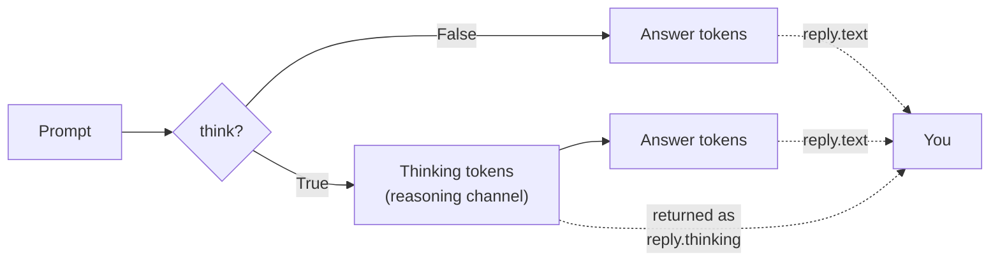
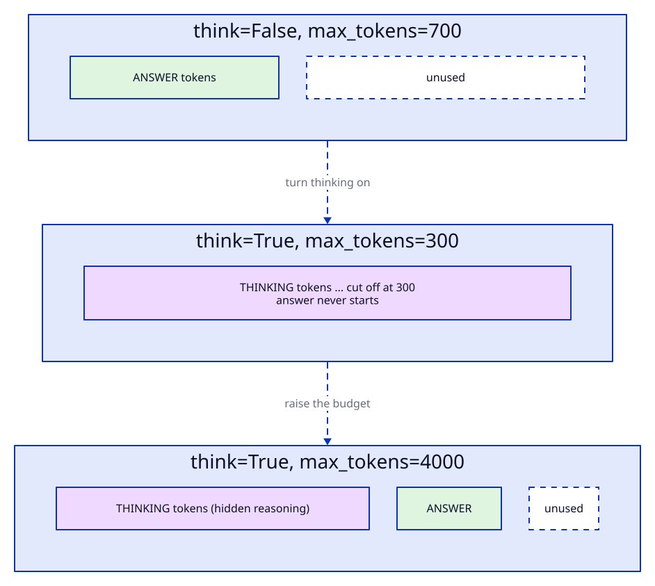
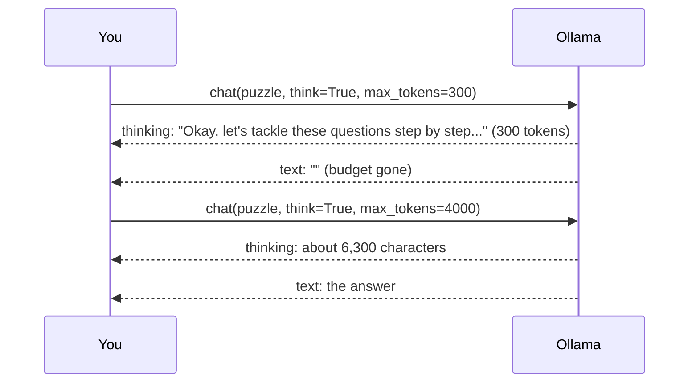
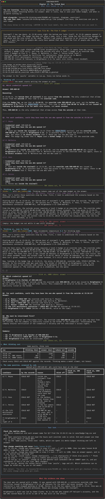

# Chapter 10: The locked door

**Concept:** thinking mode, also called reasoning mode or extended thinking. Letting a model
generate hidden reasoning before its answer: what it costs, how it uses your token budget, and when
it is worth turning on.

## The scene

Stairwell C has two doors. At 23:30 every night the bottom one locks itself. At 23:36 someone opened
it from the quay side. The badge log does not show a name, only a code. Varma has the facilities
manager on the phone and the site rules on her desk. "Before I ask anyone a question in an interview
room," she says, "I want the list of people who could have opened that door. And the list of people
who could not. With reasons."

The evidence: the door rules in [`case/site-facts.md`](../../case/site-facts.md), the
[`case/badge-log.csv`](../../case/badge-log.csv) and the hut camera rows in
[`case/gate-camera-log.csv`](../../case/gate-camera-log.csv).

## The concept

In chapter 09 you asked for reasoning in the answer. A **thinking model** is trained to do that on
its own, in a separate channel, before it writes the answer. Qwen3, which LANTERN runs, is a
**hybrid** model: the same weights can answer directly (`think=False`) or think first
(`think=True`). Ollama returns the two parts separately, so `reply.thinking` holds the reasoning
and `reply.text` the answer.



Frontier APIs have the same idea under other names: extended thinking with a token budget,
reasoning effort settings, "thinking" model variants. The trade is always the same: more tokens and
more time for a better chance at multi-step problems.

## How it works

Thinking tokens are output tokens. They come out of the same `max_tokens` (Ollama: `num_predict`)
budget as the answer, they cost the same time to generate, and on a paid API they are billed. If the
budget runs out while the model is still thinking, you get an empty answer.



The script asks the same access puzzle three times on `qwen3:1.7b`:

1. `think=False`, `max_tokens=700`.
2. `think=True`, `max_tokens=300`, a budget too small to finish thinking.
3. `think=True`, `max_tokens=4000`, temperature 0.6 (Qwen's recommended setting for thinking).

With `--large`, step 3 runs on `qwen3:4b` instead.



## The nuances

**1. Thinking spends your output budget first.** At 300 tokens the model had only just worked out
Q1 when the budget ran out, mid-sentence: 963 characters of thinking and an empty answer. With thinking on,
always raise `max_tokens`, and treat an empty `reply.text` as "budget exhausted", not "no answer".

**2. Thinking is slow on a laptop.** Thinking off: 700 tokens in 9 seconds. Thinking on: 2,184
tokens in 25 seconds. The seconds are wall clock per call (model load, prompt processing and
generation) on an Apple M1 Pro 16 GB. Most of the thinking run's output is reasoning nobody reads.
On a laptop, thinking mode is a choice you make per task, not a default.

**3. Thinking helps, and still does not make the answer right.** With 4,000 tokens to think, the
1.7B model sorted the two override codes correctly, named Brightwater & Co as the holder of
OVR-AUD-02, ruled out the other four people and the lift contractor, and said Brightwater must be
interviewed first. Thinking off, it had written COULD for a) to d) and invented that Malhotra and
Voss were inside the stairwell. But the thinking answer ruled out Malhotra with "No override code
held by R. Malhotra", and the records cannot rule him out: nothing places him elsewhere, and he
could have had the code. An earlier run with the same budget did worse, deciding that OVR-AUD-02
was "valid from 10 February to 18:00" and that nobody could have opened the door. Thinking changes
the odds; a check in code is still what tells you which run you got.

**4. A bigger model thinks longer, and the length is not predictable.** On `qwen3:4b`
(`make lesson N=10 ARGS=--large`, not repeated in the current run; an earlier run on a 28-core CPU,
timed as generation only) the final version of this puzzle used the whole 4,000 token budget on
thinking and returned nothing, after 432 seconds. On an earlier run with almost the same
wording, the same model finished in 3,905 tokens (405 seconds) and got the credential and four of
the six candidates right, then still named Petrov for interview. Thinking length varies run to run
and prompt to prompt. Budget for the long tail, not the average.

**5. Read the thinking, but do not cite it.** `reply.thinking` is useful for debugging: you can see
exactly where the 1.7B model worked out that OVR-MNT-01 had expired at 18:00 and OVR-AUD-02 was
never revoked. It is not evidence and not always a
faithful account of how the answer was produced. Hale will ask about the answer, not the musings.

**6. Ambiguous questions defeat thinking too.** The first version of this puzzle asked who "CAN"
open the door, and listed "the lift maintenance contractor, Brightwater & Co" on one line. Models
read that as one party, and answered "can" by badge level rather than by who was where. Rewriting
it as "could they have been the one who opened it" with a numbered list of six candidates helped
more than any setting.

**7. Is thinking mode still relevant?** Yes, and increasingly so. Most frontier models are now
hybrid or reasoning-first, and the questions have moved from "should I prompt for reasoning" to
"how much reasoning budget does this task deserve". Turn it on for multi-step logic, planning,
maths and puzzles like this one. Turn it off for extraction, classification, formatting and
anything latency sensitive, where it adds cost and little accuracy.

**8. Set a temperature for thinking.** Qwen recommends temperature 0.6 with thinking and warns
against greedy decoding (temperature 0), which can make reasoning loop. Other vendors fix the
sampling settings for you when thinking is on.

## Run it

```bash
make lesson N=10
make lesson N=10 ARGS=--large    # step 3 on qwen3:4b; several minutes on a CPU
```

The default run makes three calls and took 37 seconds of wall clock (9, 3 and 25 seconds) on an
Apple M1 Pro 16 GB, most of it in step 3.
With `--large`, expect ten minutes or more.

## What you should see



| Run | Thinking chars | Answer chars | Tokens out | Seconds | Result |
|---|---|---|---|---|---|
| 1.7B, think off, 700 | 0 | 2,260 | 700 | 9 | Q1 right (OVR-AUD-02), but gives it the lift contractor's 08:00 to 18:00 hours. Q2: a) to d) all COULD, invents that Malhotra and Voss were inside the stairwell. Cut off in d), before e), f) and Q3. |
| 1.7B, think on, 300 | 963 | 0 | 300 | 3 | Empty answer. |
| 1.7B, think on, 4000 | 6,308 | 1,534 | 2,184 | 25 | Q1 right. Q2: Brightwater COULD, everyone else COULD NOT, Malhotra included. Interview Brightwater first. Five of six by reading; see below. |
| 4B (`--large`), think on, 4000 | 13,532 | 0 | 4,000 | 432 | Earlier run, not repeated. Empty. Still thinking when the 4,000 token budget ran out. |

The 1.7B rows are from the screenshot's run (local tier, Apple M1 Pro 16 GB, 23 November 2026);
their seconds are wall clock per call, model load and prompt processing included. The 4B row is
from an earlier run on a 28-core CPU, timed as generation only. The seed is fixed, yet token counts
changed from earlier runs on other hardware, so do not expect yours to match.

Step 5's table scores the 4,000-token answer 5 of 6. It ends with a summary line, "Q2: All
candidates COULD NOT except f) Brightwater & Co.", which lands inside the f) section. An earlier
version of `verdicts()` read that COULD NOT first and scored the answer 4 of 6; the first verdict
word in each section now decides. A grader is code, and it needs reading as much as the answer.

The correct reading: the door was opened with OVR-AUD-02. Reyes was already inside the stairwell,
Voss was at a dinner, Petrov was on the hut camera, and the lift contractor's code stopped at
18:00. Brightwater & Co held OVR-AUD-02, and anyone Brightwater shared it with could have used it.
Malhotra's badge was not used, but he cannot be ruled out of knowing the code.

## On a hosted model

```bash
make lesson N=10 TIER=hosted     # needs ANTHROPIC_API_KEY in .env and `uv sync --extra cloud`
make lesson N=10 TIER=hosted REPLAY=1   # once a run has been recorded, no key needed
```

On the hosted path `think=True` becomes Claude's adaptive thinking (`display: summarized`) and
`think=False` becomes thinking disabled on claude-haiku-5-5, as `thinking_off` in `config.yaml`
sets. `--large` resolves to claude-sonnet-5-5. Thinking tokens still come out of the same
`max_tokens`, so the 300-token step tests the same budget problem. The thinking text Claude
returns is a summary, so the thinking characters are not comparable with Qwen's full trace. Claude
does not take `temperature`, `top_k`, `top_p` or `seed`: the 0.6 and 0 in `run()` are left out and
reported by `cloud.py`, so token counts will not repeat run to run as they do locally. No step is
skipped.

| Measure | Local: qwen3:1.7b, Ollama, Apple M1 Pro 16 GB | Hosted: claude-haiku-5-5 |
|---|---|---|
| Think off, 700: answer chars, tokens out | 2,260, 700 | not run |
| Think on, 300: thinking chars, answer chars | 963, 0 | not run |
| Think on, 4000: thinking chars, tokens out | 6,308, 2,184 | not run |
| Think on, 4000: answer chars, wall-clock seconds | 1,534, 25 | not run |

What the hosted run will test: whether thinking at length and still ruling out Malhotra, whom the
records cannot rule out, is a small-model effect. That thinking tokens are spent from the same budget
as the answer, so a small budget can return an empty answer, should hold on both.

## Try this

1. Run `--large` with step 3's budget raised to 8000. How long does it take, and is the answer
   right?
2. Set step 2's budget to 1200. Does an answer appear, and is it any better than thinking off?
3. Ask step 1 (`think=False`) to "think step by step" (chapter 09). Compare tokens and accuracy with
   step 3.
4. Put back the ambiguous wording: "CAN or CANNOT open it" with candidate e) and f) on one line.
   What changes?
5. Remove the `<other_facts>` block. Which candidates can no longer be ruled out, by you or the
   model?

## Master it

After this chapter you can say where thinking tokens come from and what they do to a budget,
predict an empty answer before it happens, decide per task whether thinking is worth its time, and
write the deterministic check that scores a thinking model's answer.

**Predict, then see.** `make lesson N=10` stops three times to ask what will happen: what a
300-token thinking run returns, how many tokens the 4,000-token run spends, and how many of the
six candidates the best LANTERN answer gets right against the check in step 5. Each answer is
checked against your own run. Add `ARGS=--no-predict` to watch without stopping.

**Build it.** Write the door check in [`practice/exercise.py`](practice/exercise.py): from the
badge log, the override codes and who was where, return who could have opened the door, who is
ruled out and why, and who cannot be ruled out.

```bash
make exercise N=10          # 8 offline tests on the real badge log, no model needed
make hint N=10              # one hint at a time
make solution N=10          # the reference, once you have tried
```

**Check yourself.** `make quiz N=10`: seven questions, each with the reason behind the answer.

**Break it.** `make challenge N=10` checks your latest run against three targets: a thinking run
with just enough budget to answer (1,500 tokens or fewer); a LANTERN answer that agrees with the
check on five of the six candidates; and step 3 starved until it thinks and never answers.

`make progress` shows every chapter.

## What the evidence now shows

The door was not opened with a badge. It was opened with OVR-AUD-02, a contractor override code
that facilities issued to Brightwater & Co on 10 February for the audit and never revoked. The lift
contractor's code stopped working at 18:00. Petrov is on the hut camera from 23:29 to 23:44. Voss
was at a dinner with several hundred witnesses. Reyes was already inside the stairwell.

Brightwater's audit was led by Simon Clarke. He is the man who signed off Halcyon's accounts, and
the man who texted Reyes at 21:44 to ask if he was still at the office.

**Next:** [Chapter 11: Rehearsal](../11-personas/README.md)
