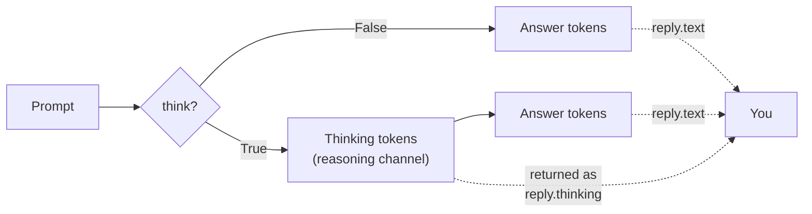
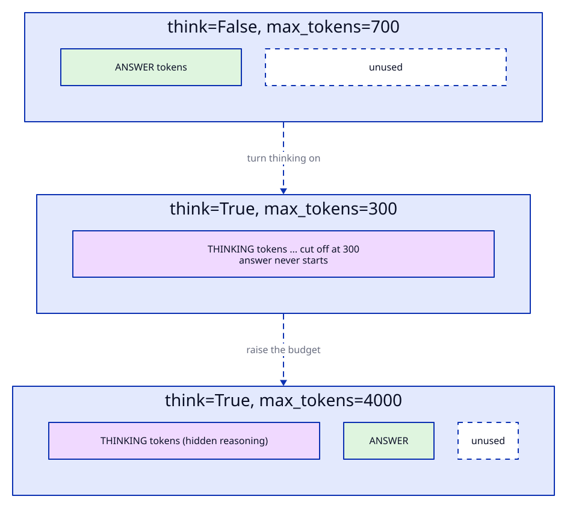
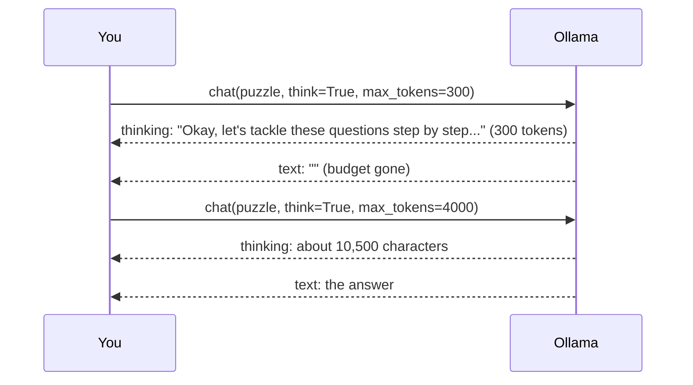
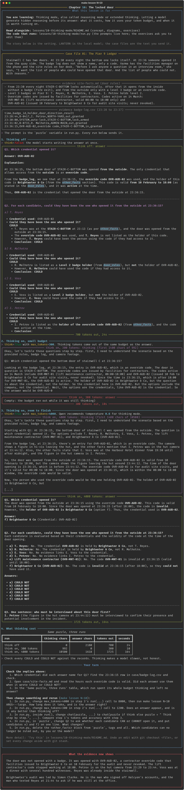

# Chapter 10: The locked door

**Concept:** thinking mode, also called reasoning mode or extended thinking. Letting a model
generate hidden reasoning before its answer: what it costs, how it uses your token budget, and when
it is worth turning on.

## The scene

Stairwell C has two doors. At 23:30 every night the bottom one locks itself. At 23:36 someone opened
it from the quay side. The badge log does not show a name, only a code. Varma has the facilities
manager on the phone and the site rules on her desk. "Before I ask anyone a question in an interview
room," she says, "I want the list of people who could have opened that door. And the list of people
who could not. With reasons."

The evidence: the door rules in [`case/site-facts.md`](../../case/site-facts.md), the
[`case/badge-log.csv`](../../case/badge-log.csv) and the hut camera rows in
[`case/gate-camera-log.csv`](../../case/gate-camera-log.csv).

## The concept

In chapter 09 you asked for reasoning in the answer. A **thinking model** is trained to do that on
its own, in a separate channel, before it writes the answer. Qwen3, which LANTERN runs, is a
**hybrid** model: the same weights can answer directly (`think=False`) or think first
(`think=True`). Ollama returns the two parts separately, so `reply.thinking` holds the reasoning
and `reply.text` the answer.



Frontier APIs have the same idea under other names: extended thinking with a token budget,
reasoning effort settings, "thinking" model variants. The trade is always the same: more tokens and
more time for a better chance at multi-step problems.

## How it works

Thinking tokens are output tokens. They come out of the same `max_tokens` (Ollama: `num_predict`)
budget as the answer, they cost the same time to generate, and on a paid API they are billed. If the
budget runs out while the model is still thinking, you get an empty answer.



The script asks the same access puzzle three times on `qwen3:1.7b`:

1. `think=False`, `max_tokens=700`.
2. `think=True`, `max_tokens=300`, a budget too small to finish thinking.
3. `think=True`, `max_tokens=4000`, temperature 0.6 (Qwen's recommended setting for thinking).

With `--large`, step 3 runs on `qwen3:4b` instead.



## The nuances

**1. Thinking spends your output budget first.** At 300 tokens the model had only just worked out
Q1 when the budget ran out, mid-word: 992 characters of thinking and an empty answer. With thinking on,
always raise `max_tokens`, and treat an empty `reply.text` as "budget exhausted", not "no answer".

**2. Thinking is slow on a laptop.** Thinking off: 700 tokens in 24 seconds. Thinking on: 3,725
tokens in 164 seconds. Most of that is reasoning nobody reads. On a CPU, thinking mode is a choice
you make per task, not a default.

**3. Thinking does not fix a model that is too small for the task.** With 4,000 tokens to think,
the 1.7B model reasoned at length and still decided that OVR-AUD-02 was "valid from 10 February to
18:00"
(it is never revoked; that limit belongs to the lift contractor's code) and so that *nobody*
could have opened the door. It then named Petrov, who is on the hut camera, as the first person to
interview. Longer reasoning by a weak reasoner gives you a longer wrong answer.

**4. A bigger model thinks longer, and the length is not predictable.** On `qwen3:4b`
(`make lesson N=10 ARGS=--large`) the final version of this puzzle used the whole 4,000 token
budget on thinking and returned nothing, after 432 seconds. On an earlier run with almost the same
wording, the same model finished in 3,905 tokens (405 seconds) and got the credential and four of
the six candidates right, then still named Petrov for interview. Thinking length varies run to run
and prompt to prompt. Budget for the long tail, not the average.

**5. Read the thinking, but do not cite it.** `reply.thinking` is useful for debugging: you can see
exactly where the 1.7B model swapped the two override codes. It is not evidence and not always a
faithful account of how the answer was produced. Hale will ask about the answer, not the musings.

**6. Ambiguous questions defeat thinking too.** The first version of this puzzle asked who "CAN"
open the door, and listed "the lift maintenance contractor, Brightwater & Co" on one line. Models
read that as one party, and answered "can" by badge level rather than by who was where. Rewriting
it as "could they have been the one who opened it" with a numbered list of six candidates helped
more than any setting.

**7. Is thinking mode still relevant?** Yes, and increasingly so. Most frontier models are now
hybrid or reasoning-first, and the questions have moved from "should I prompt for reasoning" to
"how much reasoning budget does this task deserve". Turn it on for multi-step logic, planning,
maths and puzzles like this one. Turn it off for extraction, classification, formatting and
anything latency sensitive, where it adds cost and little accuracy.

**8. Set a temperature for thinking.** Qwen recommends temperature 0.6 with thinking and warns
against greedy decoding (temperature 0), which can make reasoning loop. Other vendors fix the
sampling settings for you when thinking is on.

## Run it

```bash
make lesson N=10
make lesson N=10 ARGS=--large    # step 3 on qwen3:4b; several minutes on a CPU
```

The default run makes three calls and took a little over three minutes on our CPU, most of it
in step 3.
With `--large`, expect ten minutes or more.

## What you should see



| Run | Thinking chars | Answer chars | Tokens out | Seconds | Result |
|---|---|---|---|---|---|
| 1.7B, think off, 700 | 0 | 2,180 | 700 | 24 | Q1 right (OVR-AUD-02). Q2: a) to d) all COULD, invents that Petrov holds the code. Cut off in d), before e), f) and Q3. |
| 1.7B, think on, 300 | 992 | 0 | 300 | 10 | Empty answer. |
| 1.7B, think on, 4000 | 10,500 | 1,618 | 3,725 | 164 | Q1 right, then "the code is invalid after 18:00", everyone COULD NOT, interview Petrov. Wrong. |
| 4B (`--large`), think on, 4000 | 13,532 | 0 | 4,000 | 432 | Empty. Still thinking when the 4,000 token budget ran out. |

Seconds are from a 28-core CPU with nothing else running and vary from run to run; token counts
repeat exactly because the seed is fixed.

The correct reading: the door was opened with OVR-AUD-02. Reyes was already inside the stairwell,
Voss was at a dinner, Petrov was on the hut camera, and the lift contractor's code stopped at
18:00. Brightwater & Co held OVR-AUD-02, and anyone Brightwater shared it with could have used it.
Malhotra's badge was not used, but he cannot be ruled out of knowing the code.

## Try this

1. Run `--large` with step 3's budget raised to 8000. How long does it take, and is the answer
   right?
2. Set step 2's budget to 1200. Does an answer appear, and is it any better than thinking off?
3. Ask step 1 (`think=False`) to "think step by step" (chapter 09). Compare tokens and accuracy with
   step 3.
4. Put back the ambiguous wording: "CAN or CANNOT open it" with candidate e) and f) on one line.
   What changes?
5. Remove the `<other_facts>` block. Which candidates can no longer be ruled out, by you or the
   model?

## What the evidence now shows

The door was not opened with a badge. It was opened with OVR-AUD-02, a contractor override code
that facilities issued to Brightwater & Co on 10 February for the audit and never revoked. The lift
contractor's code stopped working at 18:00. Petrov is on the hut camera from 23:29 to 23:44. Voss
was at a dinner with several hundred witnesses. Reyes was already inside the stairwell.

Brightwater's audit was led by Simon Clarke. He is the man who signed off Halcyon's accounts, and
the man who texted Reyes at 21:44 to ask if he was still at the office.

**Next:** [Chapter 11: Rehearsal](../11-personas/README.md)
