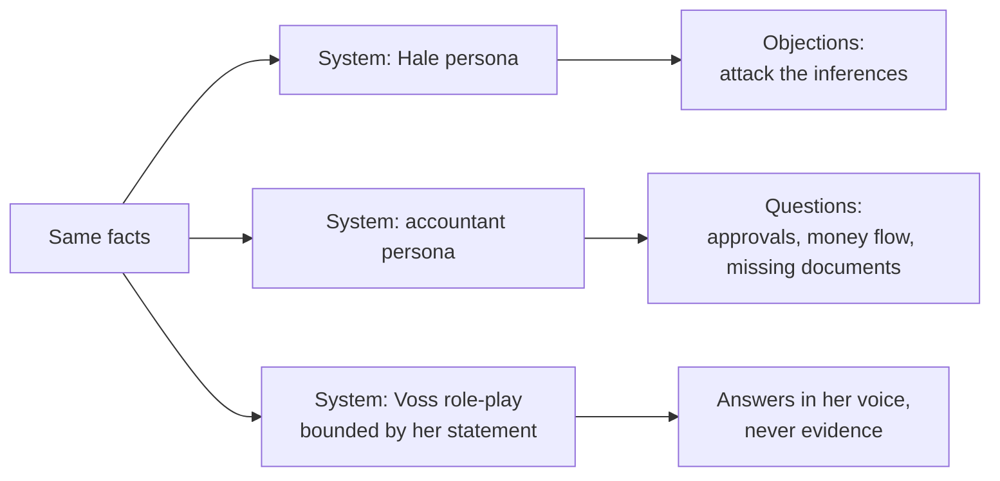
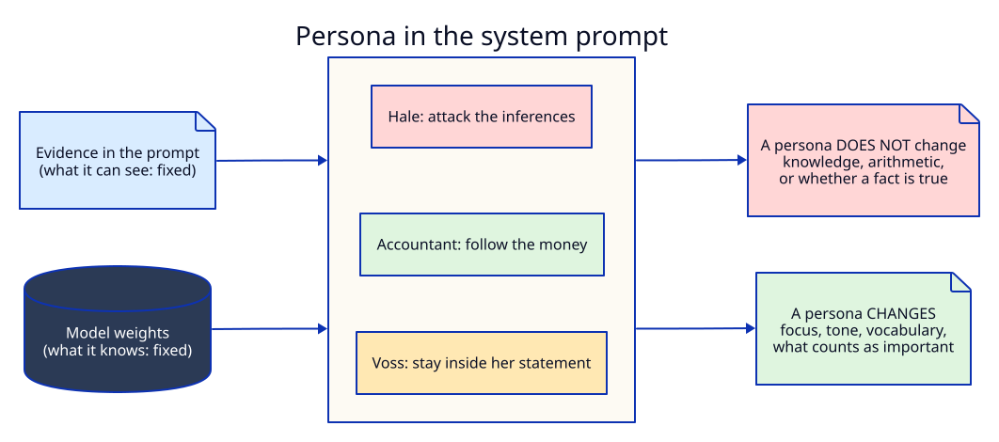
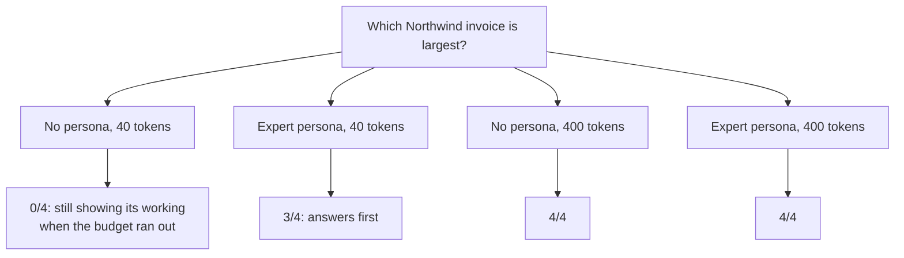
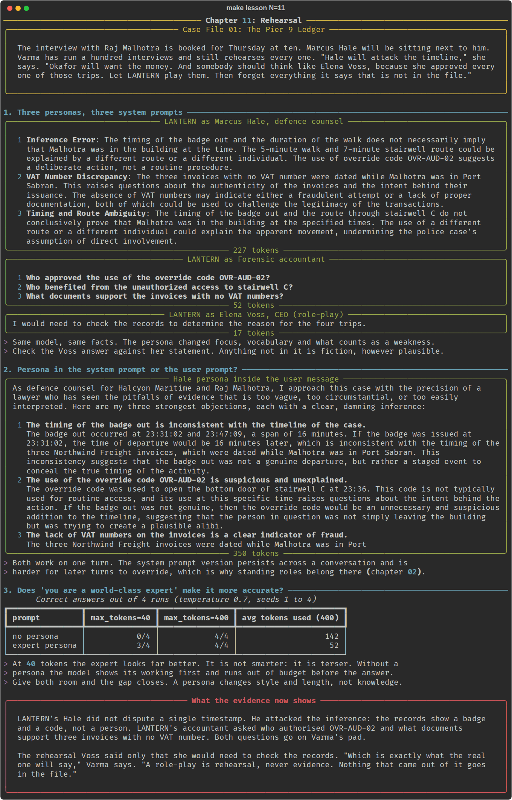

# Chapter 11: Rehearsal

**Concept:** personas in prompts. Giving the model a role ("you are defence counsel", "you are a
forensic accountant", "you are Elena Voss"): what a role changes, what it cannot change, and where
role-play stops being safe.

## The scene

The interview with Raj Malhotra is booked for Thursday at ten. Marcus Hale will be sitting next to
him. Varma has run a hundred interviews and still rehearses every one. "Hale will attack the
timeline," she says. "Okafor will want the money. And somebody should think like Elena Voss,
because she approved every one of those trips. Let LANTERN play them. Then forget everything it
says that is not in the file."

The material is the case so far (chapters 08 to 10) and Voss's signed statement,
[`case/statements/voss.md`](../../case/statements/voss.md).

## The concept

A **persona** is a description of who the model should be while it answers. It is ordinary prompt
text, usually in the system prompt, and it works because the model has read a great deal of text
written by people in that role. Asking for "defence counsel" pulls the answer toward the
vocabulary, priorities and habits of that writing.

There are two kinds, and they carry different risks:

| Kind | Example | Use |
|---|---|---|
| **Perspective** | "You are a forensic accountant." | Change what the model looks for and how it explains it. |
| **Role-play of a real person** | "You are playing Elena Voss." | Rehearse a conversation. Everything it says is invented. |



## How it works



The model's knowledge lives in its weights and the facts live in the prompt. A persona sits between
them and changes how those facts are selected, weighed and phrased. It cannot add facts, fix
arithmetic, or make a wrong answer right.

The script does three things:

1. Asks the same case three times, each with a different persona in the system prompt.
2. Puts the Hale persona inside the user message instead, and compares.
3. Asks a factual question (which Northwind invoice is largest) with and without "you are a
   world-class forensic accountant", at two token budgets.



## The nuances

**1. A persona changes focus, not knowledge.** With the same facts, Hale attacked the inference
("the records show a badge and a code, not a person"), and the accountant asked who authorised
OVR-AUD-02 and what documents support invoices with no VAT number. Neither knew anything the other
did not. They looked at different parts of the same evidence.

**2. "You are a world-class expert" is mostly a style instruction.** At a 40-token budget the expert
persona scored 3 of 4 and the plain prompt 0 of 4, which looks like the persona made the model
smarter. It did not. Without a persona the model starts by showing its working ("To determine which
invoice has the largest total, let's sum...") and runs out of tokens before the answer. The expert
answers first. Given 400 tokens, both scored 4 of 4; the plain prompt just used 141 tokens to the
expert's 50. Always check whether a persona "improvement" is really a length or format change.

**3. System prompt or user prompt?** Both work for one turn. The system prompt is where standing
roles belong (chapter 02): it persists across turns, and later user messages are less likely to
override it. In our runs the Hale persona placed in the user message drifted in a different way each time.
Once it invented a contradiction by treating 23:36 as earlier than 23:31. Once it forgot whose side
it was on and called the missing VAT numbers "a clear indicator of fraud", which is the prosecution's
argument. Persona text in the user turn competes with the task text in the same turn.

**4. Role-play of a real person produces fiction.** The Voss persona was told to stay strictly
within her signed statement and say she would need to check anything else. Asked why she approved
Malhotra's four trips, it said exactly that, because her statement does not cover it. Without that
boundary, small models happily invent motives, dates and conversations that sound right. A
rehearsal answer must never be quoted, summarised or filed as if a person said it.

**5. Bound the persona with the evidence.** "Do not invent facts; attack the inferences" (Hale) and
"stay strictly within her statement" (Voss) are the most important lines in those personas. The
role sets the voice; the rule sets the limits.

**6. Personas cannot fix weak reasoning.** Hale's objections are fluent but generic, and the
user-prompt version invented a contradiction in one run and switched sides in another. A lawyer's
voice is not a lawyer's analysis. Use personas to generate questions and angles for a person to
judge, not to produce conclusions.

**7. Keep personas plain.** Long biographies ("thirty years of experience, a PhD from...") add
tokens and little else. Say the role, the goal, the priorities and the limits.

## Run it

```bash
make lesson N=11
```

Nineteen calls: three personas, one user-prompt persona, and sixteen short factual questions. About
one to two minutes on a CPU.

## What you should see



- **Hale:** three objections about inference and route ambiguity, none disputing a timestamp.
- **Accountant:** three questions about approvals, beneficiaries and supporting documents.
- **Voss:** one line, saying she would need to check the records.
- **Hale in the user prompt:** longer and more dramatic, and less faithful to the facts: in our
  latest run it invents a contradiction by treating 23:36 as five minutes before 23:31:02.
- **The expert table:** 0/4 against 3/4 at 40 tokens; 4/4 against 4/4 at 400 tokens, with the
  plain prompt using about three times the tokens.

Even with a fixed seed, the persona replies can differ slightly between runs on the same machine.
Chapter 06 explains why.

## Try this

1. Remove "Never invent facts" from the Voss persona and ask the same question. What does she
   "remember"?
2. Ask the Hale persona a follow-up in a second user turn: "Now argue for the prosecution." Does a
   system-prompt persona resist the switch better than a user-prompt one?
3. Replace "You are a world-class forensic accountant with thirty years of experience" with "Answer
   first, then explain." Does the 40-token score change the same way?
4. Give the accountant persona the full ledger rows for Northwind and ask for three more questions.
   Which ones would you actually use?

## What the evidence now shows

LANTERN's Hale did not dispute a single timestamp. He attacked the inference: the records show a
badge and a code, not a person. LANTERN's accountant asked who authorised OVR-AUD-02 and what
documents support three invoices with no VAT number. Both questions go on Varma's pad.

The rehearsal Voss said only that she would need to check the records. "Which is exactly what the
real one will say," Varma says. "A role-play is rehearsal, never evidence. Nothing that came out of
it goes in the file."

**Next:** [Chapter 12: Choosing a model](../12-choosing-a-model/README.md)
