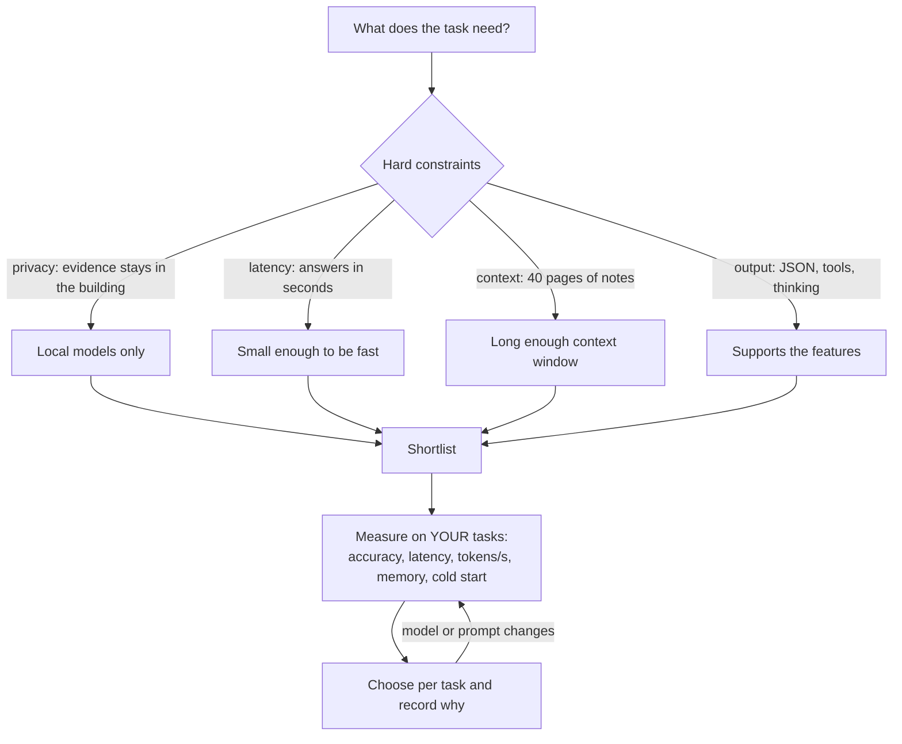
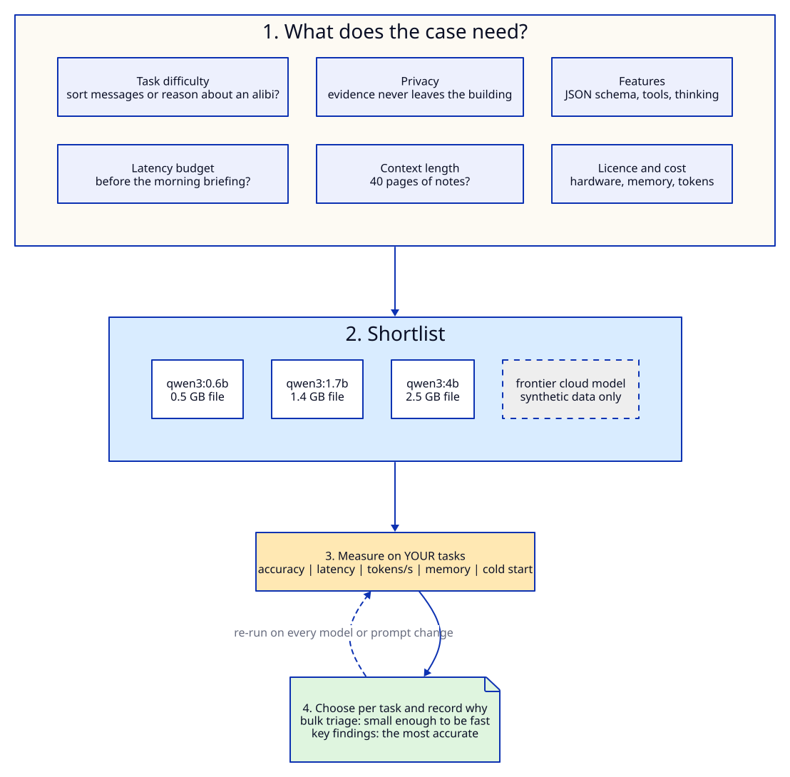
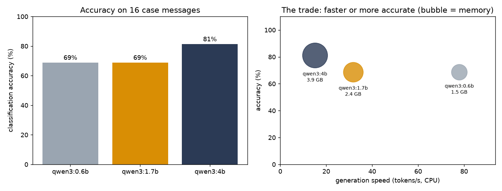
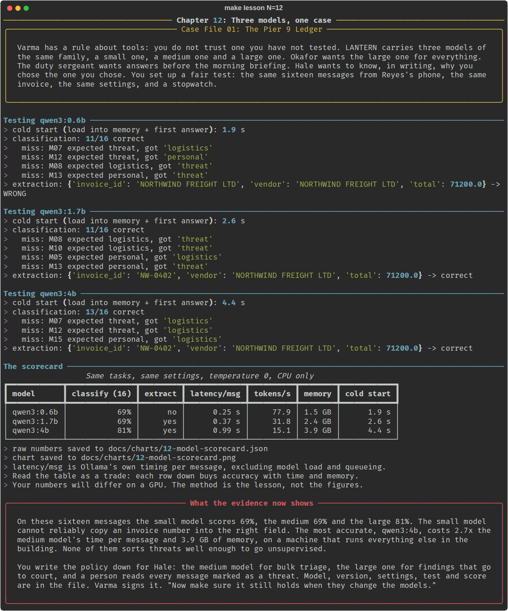

# Chapter 12: Three models, one case

**Concept:** how to choose a model: what to weigh, and why the only answer you can defend is the
one you measured on your own tasks.

## The scene

Varma has a rule about tools: you do not trust one you have not tested. LANTERN carries three
models of the same family, a small one, a medium one and a large one. Okafor wants the large one
for everything. The duty sergeant wants answers before the morning briefing. Hale wants to know,
in writing, why you chose the one you chose.

You set up a fair test: the same sixteen messages from Reyes's phone, the same invoice, the same
settings, and a stopwatch.

## The concept

There is no best model. There is a best model **for a task, under constraints**. Choosing well
means writing the constraints down first, shortlisting candidates that could meet them, and then
measuring the shortlist on your own work rather than on a public leaderboard.



LANTERN's shortlist is fixed by the story: evidence cannot leave the building, so every model runs
locally. In the lab the three models are one family at three sizes (0.6B, 1.7B and 4B
parameters). Only size changes, so the comparison is clean.

## How it works



The script runs the same work on each model in turn:

| Measurement | How | Why it matters |
|---|---|---|
| Accuracy | 16 labelled messages (6 threat, 5 logistics, 5 personal), classified with a JSON enum schema | The task you actually care about |
| Extraction | Invoice NW-0402 to JSON, checked against 71,200.00 | A second, different skill |
| Latency per message | Ollama's own timing per classification, excluding model load | What the user waits for, once the model is loaded |
| Tokens per second | One 80-word generation | Throughput for long answers |
| Memory | Size of the loaded model from Ollama's `/api/ps` | Whether it fits beside everything else |
| Cold start | Time for the first answer, including loading the model | What the first user of the morning pays |

The raw numbers go to `docs/charts/12-model-scorecard.json` and the chart below is drawn from them.



## The nuances

**1. Task difficulty sets the floor.** Sorting messages, extracting fields and summarising are easy
for most models. Reasoning across a timeline (chapter 09) or a locked-door puzzle (chapter 10) is
not. Use the smallest model that clears the bar on each task, not one model for everything.

**2. Latency is a budget, not a preference.** On this CPU-only laptop the 4B model generates about
half as fast as the 1.7B. For a nightly batch of thousands of messages, that is hours. For one
key finding, it is nothing. Choose per task.

**3. Cost has more than one form.** Cloud models charge per token. Local models charge in hardware,
memory and electricity. Ollama here keeps one model in memory at a time (`OLLAMA_MAX_LOADED_MODELS:
1` in `docker-compose.yml`), because a 16 GB laptop running other services cannot hold three. Every
switch between models pays the cold-start cost again.

**4. Privacy can decide the question before quality does.** For LANTERN, no cloud model is allowed
near the evidence, however good it is. In real projects the same applies to health records,
client contracts and source code under NDA. `config.yaml` has a cloud switch
(`provider: anthropic | openai | gemini`) for comparing quality on synthetic material only.

**5. Context length is a hard limit.** A model's advertised context is a maximum, and it costs memory.
It is 40,960 tokens for the 0.6B and 1.7B models and 262,144 for the 4B, which is a newer release
in the same family (check with `ollama show qwen3:4b`). LANTERN allocates 8,192 (`num_ctx` in `config.yaml`).
Chapter 03 shows what happens when evidence does not fit.

**6. Features are part of the choice.** Structured output, tool calling, a thinking mode and
log-probabilities differ between models and between servers. Here the 4B model writes its reasoning
into the answer even with thinking switched off. A fixed JSON schema (`format`) was what made its
classifications usable at all. Test the features you depend on.

**7. Quantization trades a little accuracy for a lot of memory.** These models are Q4_K_M: weights
stored in about 4.5 bits instead of 16. That is why a 4B model fits in a few gigabytes. Higher
precision versions exist (`qwen3:4b-q8_0`, for example), and they are larger and slower.

**8. Licence matters if you ship.** Qwen3 is released under Apache 2.0. Other open models have
licences with use restrictions. Check before anything leaves the lab.

**9. Frontier versus small is not either-or.** A common production shape is a small local model for
the bulk of the work, with the hard or high-stakes cases sent to a larger model. The large one may
be a cloud model where policy allows. The eval in chapter 14 is how you decide where the line goes.

**10. Leaderboards are someone else's tasks.** Public benchmarks measure maths olympiad problems and
coding puzzles. Your case is sixteen messages from a dead man's phone. Measure that.

**11. Your numbers will differ.** Hardware, background load, the Ollama version and even the model
digest change the figures. On a GPU everything is several times faster. The method transfers. The
numbers do not.

## Run it

```bash
make lesson N=12
```

It loads each model in turn, so it takes a few minutes on a CPU. It writes the scorecard JSON and
redraws the chart.

## What you should see



In the run captured here (a laptop CPU, no GPU, nothing else using Ollama):

| Model | Classify (16) | Extract NW-0402 | Latency per message | Tokens/s | Memory | Cold start |
|---|---|---|---|---|---|---|
| qwen3:0.6b | 69% | no | 0.25 s | 77.9 | 1.5 GB | 1.9 s |
| qwen3:1.7b | 69% | yes | 0.37 s | 31.8 | 2.4 GB | 2.6 s |
| qwen3:4b | 81% | yes | 0.99 s | 15.1 | 3.9 GB | 4.4 s |

What to read from it:

- **Size bought accuracy only at the top.** 0.6B and 1.7B tied on classification. 4B got two
  more right.
- **The small model failed a different skill.** It put the vendor's name in `invoice_id`. One task
  is not enough to rank models.
- **All three miss quiet threats.** No model here should sort threats without a person checking.
- **Speed falls fast with size.** 4B generates about half as fast as 1.7B and a fifth as fast as
  0.6B, and needs 3.9 GB of memory once loaded. The file is 2.5 GB, and the context window and
  runtime take the rest.
- **Latency is Ollama's own timing** (`total_duration` minus `load_duration`). The first version of
  this lesson used wall-clock time while other jobs were swapping models in and out, and reported
  31 seconds per message for the smallest model. Measure the thing, not the queue.

## Try this

1. Add a fourth candidate with `ollama pull` (for example `llama3.2:3b` or `gemma3:4b`) and add it to
   `MODELS` in `run.py`. Is a different family better on these messages at the same size?
2. Switch `provider` to a cloud model and run only the classification. How much better is a
   frontier model, and is that gap worth sending data out of the building?
3. Remove `format=LABEL_SCHEMA` from the classification call and ask for one word instead. What
   happens to the 4B model's accuracy, and why?
4. Run the lesson twice in a row. Which numbers are stable and which move? What does that tell you
   about measuring latency once?

## What the evidence now shows

On these sixteen messages the small and medium models both score 69% and the large one 81%. The
small model cannot reliably copy an invoice number into the right field. The most accurate costs
about 2.7 times the medium model's time per message and 3.9 GB of memory, on a machine that runs
everything else in the building. None of them sorts threats well enough to go unsupervised.

You write the policy down for Hale: the medium model for bulk triage, the large one for findings
that go to court, and a person reads every message marked as a threat. Varma signs it. "Now make
sure it still holds when they change the models."

**Next:** [Chapter 13: The swap](../13-future-proofing/README.md)
