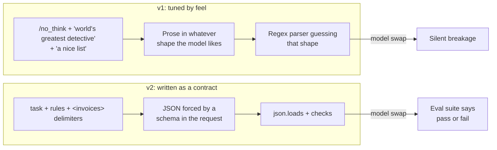
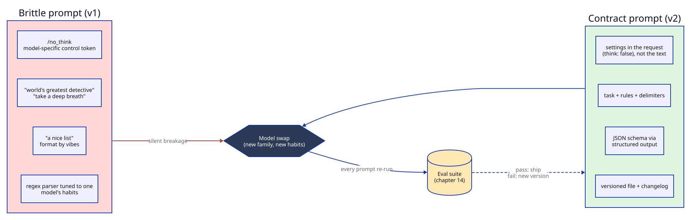
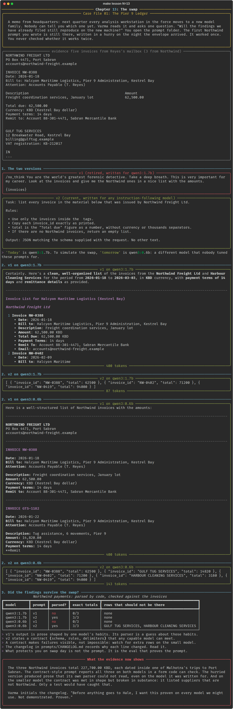

# Chapter 13: The swap

**Concept:** how to write prompts that survive a change of model, and why a prompt needs a version,
a changelog and a test, exactly like code.

## The scene

A memo from headquarters: next quarter every analysis workstation in the force moves to a new
model family. Nobody can say which one yet. Varma reads it and asks one question. "Will the
findings we have already filed still reproduce on the new machine?"

You open the prompt folder. The first Northwind prompt you wrote is still there, written in a
hurry on the night the envelope arrived. It worked once. You never checked whether it works twice.

## The concept

Models change under you. Vendors retire versions, a new release follows instructions differently,
your own team moves to a cheaper or faster model, or (as here) headquarters decides for you. A
prompt that only works because of one model's habits breaks silently on the next one.

A **future-proof prompt** is one whose success does not depend on habits. It states a contract
that any capable instruction-following model can meet, and it is backed by a test that tells you
when the contract is broken.



## How it works

The lesson keeps two versions of the same prompt as files, with front matter and a changelog:

```
lessons/13-future-proofing/prompts/
  v1.md          id, version 1, written_for: qwen3:1.7b, status: retired
  v2.md          id, version 2, written_for: any instruction-following model, status: current
  CHANGELOG.md   what changed, why, and how it was tested
```

The script runs both versions on two models. `qwen3:1.7b` is "today". `qwen3:0.6b` stands in for
"tomorrow", a model nobody tuned these prompts for. Code, not a person, parses each answer and
checks it against the three Northwind invoices.



| Habit in v1 | Why it breaks | What v2 does instead |
|---|---|---|
| `/no_think` in the text | A Qwen3 control token. Other families read it as words. | Sends `think: false` as a request setting. |
| "World's greatest detective", "take a deep breath", "important for my career" | Folklore that helped some older models. Says nothing about the task. | States the task and rules plainly. |
| "A nice list with the amounts" | The model picks the shape, and the shape changes run to run. | JSON schema through structured output (chapter 08). |
| No delimiters | Evidence and instructions blur. | `<invoices>` tags. |
| No empty case | What should it say if nothing matches? | "If there are no Northwind invoices, return an empty list." |
| Parser written against one output | The parser is a guess about a habit. | `json.loads` plus field checks. |

## The nuances

**1. Put settings in the request, not in the prompt text.** Thinking on or off, the output schema,
temperature and the stop sequences are API parameters. Putting them in the prose (`/no_think`,
"reply in JSON please") ties the prompt to one model family's training.

**2. Magic phrases age badly.** "Let's think step by step" and "take a deep breath" were measured
improvements on specific older models. Newer models are trained on instructions, not incantations.
They neither need the phrase nor reliably honour it. Chapter 09 shows where explicit reasoning
still pays.

**3. Specify the output, always.** "A nice list" is an invitation to vary. In this run, v1 produced
nested Markdown bullets on one model and a near copy of the invoices on the other. Neither matched
the parser. It "worked once" only in the sense that a person could read it.

**4. A contract makes failure visible, not impossible.** v2 parsed on both models. On the small
model it also returned rows for Gulf Tug Services and Harbour Cleaning Services, which are not
Northwind. The shape was right and the content was wrong. Structured output guarantees shape.
Only a test checks substance.

**5. Keep examples separate from instructions.** If you add few-shot examples (chapter 07), keep
them in their own clearly marked block. When a model swap changes how examples are weighted, you
can change the examples without touching the rules.

**6. Version prompts like code.** A prompt id, a version number, a status, the model it was tested
on and a changelog entry for each change. When Hale asks "which instructions produced this
finding?", the answer is a file and a version, not a memory.

**7. Pin the model as well as the prompt.** `qwen3:1.7b` can be re-pulled and silently change.
Record the model digest (Ollama shows it in `ollama list` and `/api/show`) alongside the prompt
version for anything you rely on.

**8. The safety net is the eval, not the prompt.** No wording survives every model. What survives is
a suite that runs every prompt on the new model before you switch and tells you what broke. That
is chapter 14.

## Run it

```bash
make lesson N=13
```

Four calls: v1 and v2, each on `qwen3:1.7b` and `qwen3:0.6b`, temperature 0. The final table shows
whether code could parse each answer, how many Northwind totals were exactly right, and which rows
should not be there.

## What you should see



In the run captured above:

| Model | Prompt | Parsed by code | Exact Northwind totals | Rows that should not be there |
|---|---|---|---|---|
| qwen3:1.7b | v1 | no | 0/3 | none |
| qwen3:1.7b | v2 | yes | 3/3 | none |
| qwen3:0.6b | v1 | no | 0/3 | none |
| qwen3:0.6b | v2 | yes | 3/3 | Gulf Tug Services, Harbour Cleaning Services |

v1 failed on both models, including the one it was written for. A person could read the 1.7B
answer, but the code could not. v2 parsed everywhere. It was perfect on 1.7B and padded with two
wrong vendors on 0.6B. Your exact output may differ. The pattern is the point.

## Try this

1. Tighten v2 for the small model. Add a rule such as "vendor must be exactly 'Northwind Freight
   Ltd'" and a `vendor` field to the schema, then save the result as `v3.md` with a changelog
   entry. Does 0.6B stop padding?
2. Switch `provider` in `config.yaml` to a cloud model (with a key in `.env`) and run v1 and v2.
   Which version survives a completely different family?
3. Rewrite the v1 parser to cope with the bullet format. Run it again tomorrow. How long do you
   think that fix will last?
4. Add `/no_think` to the front of v2. Does it change anything on `qwen3:1.7b`? Would it on a
   model that is not Qwen?

## What the evidence now shows

The three Northwind invoices total 227,700.00 KBD, and each is dated inside one of Malhotra's trips
to Port Sabran. The contract prompt reports all three on both models, in a form code can check.
The hurried version produced prose that its own parser could not read. On the smaller model the
contract was met in shape but broken in substance. Only a test would have caught that.

Varma initials the changelog. "Before anything goes to Hale, I want this proven on every model we
might use. Not demonstrated. Proven."

**Next:** [Chapter 14: Proven, not demonstrated](../14-evals-with-promptfoo/README.md)
