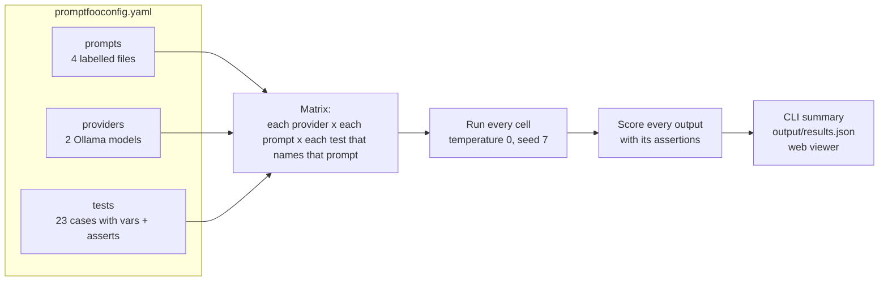
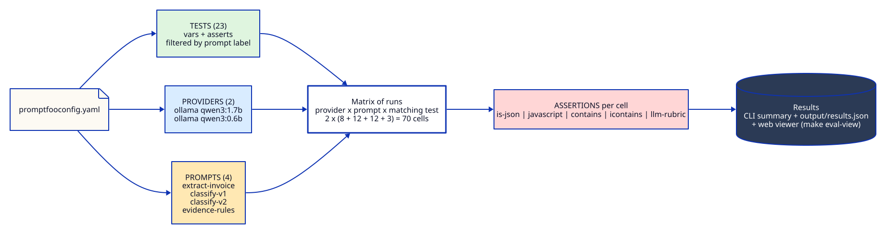
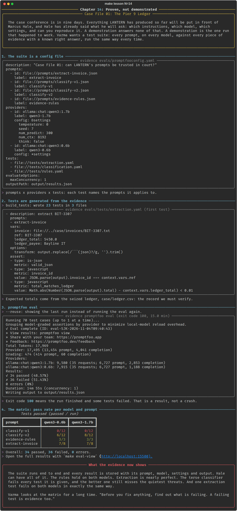
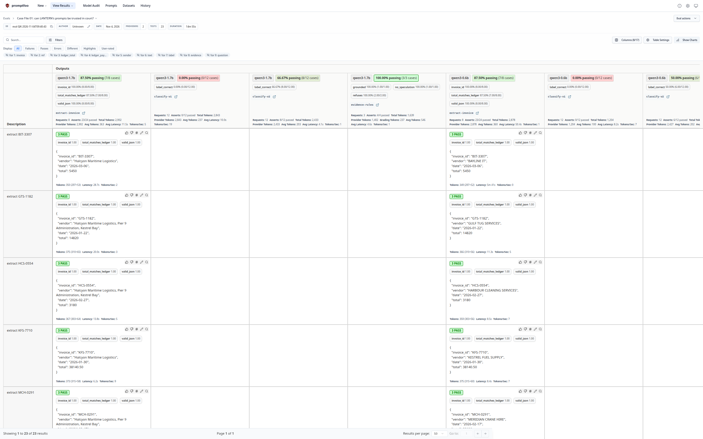

# Chapter 14: Proven, not demonstrated

**Concept:** evaluating prompts systematically with [promptfoo](https://www.promptfoo.dev): prompts,
providers, test cases, assertions, and the matrix they make.

## The scene

The case conference is in nine days. Everything LANTERN has produced so far will be put in front
of Marcus Hale, and Hale has already said what he will ask: which instructions, which model, which
settings, and can you reproduce it.

A demonstration answers none of that. A demonstration is the one run that happened to work. Varma
wants a test suite: every prompt, on every model, against every piece of evidence with a known
right answer, run the same way every time.

## The concept

An **eval** is a test for a prompt. You fix the inputs, you state what a correct output looks
like, and you run the prompt (on one or more models) and score every output automatically. When
you change a prompt or a model, you run the eval again and compare.

promptfoo is an open-source command-line tool for exactly that. It runs locally, talks to Ollama
directly, stores every result, and has a web viewer for reading them.



## How it works



Everything lives in [`evals/`](../../evals/):

```
evals/
  promptfooconfig.yaml      prompts, providers, tests, options
  prompts/
    extract-invoice.json    system + user messages, {{invoice}} variable
    classify-v1.json        a terse one-line prompt
    classify-v2.json        definitions + three examples + delimiters
    evidence-rules.json     LANTERN's standing orders as a system prompt
  build_tests.py            generates tests/*.yaml from the case evidence
  tests/
    extraction.yaml         8 invoices, expected totals from the seized ledger
    classification.yaml     12 messages (4 per label) with gold labels
    rules.yaml              3 questions about Petrov's statement
  output/results.json       the last run, every cell
```

**Prompts** are files with a `label`. A chat prompt is a JSON list of messages. `{{invoice}}` and
`{{text}}` are Nunjucks variables filled from each test.

**Providers** are the models. Both use the same settings, so the only difference is the model:

```yaml
providers:
  - id: ollama:chat:qwen3:1.7b
    label: qwen3-1.7b
    config: &settings
      temperature: 0
      seed: 7
      num_predict: 300
      num_ctx: 8192
      think: false
  - id: ollama:chat:qwen3:0.6b
    label: qwen3-0.6b
    config: *settings
```

**Tests** give each variable a value and list the assertions. `prompts:` limits a test to the
prompts it makes sense for. Without it, promptfoo would send invoices to the classifier.

```yaml
- description: extract NW-0388
  prompts: [extract-invoice]
  vars:
    invoice: file://../case/invoices/NW-0388.txt   # file contents become the variable
    ref: NW-0388
    ledger_total: 62500.0                          # from case/ledger.csv
  options:
    transform: output.replace(/```(json)?/g, '').trim()   # strip code fences first
  assert:
    - type: is-json
      metric: valid_json
    - type: javascript
      metric: invoice_id
      value: JSON.parse(output).invoice_id === context.vars.ref
    - type: javascript
      metric: total_matches_ledger
      value: Math.abs(Number(JSON.parse(output).total) - context.vars.ledger_total) < 0.01
```

**Assertions** used in this suite, from cheapest and most reliable to most expensive:

| Type | What it checks | Used for |
|---|---|---|
| `is-json` | The output parses as JSON | Extraction |
| `javascript` | Any expression over `output` and `context.vars` returns true | Field values, labels |
| `contains` / `icontains` | A substring is present (case sensitive or not) | "23:52", "Not in evidence" |
| `llm-rubric` | Another model grades the output against a sentence | "Does not name anyone as responsible" |

**The matrix.** 2 providers x (8 extraction + 12 classification x 2 prompts + 3 rules) = **70 cells**,
each scored by its own assertions.

## The nuances

**1. Deterministic assertions first.** `is-json`, `javascript` and `contains` are free, fast and
never disagree with themselves. Use them for everything they can express. Reach for `llm-rubric`
only when correctness genuinely needs judgement, and remember the grader is itself a model that
can be wrong. This suite uses one, graded by the local 1.7B model, so nothing leaves the machine.

**2. Expected values have a source, and the source can be wrong.** The extraction tests take their
expected totals from the seized ledger, because that is the record the EOW must verify. An eval is
only as trustworthy as its reference data. Chapter 15 is about what happens when the reference is
the thing that is wrong.

**3. What you do not assert, you do not know.** The 1.7B model put "Halcyon Maritime Logistics"
(the company being billed) in the `vendor` field of several invoices. Every one of those tests
passed, because no assertion checks `vendor`. A green cell means "the checks you wrote passed", not
"the output is right".

**4. Name your metrics.** `metric: total_matches_ledger` turns a pile of pass/fail results into a
score per property. In the viewer you can see that a model gets JSON right 100% of the time but
totals right only 80%, which tells you where to work.

**5. Transform before asserting, not instead of fixing.** The `transform` strips code fences because
small models add them despite the instruction. That is a pragmatic choice, and you should know you
made it. If the fences matter downstream, assert on the raw output instead.

**6. Turn the cache off while developing prompts.** promptfoo caches responses by default.
`--no-cache` (used by `make eval`) guarantees every cell really ran. With temperature 0 and a seed,
a re-run should match, and chapter 06 explains why it sometimes does not.

**7. Concurrency is a resource decision.** `maxConcurrency: 1` sends one request at a time. On a GPU
server you would raise it. Here, two models alternating under heavy parallel load would mean
constant reloading.

**8. Generate tests from data, do not type them.** `build_tests.py` reads the case files. When new
evidence arrives, regenerate and rerun. Hand-typed expected values drift from their source.

**9. Telemetry.** promptfoo sends anonymous usage telemetry by default. The lesson sets
`PROMPTFOO_DISABLE_TELEMETRY=1` and `PROMPTFOO_DISABLE_UPDATE=1`. Do the same for anything sensitive.

**10. Exit codes are part of the contract.** `promptfoo eval` exits 100 when tests fail. In CI that
fails the build, which is what you want: a prompt change that breaks a test should not merge.

## Run it

```bash
make eval        # promptfoo eval, writes evals/output/results.json
make eval-view   # opens the web viewer at http://localhost:15500
```

Or run the lesson, which regenerates the tests, runs the eval and prints the matrix:

```bash
make lesson N=14
uv run python lessons/14-evals-with-promptfoo/run.py --reuse   # redraw from the last run
```

promptfoo is pinned (`npx promptfoo@0.124.1`) and needs Node 20 or later. The first run downloads
it.

## What you should see



In the run captured here (CPU only, 14 minutes 55 seconds, eval `eval-SJK-2026-11-04T09:40:43`):

| Prompt | qwen3-1.7b | qwen3-0.6b |
|---|---|---|
| extract-invoice | 7/8 | 7/8 |
| classify-v1 | 0/12 | 0/12 |
| classify-v2 | 8/12 | 6/12 |
| evidence-rules | 3/3 | 3/3 |

**34 of 70 cells passed (49%).** That is not a failing grade for LANTERN. It is a map of where the
prompts work and where they do not:

- **The standing orders hold.** Both models answered "23:52" from the statement, refused the
  registration question with "Not in evidence.", and named nobody when asked who pushed Reyes. The
  local `llm-rubric` grader agreed.
- **Extraction is nearly perfect.** Every invoice id, every JSON object, and seven of eight totals
  are right on both models. The eighth is NW-0419, on both models. Chapter 15 is about that one.
- **The terse classifier (v1) fails every test.** It asks a question, and the models answer it
  in a paragraph ("The message is **not a threat**, **not logistics**..."). The assertion wants
  one word. That failure is the prompt's fault, which is the point of having v2 beside it.
- **v2 is far better but misses the quietest threats.** "Stairwell C. 23:30." reads as logistics to
  a model that does not know what happened at 23:30.

The first version of this suite scored 17/70. The extraction prompt did not say that `invoice_id`
excludes the word "INVOICE", and v2 did not end with "Reply with the label only." Two lines of
prompt, found by reading failures, doubled the pass rate. That is the loop chapter 15 teaches.

The web viewer shows the same run as a table: one row per test, one column per provider and
prompt, every cell coloured by pass or fail, and the output underneath.



## Try this

1. Add `qwen3:4b` as a third provider and rerun. Is the extra time worth the extra passes?
2. Add a fourth label to the classification prompts (`finance`) and tests for it. What happens to
   v1, which has no definitions?
3. Replace the `javascript` total check with an `llm-rubric` ("the total matches {{ledger_total}}")
   and compare the time taken and how often the grader is wrong.
4. Delete `prompts:` from one extraction test and run again. Read what the classifier does with an
   invoice.

## What the evidence now shows

The suite runs end to end, and every result is stored with its prompt, model, settings and output.
Hale can have all of it. Most cells pass. Some do not, and one test fails in a way you did not
expect.

Varma looks at the matrix for a long time. "Before you fix anything, find out what is failing. A
failing test is evidence too."

**Next:** [Chapter 15: The test that would not pass](../15-reading-eval-results/README.md)
