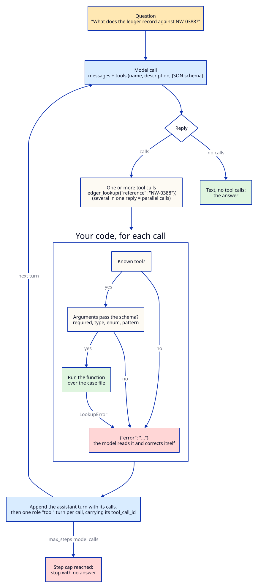
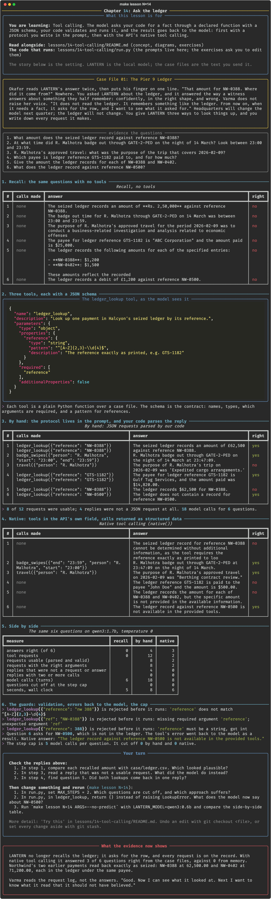

# Chapter 14: Ask the ledger

**Concept:** tool calling. The model asks your code for a fact through a declared function with a
JSON schema, your code validates and runs it, and the result goes back to the model: first with a
protocol you write in the prompt, then with the API's native tool calling.

## The scene

Okafor reads LANTERN's answer twice, then puts his finger on one line. "That amount for NW-0388.
Where did it come from?" Nowhere. You asked LANTERN about the ledger, and it answered the way a
witness answers about something they half remember: confidently, in the right shape, and wrong.

Varma does not raise her voice. "It does not read the ledger. It remembers something like the
ledger. From now on, when it needs a fact, it asks for the row, and I want to see what it asked
for."

Headquarters will change the model next quarter; the ledger will not change. You give LANTERN
three ways to look things up, and you write down every request it makes.

## The concept

A model cannot read a file, query a database or check a clock. It can only write text. **Tool
calling** turns that limit into a protocol: you describe functions to the model (a name, a
description, a JSON schema for the arguments), the model replies with a request to call one, your
code runs it, and the result goes back into the conversation for the next turn.

The model never runs anything. It asks. Your code decides whether the request is well formed,
whether to run it, and what to send back. That split is the whole design, and every safeguard in
this chapter and the next lives on your side of it.

There are two ways to build the protocol:

| | By hand | Native |
|---|---|---|
| Where the tools are described | In the system prompt, as text | In the API's `tools` field |
| How a call comes back | JSON somewhere in the reply text, which you find and parse | A structured `tool_calls` list, separate from the text |
| Several calls at once | Only if your prompt and parser allow it | A reply can carry several, each with an id |
| How the result goes back | A user turn you format | A `tool` turn carrying the call's id |
| What the model was trained on | Your format, never | The provider's format |

Teams use native tool calling: Ollama's `tools` field here, and on the hosted tier Anthropic's
`tool_use` and `tool_result` blocks. Building it by hand first shows what the native version does
for you, and the chapter measures the difference on the same questions.

## How it works



Each tool is a plain function over a case file, with a schema:

```python
def ledger_lookup(reference: str) -> dict:
    for row in LEDGER:
        if row["reference"] == reference.strip().upper():
            return {k: row[k] for k in ("date", "payee", "description", "amount_kbd", "reference")}
    raise LookupError(f"no ledger row with reference {reference}")

TOOLS = [{"name": "ledger_lookup",
          "description": "Look up one payment in Halcyon's seized ledger by its reference.",
          "parameters": {"type": "object",
                         "properties": {"reference": {"type": "string",
                                                      "pattern": r"^[A-Z]{2,3}-\d{4}$"}},
                         "required": ["reference"], "additionalProperties": False}}]
```

The native loop, in full (`native()` in [run.py](run.py)):

```python
for turn in range(1, max_steps + 1):              # the step cap
    r = chat(messages, tools=tools)
    if not r.tool_calls:
        return r.text                              # no calls: this is the answer
    messages.append({"role": "assistant", "content": r.text,
                     "tool_calls": [{"id": i, "function": {"name": c.name,
                                                           "arguments": c.arguments}} ...]})
    for call_id, c in zip(ids, r.tool_calls):
        if c.name not in functions:      result = {"error": f"no tool named {c.name!r}"}
        elif problems := validate(c.arguments, schemas[c.name]):
                                         result = {"error": "invalid arguments: ..."}
        else:
            fn = functions[c.name]
            try:                         result = fn(**c.arguments)
            except LookupError as e:     result = {"error": str(e)}
        messages.append({"role": "tool", "tool_call_id": call_id, "content": json.dumps(result)})
```

The hand-built version puts the schemas in the system prompt and asks for
`{"tool": ..., "arguments": ...}` or `{"answer": ...}` as the whole reply, one tool per reply.
`first_json()` finds the first JSON object in whatever comes back; anything else is a parse
failure, and the loop tells the model so and tries again.

The run asks six questions about the case files three ways, at temperature 0: from memory with no
tools, with the hand-built protocol, and with native tool calling.

## The nuances

NUANCES

## Run it

```bash
make lesson N=14
make lesson N=14 ARGS=--mine     # the native step on your own run_tools (see Master it)
```

RUNTIME

## What you should see



SEE

## On a hosted model

```bash
make lesson N=14 TIER=hosted     # needs ANTHROPIC_API_KEY in .env
make lesson N=14 TIER=hosted REPLAY=1   # from a recorded run, once one is committed
```

The native step uses Anthropic's native tool use: each tool becomes a `tools` entry with an
`input_schema`, each call comes back as a `tool_use` block with an id, and each result goes back
as a `tool_result` block carrying that id (see `anthropic_request` in `src/lantern/cloud.py`).
The hand-built step sends the same prompt protocol as text. Claude does not take `temperature`
(current models reject sampling settings) or `seed`, so the run's `temperature=0` is not sent and
is reported once on the console; repeated hosted runs may differ.

HOSTED

## Try this

1. Set `MAX_STEPS = 2` in run.py. Which questions are cut off, and which approach suffers more?
2. In `ledger_lookup`, return `{}` instead of raising `LookupError`. What does LANTERN now say
   about NW-0500?
3. Delete the `pattern` from the `reference` schema and ask question 1 with "nw 388" written in
   lower case. Does the call still reach the ledger, and does it find the row?
4. Run with `LANTERN_MODEL=qwen3:0.6b` and with `LANTERN_MODEL=qwen3:4b`. Which approach holds up
   on the small model?

## Master it

After this chapter you can follow a tool call message by message, write the tool loop with
validation, errors returned to the model and a step cap, and measure a hand-built protocol
against native tool calling.

**Predict, then see.** `make lesson N=14` stops four times to ask: how many questions LANTERN
gets right from memory, how many hand-written requests are usable, how native tool calling fetches
two rows at once, and how many model calls the native run needs. Each answer is checked against
your own run. Add `ARGS=--no-predict` to watch without stopping.

**Build it.** Write `validate()` and `run_tools()` in
[`practice/exercise.py`](practice/exercise.py): the whole loop the native step runs.

```bash
make exercise N=14             # 8 offline tests, scripted model, no Ollama needed
make hint N=14                 # one hint at a time
make solution N=14             # the reference, once you have tried
make lesson N=14 ARGS=--mine   # the six questions through your run_tools()
```

**Check yourself.** `make quiz N=14`: six questions, each with the reason behind the answer.

**Break it.** `make challenge N=14` checks your latest run against three targets: your loop
answering five of six natively; a tool that hides "not found", so LANTERN invents an amount for
NW-0500; and a hand-built protocol with parallel requests that needs no more turns than native.

`make progress` shows every chapter.

## What the evidence now shows

EVIDENCE

**Next:** [Chapter 15: The note in the margin](../15-prompt-injection/README.md)
