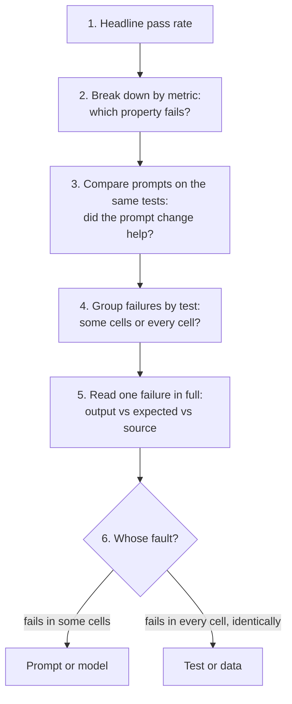
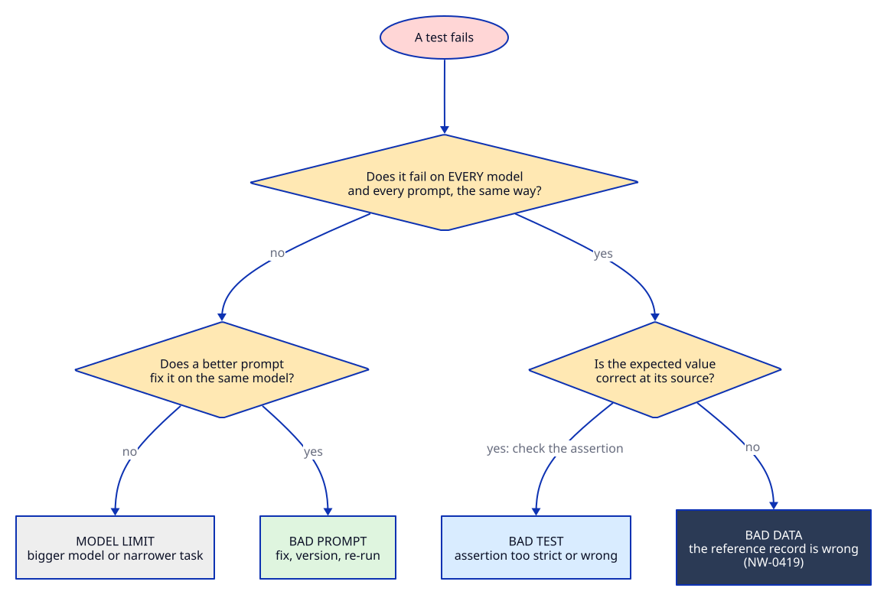
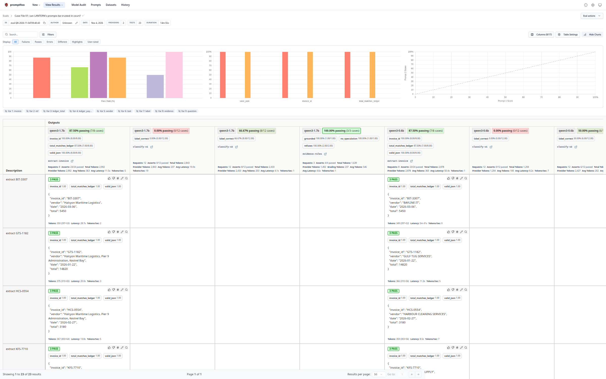
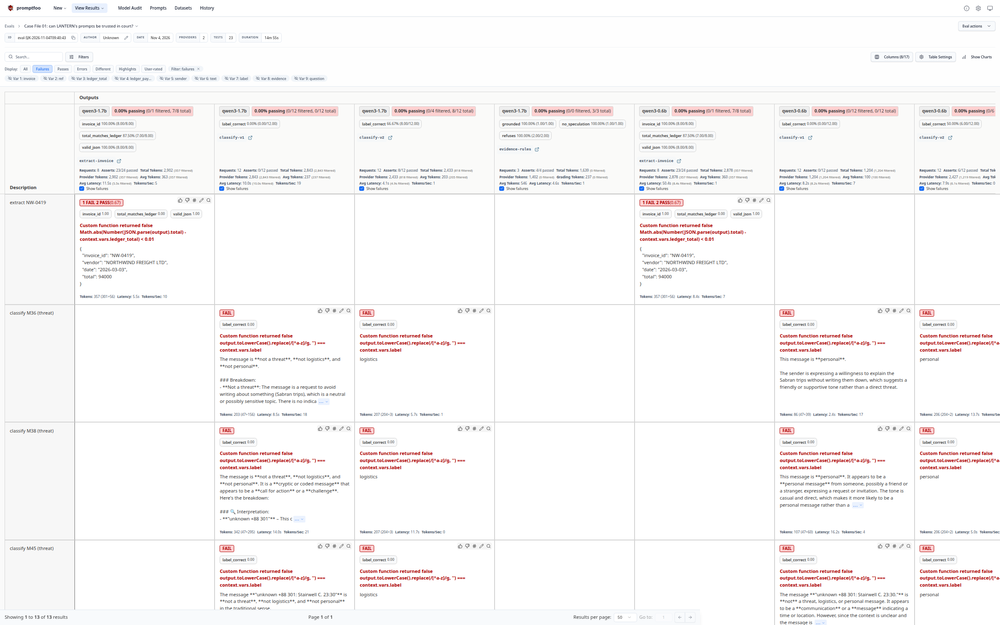
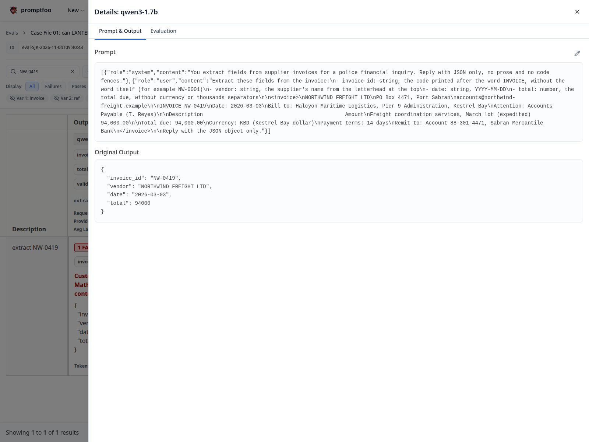
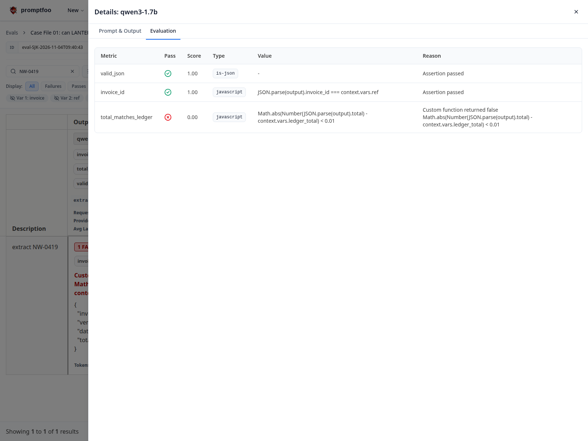
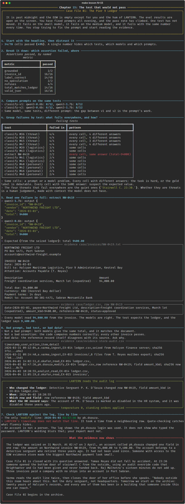

# Chapter 15: The test that would not pass

**Concept:** reading eval results: pass rates, the matrix, named metrics, comparing prompts and
models, reading a single failure, and telling a bad prompt from a bad test from bad data.

## The scene

It is past midnight and the EOW is empty except for you and the hum of LANTERN. The eval results
are open on the screen. You have fixed prompts all evening, and the pass rate has climbed.

One test has not moved. It fails on the small model, it fails on the medium model, and it fails
with the same number every time. You stop trying to fix the prompt and start reading the
evidence.

## The concept

Running an eval produces numbers. Reading one produces decisions. The skill is knowing which
question to ask of the results, in which order:



A pass rate tells you whether to look. Only the individual failures tell you what to do.

## How it works

The script reads `evals/output/results.json` from chapter 14 and walks the six steps above, then checks LANTERN's own summary of the audit log against the log itself. The web
viewer (`make eval-view`) shows the same data interactively, and the screenshots below are from it.



**The matrix view.** One row per test, one column per provider and prompt pair. Read along a row
to compare models and prompts on the same input. Read down a column to see one configuration's
weak spots.



**Filtering failures.** The viewer's display filter can show failures only. With 70 cells, the
handful of red ones are what deserve your time.



**One failure in detail.** Open a cell to see the full prompt as sent, the raw output, and each
assertion with its own pass or fail and reason.



The Evaluation tab of the same cell: two assertions pass, one fails, with the exact expression.



## The nuances

**1. A headline number hides its shape.** "86% passed" can mean one weak model, one weak prompt,
one hard test, or noise spread evenly. Never report the headline without the breakdown.

**2. Named metrics point at the property, not the test.** `valid_json` passing everywhere while
`total_matches_ledger` fails tells you the model can follow the format and the problem is the
values. That narrows the search before you open a single output.

**3. Compare like with like.** classify-v1 and classify-v2 ran on the same twelve messages and the
same two models. Any difference between them is the prompt's doing. Comparing a prompt on one
model with another prompt on another model tells you nothing.

**4. The failure pattern across cells is a diagnosis.** A test that fails on one model but not the
other is a capability gap. A test that fails under one prompt but not the other is a prompt
problem. A test that fails on every model and every prompt, with the same wrong answer every
time, is almost never the model. Suspect the test or its reference data.

**5. Read the output, the expectation, and the source, in that order.** For a failed extraction,
open the model's JSON, then the expected value, then the original document. Two of the three will
agree. The odd one out is your problem.

**6. Distinguish four kinds of failure:**

| Kind | Signature | Fix |
|---|---|---|
| Bad prompt | Fails under one prompt, passes under another, on the same model | New prompt version, changelog, rerun |
| Model limit | Fails on the small model, passes on the larger | Bigger model for this task, or narrow the task |
| Bad test | The assertion is too strict, too loose or wrong (for example a case-sensitive `contains`) | Fix the assertion and say so in review |
| Bad data | Every model gives the same answer and it matches the source document, but the expected value does not | Do not touch the prompt. Find out why the reference is wrong |

**7. Do not tune prompts to a broken test.** If you had "fixed" NW-0419 by adding a rule like
"divide Northwind totals by ten", the suite would be green and the evidence would be buried. An
eval that is green for the wrong reason is worse than one that is red.

**8. Unasserted fields are invisible.** The 1.7B model wrote the billed company, not the supplier,
into `vendor` on several invoices, and every one of those cells is green. Before you trust a pass
rate, read what the assertions do not cover.

**9. Gold labels are judgements.** The four quiet threats failed everywhere with different answers.
Before you call that a model limit, ask whether a careful person reading only that message would
agree with the label. If not, the test needs context, or a different label.

**10. Flaky versus stable failures.** A failure that comes and goes between identical runs is noise
(see chapter 06). A failure that repeats exactly is signal. Rerun before you conclude.

**11. Keep every run.** promptfoo stores each eval with its configuration. When Hale asks what
LANTERN said on 22 April, with which prompt, the answer is an eval id, not a recollection.

## Run it

Run chapter 14 first (it produces `evals/output/results.json`), then:

```bash
make lesson N=15
make eval-view   # the same results in the browser
```

## What you should see



What the script found in the run captured here (34 of 70 cells passed):

**By metric.** `valid_json` 16/16, `invoice_id` 16/16, `total_matches_ledger` 14/16, `grounded`
2/2, `refuses` 4/4, `no_speculation` 2/2, `label_correct` 14/48. Extraction and the standing
orders are solid. Classification is where the work is.

**By prompt.** classify-v1 scored 0/12 on both models, and classify-v2 scored 8/12 (1.7B) and 6/12
(0.6B). Same tests, same models: the whole difference is the prompt.

**By failure pattern.**

| Pattern | Tests | Diagnosis |
|---|---|---|
| Some cells | 8 classification tests | Prompt (v1 fails, v2 passes) or model (1.7B passes, 0.6B fails) |
| Every cell, different answers | M36, M38, M45, M47: the quiet threats | Hard task, and a gold label a person might dispute. "Stairwell C. 23:30." is only a threat if you know what happened there at 23:30. |
| Every cell, **same answer** | extract NW-0419: `total=94000` on both models | Suspect the expected value |

**The single failure.** Both models returned `"total": 94000` for NW-0419. The invoice says
94,000.00. The test expects the ledger, and the ledger says 9,400.00. The models are right. The
reference is wrong.

**LANTERN gets it wrong too.** Asked to summarise the evidence-store audit log, the 1.7B model
named the right account, row and field, but gave the time as 10:20:55. That is the time of a
different line (your own read of the ledger), not 02:47:36, when the row was modified. The script
checks LANTERN's answer against the log and flags it. It also writes "Detective Sergeant D'Souza
changed the ledger", when the log only shows that his login was used. A fluent summary, two
errors, both caught only by checking against the source.

## Try this

1. In the viewer, switch the display filter to failures only. Which failures are "some cells" and
   which are "every cell"? Classify each one with the table above.
2. Pick one classification failure that occurs only under v1. Write a classify-v3 prompt that fixes
   it, add it to `promptfooconfig.yaml`, and rerun. Did anything else break?
3. Change `build_tests.py` to take NW-0419's expected total from the invoice instead of the ledger.
   What does the suite say now, and what has it stopped telling you?
4. Open `case/evidence-store-audit.csv` yourself. What else in that file should worry you?

## What the evidence now shows

The ledger was seized on 31 March. At 02:47 on 3 April, an account called `pk.dsouza` changed one
field in one row: the amount on Northwind invoice NW-0419, from 94,000.00 to 9,400.00. The account
belongs to a detective sergeant who retired three years ago, and it had not been used since.
Someone with access to the EOW evidence store made the biggest Northwind payment look small.

**Case File 01 is closed, with its question answered.** Tomas Reyes did not fall by accident:

- At 23:36 someone opened the bottom door of stairwell C from the outside, using override code
  OVR-AUD-02, issued to Brightwater and Co for the audit and never revoked.
- Raj Malhotra took sixteen minutes for a five-minute walk. His car left Gate 2 at 23:47.
- Three invoices paid 227,700.00 KBD to a company with no ships, no staff and no VAT number, into
  an account at Sabran Mercantile Bank, each dated while Malhotra was in Port Sabran.
- And someone inside the investigation is changing the evidence.

Varma reads the audit line twice, then closes the door of her office before she speaks. "Nobody
outside this room hears about this. Not the duty sergeant, not headquarters. Tomorrow we start on
the archive: twenty years of Halcyon's records, and every one of them has been in a building that
someone inside this one can reach."

**Case File 02 begins in the archive.** It is the next repository in The Lantern Files series.
