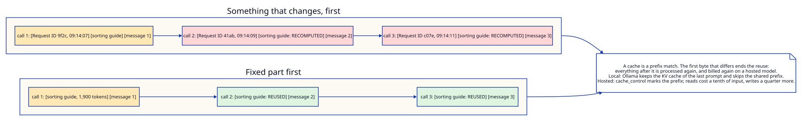
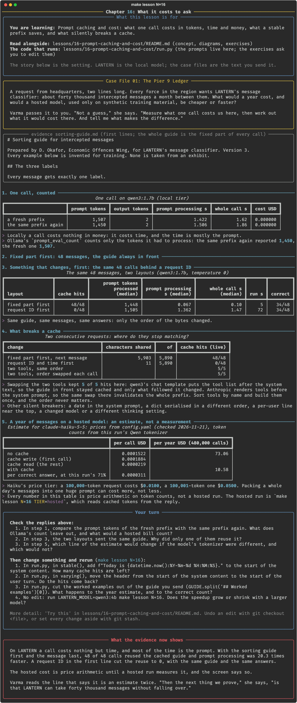

# Chapter 16: What it costs to ask

**Concept:** prompt caching and cost: what one call costs in tokens, time and money, what a
stable prefix saves, and what silently breaks a cache.

## The scene

A request from headquarters, two lines long. Every force in the region wants LANTERN's message
classifier: about forty thousand intercepted messages a month between them. What would a year
cost, and would a hosted model, used only on synthetic training material, be cheaper or faster?

Varma passes it to you. "Not a guess," she says. "Measure what one call costs us here, then work
out what it would cost there. And tell me what makes the difference."

The classifier's standing instructions are Okafor's sorting guide,
[`case/sorting-guide.md`](../../case/sorting-guide.md): three labels, eight rules and thirty
worked examples, all invented for training. The messages are the 48 from Reyes's phone,
[`case/messages.jsonl`](../../case/messages.jsonl), with Okafor's labels.

## The concept

A call to a model is paid for in **tokens**. On a hosted model the bill is input tokens times the
input price plus output tokens times the output price; on LANTERN the bill is time, and most of
that time is spent reading the prompt. A classifier sends the same long instructions with every
message, so almost every token of every call is a token it has sent before.

A **prompt cache** stops paying for that again. The model's work on a prompt (the key and value
vectors for each token, the KV cache) depends only on the tokens before it. If a new prompt starts
with exactly the same tokens as an earlier one, that work can be reused, and only the new tail
has to be processed.



Three ideas follow, and the chapter measures each:

| Idea | What it means | What the run measures |
|---|---|---|
| Cost per call | Tokens in and out, times price; locally, seconds | One call, counted (step 1) |
| Prefix stability | The cache is a prefix match: the first byte that differs ends the reuse | Fixed part first against a request ID first (steps 2 and 3) |
| Cost per correct answer | What you pay divided by what you got right | The estimate in step 5 |

## How it works

**Locally.** Ollama's runner keeps the KV cache of the last prompt it processed. When the next
request starts with the same tokens, it skips them and processes only the rest. Nothing has to be
switched on, and `chat(..., cache=True)` is ignored. Two numbers on every `Reply` show it:

- `prompt_seconds`: Ollama's own prompt processing time (`prompt_eval_duration`);
- `seconds`: the whole call on the wall clock, including model load, prompt processing and
  generation.

**Hosted.** Anthropic caches only when asked. `chat(..., cache=True)` adds a top-level
`cache_control: {"type": "ephemeral"}` to the request (`anthropic_request` in
`src/lantern/cloud.py`): automatic caching of the longest prefix, kept for five minutes and
refreshed by every read. The reply says what happened, and `Reply` carries it:

```python
r = chat([{"role": "system", "content": GUIDE}, {"role": "user", "content": msg}], cache=True)
r.prompt_tokens        # every input token, cached or not
r.cache_write_tokens   # written to the cache on this call (billed at cache_write)
r.cached_tokens        # read from the cache on this call (billed at cache_read)
r.cost_usd             # llm.cost_of(r), from config.yaml `prices:`
```

The prices are in `config.yaml`, copied from the provider's price page and checked on
21 November 2026. For `claude-haiku-5-5`, in USD per million tokens: input 0.10, cache write
0.125, cache read 0.01, output 0.50, and every price five times higher for a request above
100,000 prompt tokens. `llm.cost_of` applies them.

## The nuances

**1. Locally, the cost is time, and the time is the prompt.** NUANCE1

**2. A cache is a prefix match.** NUANCE2

**3. Ollama counts what it processed, not what you sent.** NUANCE3

**4. What breaks a cache.** Anything early in the prompt that changes between calls: a timestamp
or request ID in the system prompt, a per-user line near the top, a dictionary serialised in a
different order, a tool list built from a set. Tools come first in the rendered prompt on both
Ollama and Anthropic, so reordering them changes the very first bytes. NUANCE4 Changing the model
or the thinking setting also starts a new cache: caches belong to one model.

**5. Cost per correct answer, not cost per call.** A cheaper call that is wrong more often is not
cheaper. Divide what a run costs by how many answers were right. NUANCE5

**6. The long-prompt tier.** Packing many messages into one prompt saves the repeated guide, but
Haiku bills a request above 100,000 prompt tokens at five times the price, for the whole request.
In step 5, a 100,000-token request is priced at NUANCE6

**7. An estimate is not a measurement.** Step 5 prices the hosted model with Qwen's token counts.
Claude's tokenizer splits the same text differently, so the numbers are for the order of
magnitude and for comparing layouts. They say "estimate" on the screen and here. The hosted run
reads the real counts, cache reads and writes included, from the reply.

**8. Hosted caches have a floor and a lifetime.** A prefix shorter than the model's minimum
cacheable length is not cached at all, silently: `cache_write_tokens` stays 0. The sorting guide
is well above it. An entry lives five minutes from its last use, so a steady stream of calls
keeps it warm and a batch run once a day pays the write again each time.

## Run it

```bash
make lesson N=16
```

About 110 local calls on `qwen3:1.7b`: one counted call, 48 messages in each layout, and 12 calls
with tools. RUNTIME

## What you should see



SEE

## On a hosted model

```bash
make lesson N=16 TIER=hosted            # needs ANTHROPIC_API_KEY in .env
make lesson N=16 TIER=hosted REPLAY=1   # from a recorded run, once one is committed
```

The hosted path uses Anthropic's native prompt caching: `cache=True` sends top-level
`cache_control` (automatic caching of the longest prefix, five-minute lifetime), and the chapter
counts a cache hit from `cache_read_input_tokens` in the reply, not from timing. Claude does not
take `temperature`, `top_k`, `top_p` or `seed`, so the run's `temperature=0` is not sent and is
reported once on the console. Ollama's `prompt_seconds` has no hosted equivalent and shows as
"not reported".

HOSTED

## Try this

1. In `stable()`, put `f"Today is {datetime.now():%Y-%m-%d %H:%M:%S}."` at the start of the system
   content. How many cache hits are left?
2. In `varying()`, move the header from the system content to the start of the user turn. Do the
   hits come back, and does the request ID still reach the model?
3. Send only the rules: `GUIDE.split("## Worked examples")[0]`. What happens to the year estimate,
   and to the correct count? Work out the cost per correct answer for both.
4. Run with `LANTERN_MODEL=qwen3:4b`. Does the speedup grow or shrink with a larger model?

## Master it

After this chapter you can count what a call costs, lay out a prompt so its fixed part is reused,
find what breaks a cache before it reaches the bill, and price a run from its usage, labelled as
an estimate when it is one.

**Predict, then see.** `make lesson N=16` stops four times to ask: how many prompt tokens one
call carries, how much faster prompt processing is with the guide cached, how many calls reuse
the cache when a request ID comes first, and what share of the uncached cost a cached year would
be. Each answer is checked against your own run. Add `ARGS=--no-predict` to watch without
stopping.

**Build it.** Write `run_cost()` and `cache_breakers()` in
[`practice/exercise.py`](practice/exercise.py): the cost of a run from call-log records and a
price table, cache reads, writes and the long-prompt tier included, and a check that finds what in
a prompt would break its cache.

```bash
make exercise N=16          # 9 offline tests, no model needed
make hint N=16              # one hint at a time
make solution N=16          # the reference, once you have tried
```

**Check yourself.** `make quiz N=16`: six questions, each with the reason behind the answer.

**Break it.** `make challenge N=16` checks your latest run against two targets: a date at the top
of the stable layout, so it misses its cache; and the request ID kept on every call, moved so the
guide is reused again.

`make progress` shows every chapter.

## What the evidence now shows

EVIDENCE

**Next:** [Chapter 17: Forty thousand messages](../17-reliable-calls-at-scale/README.md)
