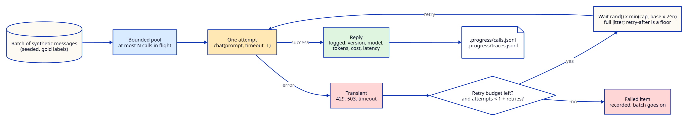
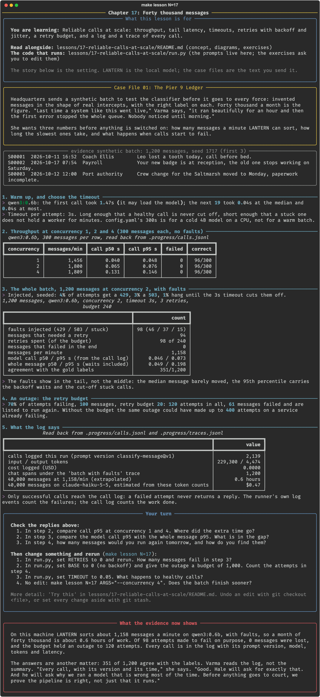

# Chapter 17: Forty thousand messages

**Concept:** reliable calls at scale: throughput, tail latency, timeouts, retries with backoff
and jitter, a retry budget, and a log and a trace of every call.

## The scene

Headquarters sends a synthetic batch to test the classifier before it goes to every force:
invented messages in the shape of real intercepts, with the right label on each. Forty thousand
a month is the figure. "Last time a system like this went live," Varma says, "it ran beautifully
for an hour and then the first error stopped the whole queue. Nobody noticed until morning."

She wants three numbers before anything is switched on: how many messages a minute LANTERN can
sort, how long the slowest ones take, and what happens when calls start to fail.

The batch is made by [`generate.py`](generate.py), seeded, so every run sorts the same messages.

## The concept

Forty-eight messages hide every problem this chapter is about. At a few thousand, the problems
are the point:

- **Throughput**: messages per minute. It decides whether a month's work takes an afternoon or a
  week.
- **Tail latency**: the 95th percentile (p95), the time that 95 messages in 100 finish within.
  The median says what a typical message costs; the tail says what the queue behind it feels.
- **Failures**: at scale, some calls fail. A rate limit (HTTP 429), an overloaded server (503), a
  call that never answers. One unhandled failure must not stop the batch, and a thousand retries
  must not turn a short outage into a long one.



The runner in the diagram is the chapter's exercise. Five parts, each answering one failure:

| Part | Without it |
|---|---|
| Bounded concurrency | Either one call at a time, or as many as the server will queue |
| A timeout per attempt | One stuck call holds a worker for minutes |
| Retries on `Transient` only | A blip fails a message; or a bad request is sent again and again |
| Exponential backoff with full jitter | Every worker that failed together retries together |
| A retry budget for the batch | An outage multiplies the load on the service that is failing |

## How it works

**The batch.** `generate.messages(n)` fills thirty templates (logistics, personal, threat) with
seeded details: ships, piers, invoice numbers, days. Each message has a gold label, so the batch
also measures agreement.

**One attempt.** `chat(..., retries=0, timeout=3)`: the runner owns retries, so the client's own
are off. `lantern.chat` measures every call on the wall clock, logs it to `.progress/calls.jsonl`
with its prompt version (`classify-message@v1`), model, tokens, cost and latency
(`lantern.calllog`), and traces it as an OpenTelemetry span with GenAI attributes in
`.progress/traces.jsonl` (`lantern.trace`).

**Retries.** `lantern.retry.backoff(n, base, cap)` is full jitter: a random wait between 0 and
`min(cap, base * 2**n)`. With `base=0.25` and `cap=4`, the first retry waits up to 0.25 s, the
third up to 1 s. A `retry-after` hint from the provider is a floor on the wait.

**Faults, on purpose.** `Faults` wraps the model call. For a seeded share of attempts it raises
`Transient("HTTP 429")` or `Transient("HTTP 503")` instead of calling the model, or it hangs until
the timeout and then fails, as httpx does when a server never answers. The draw depends only on
the message and the attempt number, so every run injects the same faults.

**Reading it back.** Each batch runs inside `trace.span(...)`. Worker threads do not inherit the
trace context, so the chapter carries it over (`in_this_trace`) and each chat span nests under its
batch. The numbers in steps 2, 3 and 5 are read back from the call log, not kept in memory: the
log is what an operator would have.

```python
results = run_batch(batch, chat=faulty, prompt=prompt, concurrency=2, timeout=3.0,
                    retries=3, base=0.25, cap=4.0, retry_budget=len(batch) // 5)
```

## The nuances

**1. Concurrency helps only up to the server's parallelism.** One call at a time sorted 1,431
messages a minute; two at a time 1,761; four at a time 1,772. Past two, the extra workers only
waited: Ollama runs a fixed number of requests at once and queues the rest, so the median call got
slower (0.040 s, then 0.066 s, then 0.135 s) while throughput stayed flat. Measure where the curve
bends before you size a worker pool.

**2. Report the tail.** In the faulted batch the median message took 0.050 s, almost the same as
with no faults. The 95th percentile took 0.157 s: that is where the backoff waits and the cut-off
stuck calls went. A dashboard that shows only the median shows a healthy service during an
incident.

**3. Retry only what can succeed next time.** A 429, a 5xx, a timeout or a dropped connection may
succeed a moment later. A 400 (a schema the provider rejects, a prompt too long) fails the same
way every time; retrying it burns quota. `lantern.retry.Transient` marks the first kind, and the
runner fails the second at once.

**4. Jitter is what makes backoff work.** Plain exponential backoff sends every client that failed
together back together: 1 s, 2 s, 4 s, in step, and the second wave fails like the first. Full
jitter waits a random time between zero and the exponential cap, which spreads the retries out.
A provider's `retry-after` is a floor on that wait, never ignored.

**5. A budget turns an outage into a list.** With 70% of attempts failing and a budget of 20
retries for 100 messages, the batch made 120 attempts and listed 60 messages to run again. Without
the budget the same outage could have made up to 400 attempts against a service that was already
failing. Retries are load; a budget caps it.

**6. Set the timeout from the measured tail.** Warm, qwen3:0.6b answered in 0.04 s at the median
and at most; its first call took 1.76 s because it loaded the model. The batch uses 3 s per
attempt: well above any healthy call, so none is cut off, and short enough that a stuck one frees
its worker in seconds. `config.yaml`'s 300 s is for a cold 4B model on a CPU, not a warm batch.

**7. Only successful calls reach the call log.** A failed attempt never produces a reply, so the
call log counts the work done and the runner's own events count the failures. Read both. Every
logged call carries its prompt version, so a change of prompt shows up as a new version in the
log, not as a mystery in the numbers.

**8. Fast is not the same as right.** At this scale the plumbing held: 98 injected faults, 0
messages lost. The classifier did not: qwen3:0.6b agreed with the gold labels on 351 of 1,200
messages (29%), no better than guessing among three labels, because it calls most messages a
threat. A throughput number is only worth having for a model whose answers you have already
measured (chapter 12). And extrapolate with care: 1,177 a minute makes forty thousand messages
about 0.6 hours, if nothing else on the machine changes.

## Run it

```bash
make lesson N=17                          # the full run
make lesson N=17 ARGS="--batch 200"       # a quick run
make lesson N=17 ARGS="--concurrency 4"   # the main batch at another concurrency
make lesson N=17 ARGS=--mine              # on the runner you wrote
```

About 2,100 model calls on `qwen3:0.6b`. About eight minutes on an Apple M1 Pro with 16 GB.

## What you should see



A real run on `qwen3:0.6b`, local tier, Apple M1 Pro 16 GB, 1,200 synthetic messages, seed 1717:

| concurrency (300 messages, no faults) | messages per minute | call p50 s | call p95 s |
|---|---|---|---|
| 1 | 1,431 | 0.040 | 0.049 |
| 2 | 1,761 | 0.066 | 0.081 |
| 4 | 1,772 | 0.135 | 0.157 |

| the whole batch: 1,200 messages, concurrency 2, faults injected | |
|---|---|
| faults injected (429 / 503 / stuck) | 98 (46 / 37 / 15) |
| messages that needed a retry | 94 |
| retries spent | 98 of a budget of 240 |
| messages that failed in the end | 0 |
| messages per minute | 1,177 |
| whole message p50 / p95 s | 0.050 / 0.157 |
| agreement with the gold labels | 351 of 1,200 |

- **Step 4**: an outage with 70% of attempts failing; the budget stops it at 120 attempts, and 60
  messages are listed to run again.
- **Step 5** reads the numbers back from `.progress/calls.jsonl` (2,140 calls under prompt version
  `classify-message@v1`, 229,408 input and 4,476 output tokens) and `.progress/traces.jsonl`
  (1,200 chat spans under the batch's trace). Its hosted line is labelled an estimate, not a
  measurement.
- **The agreement row** is the warning: the batch ran cleanly on a model that is wrong most of the
  time.

## On a hosted model

```bash
make lesson N=17 TIER=hosted            # needs ANTHROPIC_API_KEY in .env; 120 messages by default
make lesson N=17 TIER=hosted REPLAY=1   # from a recorded run, once one is committed
```

On the hosted tier the batch is smaller by default (`--batch 120 --sweep 30`): every call is
billed. The model is `claude-haiku-5-5`. The runner is the same; what differs is the server. A
hosted API runs many requests at once, up to the account's rate limit, so concurrency is where its
throughput comes from, and a real 429 carries a `retry-after` header that `lantern.cloud` passes
to the runner as the floor on its wait. The Anthropic SDK's own retries are turned off
(`max_retries=0`) so that every attempt is counted here. Claude does not take `temperature` or
`seed`; they are not sent and are reported once on the console.

| Measure | Local: qwen3:0.6b, Ollama, Apple M1 Pro 16 GB | Hosted: claude-haiku-5-5 |
|---|---|---|
| messages per minute, concurrency 1 | 1,431 | not run |
| messages per minute, concurrency 4 | 1,772 | not run |
| whole message p95 s, faulted batch | 0.157 | not run |
| agreement with the gold labels | 351 of 1,200 | not run |
| cost logged, USD | 0.0000 | not run |

Live hosted numbers are not run: this lab has no hosted key, and no number here is estimated.

What the hosted run will test: whether throughput keeps rising with concurrency on a server that
runs many requests at once (the flat curve past two is likely an Ollama effect), what real 429s
and `retry-after` waits look like at the account's rate limit, and whether a larger model's
agreement with the labels makes the throughput worth having. That retries recover transient
faults, that a budget caps an outage and that the tail carries the faults should hold on both.

## Try this

1. Set `RETRIES = 0` and rerun. How many messages fail in step 3, and which faults caused them?
2. Set `BASE = 0` and give the outage a budget of 1,000. Count the attempts in step 4.
3. Set `TIMEOUT = 0.05`. What happens to healthy calls, and to the retry budget?
4. Run `make lesson N=17 ARGS="--concurrency 4"`. Does the batch finish sooner? Compare the call
   p95 with step 2.
5. Open `.progress/calls.jsonl` and find the slowest call of the run. Then find its span in
   `.progress/traces.jsonl` by its time, and read which batch it belonged to.

## Master it

After this chapter you can measure a batch in messages per minute and p50 and p95 latency, read
the numbers back from a call log, say why concurrency stops helping, and write a runner that
survives rate limits, server errors and stuck calls without turning an outage into a storm.

**Predict, then see.** `make lesson N=17` stops three times to ask: how throughput changes from
one call at a time to four, how many messages still fail after retries, and how many attempts an
outage costs with a retry budget. Each answer is checked against your own run. Add
`ARGS=--no-predict` to watch without stopping.

**Build it.** Write `run_batch()` in [`practice/exercise.py`](practice/exercise.py): bounded
concurrency, a timeout, retries with backoff and full jitter, a retry budget and a log event per
attempt. run.py uses it in place of its own with `--mine`.

```bash
make exercise N=17             # 9 offline tests, scripted model, no Ollama needed
make hint N=17                 # one hint at a time
make solution N=17             # the reference, once you have tried
make lesson N=17 ARGS=--mine   # the whole batch, faults and all, on your runner
```

**Check yourself.** `make quiz N=17`: six questions, each with the reason behind the answer.

**Break it.** `make challenge N=17` checks your latest run against three targets: your runner on
the real batch, losing no more than five messages; no retries, so the faults get through; and a
retry storm in the outage, three times the attempts the budget allowed.

`make progress` shows every chapter.

## What the evidence now shows

On this machine LANTERN sorts about 1,177 messages a minute on qwen3:0.6b, with faults, so a month
of forty thousand is about 0.6 hours of work. Of 98 attempts made to fail on purpose, every one was
retried and recovered, and the budget held an outage to 120 attempts. Every call is in the log
with its prompt version, model, tokens and latency, and in the trace under its batch.

The answers are another matter: 351 of 1,200 agree with the labels. Varma reads the log, not the
summary. "Every call, with its version and its time," she says. "Good. Hale will ask for exactly
that. And he will ask why we ran forty thousand messages through a model that is wrong two times
in three. Before anything goes to court, we prove the pipeline is right, not just that it runs."

**Next:** [Chapter 18: Proven, not demonstrated](../18-evals-with-promptfoo/README.md)
