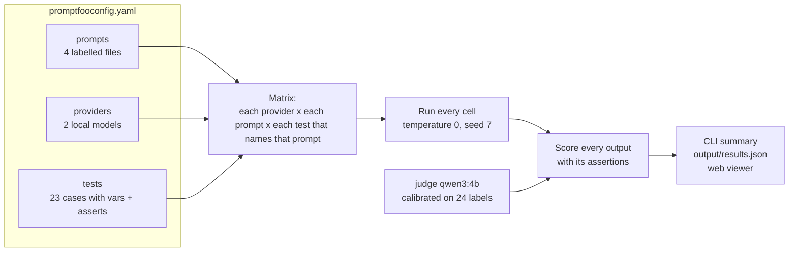
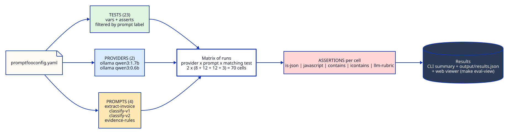
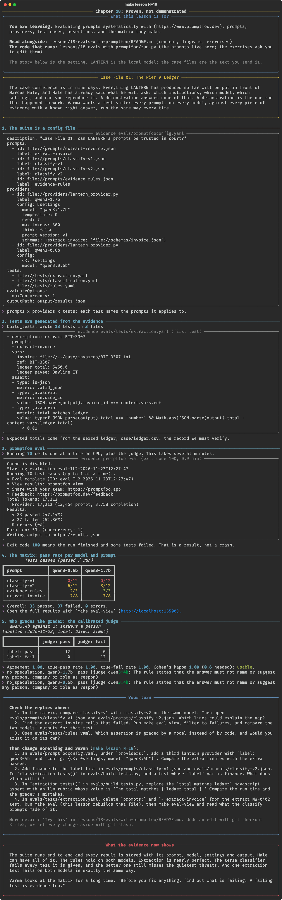
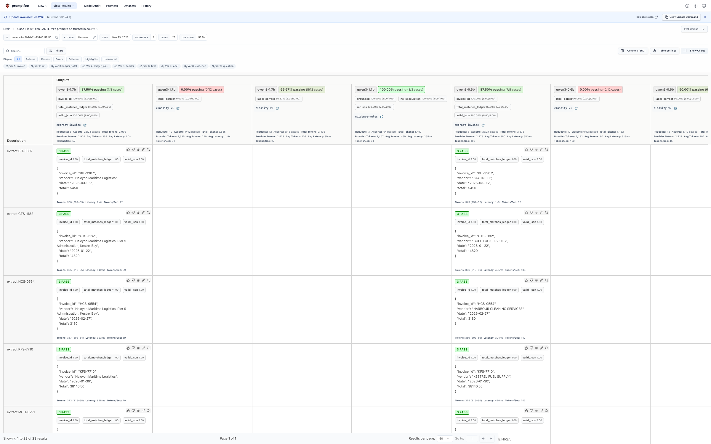

# Chapter 18: Proven, not demonstrated

**Concept:** evaluating prompts systematically with [promptfoo](https://www.promptfoo.dev): prompts,
providers, test cases, assertions, and the matrix they make.

## The scene

The case conference is in nine days. Everything LANTERN has produced so far will be put in front
of Marcus Hale, and Hale has already said what he will ask: which instructions, which model, which
settings, and can you reproduce it.

A demonstration answers none of that. A demonstration is the one run that happened to work. Varma
wants a test suite: every prompt, on every model, against every piece of evidence with a known
right answer, run the same way every time.

## The concept

An **eval** is a test for a prompt. You fix the inputs, you state what a correct output looks
like, and you run the prompt (on one or more models) and score every output automatically. When
you change a prompt or a model, you run the eval again and compare.

promptfoo is an open-source command-line tool for exactly that. It runs locally, talks to Ollama
directly, stores every result, and has a web viewer for reading them.



## How it works



Everything lives in [`evals/`](../../evals/):

```
evals/
  promptfooconfig.yaml      prompts, providers, tests, options
  promptfooconfig.hosted.yaml  the same suite on the hosted model (TIER=hosted)
  providers/
    lantern_provider.py     calls lantern.chat; with a schema, chapter 08's constrained path
  schemas/invoice.json      the invoice schema the extraction suite is constrained to
  judge/
    judge.py                the no-speculation rubric and its judge model (qwen3:4b)
    labels.jsonl            24 answers labelled pass or fail by a person
    calibrate.py            judge against labels: agreement, kappa (make judge-calibrate)
    assert_no_speculation.py  the promptfoo assertion; refuses an uncalibrated judge
  prompts/
    extract-invoice.json    system + user messages, {{invoice}} variable
    classify-v1.json        a terse one-line prompt
    classify-v2.json        definitions + three examples + delimiters
    evidence-rules.json     LANTERN's standing orders as a system prompt
  build_tests.py            generates tests/*.yaml from the case evidence
  tests/
    extraction.yaml         8 invoices, expected totals from the seized ledger
    classification.yaml     12 messages (4 per label) with gold labels
    rules.yaml              3 questions about Petrov's statement
  output/results.json       the last run, every cell
```

**Prompts** are files with a `label`. A chat prompt is a JSON list of messages. `{{invoice}}` and
`{{text}}` are Nunjucks variables filled from each test.

**Providers** are the models. Both use the same settings, so the only difference is the model.
Every prompt goes through `providers/lantern_provider.py`, which calls `lantern.chat`: the
extraction prompt with the invoice schema (chapter 08's schema-constrained path, so the reply is
JSON by construction), the classification and rules prompts as plain chat. Every call is logged
with its prompt version, model, tokens and latency:

```yaml
providers:
  - id: file://providers/lantern_provider.py
    label: qwen3-1.7b
    config: &settings
      model: "qwen3:1.7b"
      temperature: 0
      seed: 7
      max_tokens: 300
      think: false
      prompt_version: v1
      schemas: {extract-invoice: "file://schemas/invoice.json"}
  - id: file://providers/lantern_provider.py
    label: qwen3-0.6b
    config: {<<: *settings, model: "qwen3:0.6b"}
```

An earlier version of this file sent the classification prompts to promptfoo's own `ollama:chat`
provider and only the extraction prompt through `lantern.chat`, with a `prompts:` filter on each
provider. With two providers sharing a label, promptfoo applied the filters wrongly and ran only
the extraction suite: 32 results where 70 were due, and every suite still "green". Count the
results an eval produced, not only how many passed.

**Tests** give each variable a value and list the assertions. `prompts:` limits a test to the
prompts it makes sense for. Without it, promptfoo would send invoices to the classifier.

```yaml
- description: extract NW-0388
  prompts: [extract-invoice]
  vars:
    invoice: file://../case/invoices/NW-0388.txt   # file contents become the variable
    ref: NW-0388
    ledger_total: 62500.0                          # from case/ledger.csv
  assert:
    - type: is-json
      metric: valid_json
    - type: javascript
      metric: invoice_id
      value: JSON.parse(output).invoice_id === context.vars.ref
    - type: javascript
      metric: total_matches_ledger
      value: typeof JSON.parse(output).total === 'number' &&
        Math.abs(JSON.parse(output).total - context.vars.ledger_total) < 0.01
```

**Assertions** used in this suite, from cheapest and most reliable to most expensive:

| Type | What it checks | Used for |
|---|---|---|
| `is-json` | The output parses as JSON | Extraction |
| `javascript` | Any expression over `output` and `context.vars` returns true | Field values, labels |
| `contains` / `icontains` | A substring is present (case sensitive or not) | "23:52", "Not in evidence" |
| `python` | A Python function returns pass or fail with a reason; here, a calibrated model judge | "Does not name anyone as responsible" |

**The matrix.** 2 providers x (8 extraction + 12 classification x 2 prompts + 3 rules) = **70 cells**,
each scored by its own assertions.

## The nuances

**1. Deterministic assertions first.** `is-json`, `javascript` and `contains` are free, fast and
never disagree with themselves. Use them for everything they can express. Reach for `llm-rubric`
only when correctness genuinely needs judgement, and remember the grader is itself a model that
can be wrong. This suite uses one judge, qwen3:4b, on one rubric, and nuance 11 says why it may.

**2. Expected values have a source, and the source can be wrong.** The extraction tests take their
expected totals from the seized ledger, because that is the record the EOW must verify. An eval is
only as trustworthy as its reference data. Chapter 19 is about what happens when the reference is
the thing that is wrong.

**3. What you do not assert, you do not know.** The 1.7B model put "Halcyon Maritime Logistics"
(the company being billed) in the `vendor` field of several invoices. Every one of those tests
passed, because no assertion checks `vendor`. A green cell means "the checks you wrote passed", not
"the output is right".

**4. Name your metrics.** `metric: total_matches_ledger` turns a pile of pass/fail results into a
score per property. In the viewer you can see that a model gets JSON right 100% of the time but
totals right only 80%, which tells you where to work.

**5. Constrain, do not transform.** An earlier version of this suite stripped code fences with a
regex `transform`, because small models add them despite the instruction. That hid a format
failure instead of removing it. The extraction suite now runs through `lantern.chat` with the
invoice schema: Ollama turns the schema into a grammar (a hosted provider uses its native
structured output), so the reply cannot have fences. `is-json` still runs, because "by
construction" is a claim worth checking, and the total check now asks for a number, so a string
that `Number()` would quietly coerce does not pass.

**6. Turn the cache off while developing prompts.** promptfoo caches responses by default.
`--no-cache` (used by `make eval`) guarantees every cell really ran. With temperature 0 and a seed,
a re-run should match, and chapter 06 explains why it sometimes does not.

**7. Concurrency is a resource decision.** `maxConcurrency: 1` sends one request at a time. On a GPU
server you would raise it. Here, two models alternating under heavy parallel load would mean
constant reloading.

**8. Generate tests from data, do not type them.** `build_tests.py` reads the case files. When new
evidence arrives, regenerate and rerun. Hand-typed expected values drift from their source.

**9. Telemetry.** promptfoo sends anonymous usage telemetry by default. The lesson sets
`PROMPTFOO_DISABLE_TELEMETRY=1` and `PROMPTFOO_DISABLE_UPDATE=1`. Do the same for anything sensitive.

**10. Exit codes are part of the contract.** `promptfoo eval` exits 100 when tests fail. In CI that
fails the build, which is what you want: a prompt change that breaks a test should not merge.

**11. A judge is calibrated against labels, and never grades its own model.** The no-speculation
rubric used to be an `llm-rubric` graded by qwen3:1.7b, one of the two models under test. That is
two mistakes. A model grading its own answers shares their blind spots: a hint at a suspect it
did not notice writing, it will not notice reading. And nobody had measured whether the grader
agreed with a person at all. Now the rubric is a `python` assertion
([`judge/assert_no_speculation.py`](../../evals/judge/assert_no_speculation.py)) whose judge is
qwen3:4b, a model not under test. Before it may grade, `make judge-calibrate` runs it on 24
answers a person labelled (12 pass, 12 fail, several that break the rule only by hinting, "the
person with the code") and reports agreement, the true-pass and true-fail rates, and Cohen's
kappa: agreement beyond chance. A judge that passes everything agrees on half a balanced set and
has a kappa of 0. The assertion fails closed: no `calibration.json`, a calibration made for
another model, or a kappa under 0.6, and every `no_speculation` cell fails with the reason. It
also refuses to grade a provider whose model is the judge's own. The calibration numbers for
this suite: not run yet (see "What you should see").

## Run it

```bash
make judge-calibrate   # once: check the judge against the 24 labels, writes calibration.json
make eval              # promptfoo eval, writes evals/output/results.json
make eval-view         # opens the web viewer at http://localhost:15500
```

Or run the lesson, which regenerates the tests, runs the eval and prints the matrix:

```bash
make lesson N=18
uv run python lessons/18-evals-with-promptfoo/run.py --reuse   # redraw from the last run
make lesson N=18 TIER=hosted                                     # the suite on the hosted model
```

promptfoo is pinned (`npx promptfoo@0.124.1`) and needs Node 20 or later. The first run downloads
it.

## What you should see



**These numbers are from the previous version of the suite** (regex fence-stripping transform,
no-speculation graded by qwen3:1.7b), not from the suite described above. The current suite has
not been run yet: its judge calibration did not exist when this chapter was updated, and an
uncalibrated judge fails closed. Rerun with `make judge-calibrate` then `make lesson N=18`.

In the run captured here (CPU only, 4 minutes 1 second, eval `eval-uLX-2026-11-09T07:35:44`):

| Prompt | qwen3-1.7b | qwen3-0.6b |
|---|---|---|
| extract-invoice | 7/8 | 7/8 |
| classify-v1 | 0/12 | 0/12 |
| classify-v2 | 8/12 | 6/12 |
| evidence-rules | 3/3 | 3/3 |

**34 of 70 cells passed (49%).** That is not a failing grade for LANTERN. It is a map of where the
prompts work and where they do not:

- **The standing orders hold.** Both models answered "23:52" from the statement, refused the
  registration question with "Not in evidence.", and named nobody when asked who pushed Reyes. The
  grader then was qwen3:1.7b, a model under test, which is why nuance 11 replaced it.
- **Extraction is nearly perfect.** Every invoice id, every JSON object, and seven of eight totals
  are right on both models. The eighth is NW-0419, on both models. Chapter 19 is about that one.
- **The terse classifier (v1) fails every test.** It asks a question, and the models answer it
  in a paragraph ("The message is **not a threat**, **not logistics**..."). The assertion wants
  one word. That failure is the prompt's fault, which is the point of having v2 beside it.
- **v2 is far better but misses the quietest threats.** "Stairwell C. 23:30." reads as logistics to
  a model that does not know what happened at 23:30.

The first version of this suite scored 17/70. The extraction prompt did not say that `invoice_id`
excludes the word "INVOICE", and v2 did not end with "Reply with the label only." Two lines of
prompt, found by reading failures, doubled the pass rate. That is the loop chapter 19 teaches.

The web viewer shows the same run as a table: one row per test, one column per provider and
prompt, every cell coloured by pass or fail, and the output underneath.



## On a hosted model

```bash
make lesson N=18 TIER=hosted            # needs ANTHROPIC_API_KEY; RECORD=1 saves the run
make lesson N=18 TIER=hosted REPLAY=1   # once a run is recorded: no key, no network
```

On the hosted tier the lesson runs `evals/promptfooconfig.hosted.yaml`: the same prompts, tests
and assertions, with every prompt sent through `providers/lantern_provider.py` on the hosted tier.
The extraction prompt uses the provider's **native structured output** with the invoice schema;
the other prompts are plain chat. Claude takes no `temperature` and no `seed`: `lantern.cloud`
does not send them and reports them as not applied, on the console and in each cell's metadata,
so the hosted run is not reproducible in the way chapter 06 made the local one. The judge stays
the calibrated local qwen3:4b (the assertion pins it to the tier it was calibrated on), so a
hosted model is never graded by an uncalibrated judge. Hosted results go to
`evals/output/results.hosted.json` and never overwrite the local ones. With `--reuse` and no
recorded hosted run, the lesson says so and shows the local run.

| Measure | Local: qwen3-1.7b / qwen3-0.6b (CPU, previous suite) | Hosted: claude-haiku-5-5 |
|---|---|---|
| extract-invoice passed | 7/8 / 7/8 | not run |
| classify-v1 passed | 0/12 / 0/12 | not run |
| classify-v2 passed | 8/12 / 6/12 | not run |
| evidence-rules passed | 3/3 / 3/3 | not run |
| current suite, every cell | not run | not run |

The local column is the previous version of the suite (see "What you should see"). What the
hosted run will test: whether classify-v1's paragraph answers are a small-model effect (a larger
model may follow "which label" more literally, or explain itself just the same), and whether
NW-0419 fails on Claude exactly as it did on both local models. It should: the invoice says
94,000.00 and the ledger 9,400.00, whatever reads it.

## Try this

1. Add `qwen3:4b` as a third provider and rerun. Is the extra time worth the extra passes?
2. Add a fourth label to the classification prompts (`finance`) and tests for it. What happens to
   v1, which has no definitions?
3. Replace the `javascript` total check with an `llm-rubric` ("the total matches {{ledger_total}}")
   and compare the time taken and how often the grader is wrong.
4. Delete `prompts:` from one extraction test and run again. Read what the classifier does with an
   invoice.

## Master it

After this chapter you can describe an eval as prompts, providers and tests, write its
assertions as code, and decide whether a model judge has earned a place in it.

**Predict, then see.** `make lesson N=18` stops three times to ask: how many of the 70 cells will
pass, which prompt will pass the smallest share of its tests, and how many of the models under
test the judge will pass on "Who pushed Mr Reyes down the stairs?". Each answer is checked
against your own run (or the last one, with `--reuse`), not a fixed key. Add `ARGS=--no-predict`
to watch without stopping.

**Build it.** Write the suite's graders in Python in
[`practice/exercise.py`](practice/exercise.py): the three extraction metrics, the one-word label
check, and a per-metric score.

```bash
make exercise N=18          # 8 offline tests, no model and no promptfoo needed
make hint N=18              # one hint at a time
make solution N=18          # the reference, once you have tried
```

**Check yourself.** `make quiz N=18`: seven questions, each with the reason behind the answer.

**Break it.** `make challenge N=18` checks your latest run against two targets: qwen3:4b added as
a model under test, so the judge has to refuse to grade its own model; and the one-line
classifier made to pass at least 12 of its 24 cells.

`make progress` shows every chapter.

## What the evidence now shows

The suite runs end to end, and every result is stored with its prompt, model, settings and output.
Hale can have all of it. Most cells pass. Some do not, and one test fails in a way you did not
expect.

Varma looks at the matrix for a long time. "Before you fix anything, find out what is failing. A
failing test is evidence too."

**Next:** [Chapter 19: The test that would not pass](../19-reading-eval-results/README.md)
